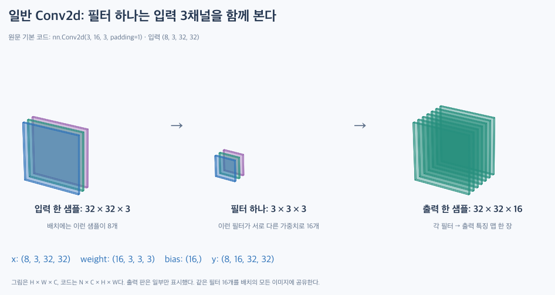
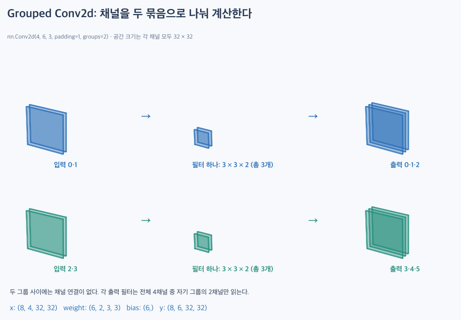
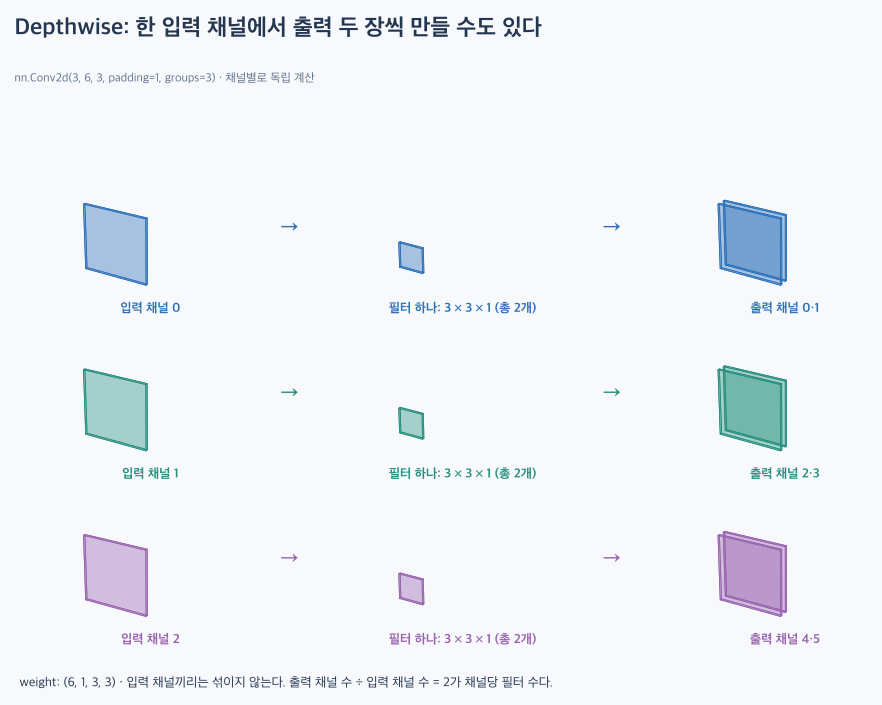
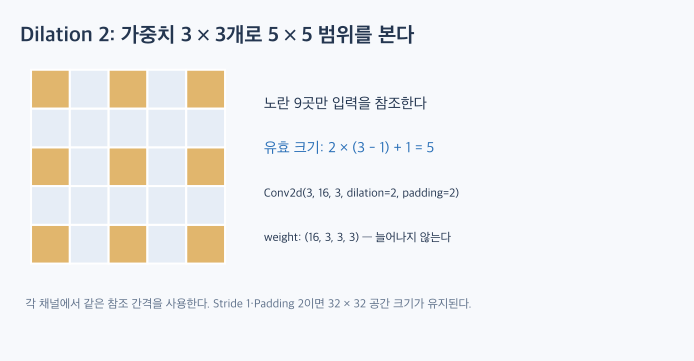
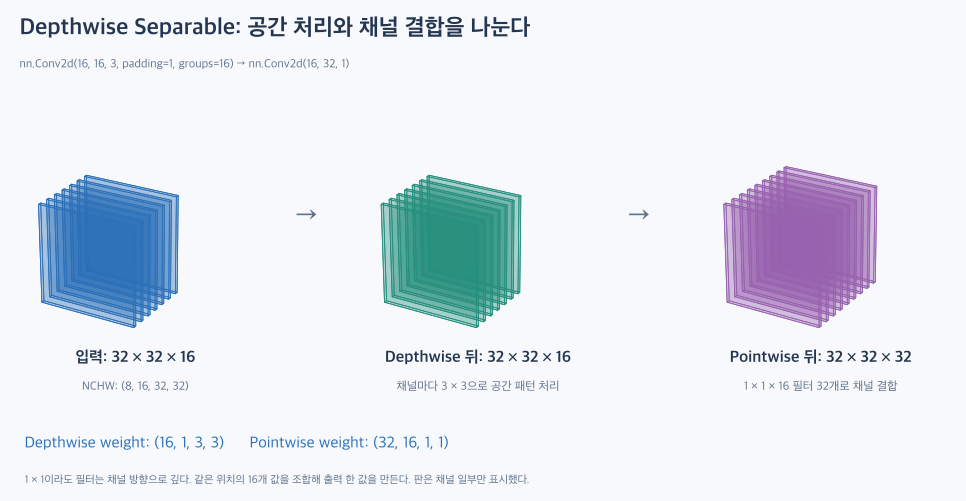

# PyTorch Conv2d: 코드의 Shape을 입체로 읽기

[TOC]

`nn.Conv2d`를 읽을 때는 네 숫자를 먼저 구분한다. **배치 N, 채널 C, 높이 H, 너비 W**다. 공간 크기가 같아도 채널 연결은 달라질 수 있다.

이 글은 원문의 코드 설정을 바탕으로 shape을 추적하는 실습이다. 랜덤 텐서에 대한 순전파를 다루며, 분류 모델을 학습하거나 성능을 평가하지 않는다.

| Task | Model | nn.Module | Autograd | Loss | Optimizer | Activation |
|---|---|---|---|---|---|---|
| 텐서 shape·채널 연결 관찰 | Conv2d와 Sequential | 사용 | 가중치가 기본적으로 추적 대상이나 backward는 수행하지 않음 | 없음 | 없음 | 마지막 연속 계층 예시에만 ReLU |

## 1. 코드 표기와 입체 그림 표기를 구분한다

| 대상 | 순서 | 예시 |
|---|---|---|
| PyTorch 배치 텐서 | N, C, H, W | `(8, 3, 32, 32)` |
| 배치 없는 단일 입력 | C, H, W | `(3, 32, 32)` |
| 입체 그림의 한 샘플 | H × W × C | `32 × 32 × 3` |

`(8, 3, 32, 32)`는 RGB 채널 3개를 가진 32×32 이미지가 **8장** 있다는 뜻이다. 8채널 이미지 한 장이 아니다. 배치의 이미지끼리는 합성곱으로 섞이지 않으며, 같은 계층의 가중치를 공유한다.

채널 하나는 공간 전체에 놓인 값의 판 한 장이다. 반대로 위치 하나를 보면 채널 수만큼의 값이 있다. 필터는 이 데이터에 곱하는 가중치이고, 출력 채널은 계산 결과다.

```python
import torch
from torch import nn

torch.manual_seed(0)
conv = nn.Conv2d(3, 16, kernel_size=3, padding=1)
x = torch.randn(8, 3, 32, 32)
y = conv(x)
print(tuple(x.shape))  # (8, 3, 32, 32)
print(tuple(y.shape))  # (8, 16, 32, 32)
```



코드의 `conv = ...`는 계층과 가중치를 만든다. `y = conv(x)`는 현재 가중치로 출력을 계산한다. 이 줄만 실행해서 가중치가 학습되는 것은 아니다.

## 2. 필터 하나를 Weight Shape에서 찾는다

일반 합성곱에서 필터 하나는 **3×3 공간 × 입력 3채널**, 즉 가중치 27개를 갖는다. 이를 16개 두므로 다음과 같다.

```python
print(tuple(conv.weight.shape))  # (16, 3, 3, 3)
print(tuple(conv.bias.shape))    # (16,)
print(tuple(conv.weight[0].shape))  # (3, 3, 3)
print(conv.weight.numel())       # 432
print(sum(p.numel() for p in conv.parameters()))  # 448
```

`weight[0]`은 출력 채널 0을 만드는 필터 전체다. 그 안의 `weight[0, 0]`은 입력 채널 0에 대응하는 3×3 가중치 판이다.

출력 한 칸을 만들 때 **입력의 3×3×3 값 27개와 가중치 27개를 각각 곱하고 모두 합한 뒤 Bias를 더한다.** 이 연산을 모든 공간 위치에서 반복해 특징 맵 한 장을 만든다. 출력 16장은 서로 다른 필터 16개가 만든다.

일반식은 다음과 같다.

\[
\text{weight.shape}=(C_{out}, C_{in}/G, K_h, K_w)
\]

\[
\text{가중치 수}=C_{out}(C_{in}/G)K_hK_w
\]

Bias를 사용하면 출력 채널마다 하나씩, \(C_{out}\)개를 더한다. **weight에는 배치 N이나 입력 이미지 전체의 H·W가 들어가지 않는다.**

## 3. HWC 이미지를 NCHW로 바꾼다

```python
image = torch.randn(32, 32, 3)       # H, W, C
chw = image.permute(2, 0, 1)        # C, H, W: (3, 32, 32)
x_one = chw.unsqueeze(0)           # N, C, H, W: (1, 3, 32, 32)
y_one = conv(x_one)                # (1, 16, 32, 32)
```

`permute`는 축의 순서를 바꾼다. `unsqueeze(0)`는 크기 1인 배치 축을 추가한다. 특징을 새로 만들거나 RGB 채널을 늘리는 연산이 아니다.

단순 `reshape`로 HWC를 CHW로 바꾸면 축 교환과 같은 결과가 보장되지 않는다. 축을 옮기려면 `permute`로 의도를 표현한다.

## 4. 공간 크기를 결정하는 설정

한 방향의 출력 크기를 계산한 뒤 높이·너비에 각각 적용한다. 아래 식은 양쪽에 같은 Padding을 두는 경우다.

\[
K_{eff}=D(K-1)+1,\qquad
O=\left\lfloor\frac{I+2P-K_{eff}}{S}\right\rfloor+1
\]

입력 32×32, Kernel 3×3일 때 다음과 같다.

| Stride | Padding | Dilation | 출력 H×W |
|---|---|---|---|
| 1 | 0 | 1 | 30×30 |
| 1 | 1 | 1 | 32×32 |
| 2 | 1 | 1 | 16×16 |
| 1 | 1 | 2 | 30×30 |
| 1 | 2 | 2 | 32×32 |

공간 크기와 출력 채널 수는 따로 계산한다. `padding=1`이 3채널을 16채널로 만드는 것이 아니다. 채널 수는 `out_channels=16`으로 결정된다.

## 5. Grouped Convolution: 그룹 안에서만 채널을 섞는다

```python
grouped = nn.Conv2d(4, 6, kernel_size=3, padding=1, groups=2)
x_group = torch.randn(8, 4, 32, 32)
y_group = grouped(x_group)
print(tuple(y_group.shape))        # (8, 6, 32, 32)
print(tuple(grouped.weight.shape)) # (6, 2, 3, 3)
```



| 그룹 | 읽는 입력 채널 | 만드는 출력 채널 | 필터 하나가 읽는 깊이 |
|---|---|---|---|
| 0 | 0, 1 | 0, 1, 2 | 2 |
| 1 | 2, 3 | 3, 4, 5 | 2 |

그룹 하나는 2개 입력 채널을 받아 필터 3개로 출력 3채널을 만든다. 전체 필터 수는 여전히 6개다. **그룹 사이의 입력은 함께 합산하지 않는다.** 출력은 채널 축에서 각 그룹 결과를 나란히 모은다.

`weight[3]`은 출력 3을 만드는 필터이며 입력 2·3에 연결된다. 이때 `weight[3, 0]`의 두 번째 인덱스 0은 **그룹 내부의 첫 입력**을 뜻한다. 전역 입력 채널 0이라는 뜻이 아니다.

입력·출력 채널 수는 모두 `groups`로 나누어떨어져야 한다. 따라서 `Conv2d(3, 6, 3, groups=2)`는 잘못된 설정이다.

| 같은 4→6 설정 비교 | weight shape | 가중치 수 | Bias 포함 |
|---|---|---|---|
| groups=1 | (6, 4, 3, 3) | 216 | 222 |
| groups=2 | (6, 2, 3, 3) | 108 | 114 |

둘 다 출력은 `(8, 6, 32, 32)`가 될 수 있다. 하지만 연결과 가중치 수가 다르므로 같은 계산은 아니다.

## 6. Depthwise: 입력 채널마다 독립적으로 계산한다

원문의 기본 예시는 16채널에 필터 하나씩을 적용한다.

```python
depthwise = nn.Conv2d(16, 16, 3, padding=1, groups=16)
x_dw = torch.randn(8, 16, 32, 32)
y_dw = depthwise(x_dw)
print(tuple(y_dw.shape))            # (8, 16, 32, 32)
print(tuple(depthwise.weight.shape)) # (16, 1, 3, 3)
```

각 필터가 입력 **한 채널만** 읽으므로 weight의 두 번째 차원이 1이다. 같은 shape이 나와도 값은 합성곱 결과로 바뀐다.

### 6.1. 입력 한 채널에 필터 두 개를 둘 수도 있다

```python
dw_two = nn.Conv2d(3, 6, 3, padding=1, groups=3)
x_two = torch.randn(8, 3, 32, 32)
y_two = dw_two(x_two)
print(tuple(y_two.shape))        # (8, 6, 32, 32)
print(tuple(dw_two.weight.shape)) # (6, 1, 3, 3)
```



출력/입력 비율이 2이므로 입력 0→출력 0·1, 입력 1→출력 2·3, 입력 2→출력 4·5로 연결된다. 출력이 6채널이어도 입력 채널끼리 섞이지 않는다.

## 7. Dilation: 필터의 가중치 수와 참조 범위를 구분한다

```python
dilated = nn.Conv2d(3, 16, 3, dilation=2, padding=2)
x_dil = torch.randn(8, 3, 32, 32)
y_dil = dilated(x_dil)
print(tuple(y_dil.shape))           # (8, 16, 32, 32)
print(tuple(dilated.weight.shape))  # (16, 3, 3, 3)
```



한 입력 채널에서 참조하는 위치는 9곳이지만, 첫 위치부터 마지막 위치까지의 범위는 5×5다. 5×5 가중치 25개로 바뀌는 것이 아니다.

## 8. 1×1 Convolution: 공간 하나에서 채널을 조합한다

```python
pointwise = nn.Conv2d(16, 32, kernel_size=1)
x_pw = torch.randn(8, 16, 32, 32)
y_pw = pointwise(x_pw)
print(tuple(y_pw.shape))           # (8, 32, 32, 32)
print(tuple(pointwise.weight.shape)) # (32, 16, 1, 1)
```

필터 하나의 전체 깊이는 16이다. 각 위치에서 입력 16개를 가중합해 출력값 하나를 만들고, 서로 다른 필터 32개가 이를 반복한다.

**1×1은 이웃 공간을 보지 않는다는 뜻이지, 값 하나만 읽는다는 뜻이 아니다.** 여기서는 같은 위치의 16채널을 함께 읽는다.

## 9. Depthwise Separable: 두 단계를 연결한다

```python
depthwise_separable = nn.Sequential(
    nn.Conv2d(16, 16, 3, padding=1, groups=16),
    nn.Conv2d(16, 32, 1),
)
x_sep = torch.randn(8, 16, 32, 32)
z_sep = depthwise_separable[0](x_sep)
y_sep = depthwise_separable[1](z_sep)
print(tuple(z_sep.shape))  # (8, 16, 32, 32)
print(tuple(y_sep.shape))  # (8, 32, 32, 32)
```



| 단계 | weight shape | 역할 |
|---|---|---|
| Depthwise | (16, 1, 3, 3) | 채널별 공간 처리 |
| Pointwise | (32, 16, 1, 1) | 채널 결합·출력 채널 결정 |

가중치 수는 \(16\times9+32\times16=656\)개다. Bias는 두 층에 각각 있어 16+32=48개, 합계 704개다.

같은 입출력 채널 수의 일반 3×3 합성곱은 가중치만 \(32\times16\times9=4,608\)개다. 파라미터는 줄지만 **모든 일반 합성곱과 동일한 함수를 표현하거나 실제로 항상 더 빠르다는 뜻은 아니다.**

## 10. 계층을 연결할 때 Shape 추적

```python
model = nn.Sequential(
    nn.Conv2d(3, 16, 3, padding=1),
    nn.ReLU(),
    nn.Conv2d(16, 32, 3, stride=2, padding=1),
    nn.ReLU(),
)
x_model = torch.randn(8, 3, 32, 32)
z = x_model
for layer in model:
    z = layer(z)
    print(type(layer).__name__, tuple(z.shape))
```

```text
Conv2d (8, 16, 32, 32)
ReLU (8, 16, 32, 32)
Conv2d (8, 32, 16, 16)
ReLU (8, 32, 16, 16)
```

앞 계층의 출력 채널 16이 다음 계층의 입력 채널 16과 맞아야 한다. ReLU는 shape을 유지한다. `Conv2d` 자체에 ReLU가 자동으로 포함되는 것은 아니다.

## 11. 나머지 인자를 읽는 기준

| 인자 | Shape 관점에서 볼 것 |
|---|---|
| kernel_size=(3, 5) | 높이·너비를 따로 계산한다 |
| stride=(2, 1) | 높이 방향만 두 칸씩 이동한다 |
| padding=(1, 2) | 위아래 각각 1, 좌우 각각 2를 추가한다 |
| padding="same" | 공간 크기 유지. PyTorch Conv2d에서는 stride=1만 지원한다 |
| bias=False | bias는 None이 되며 weight·출력 shape은 그대로다 |
| padding_mode | 추가 영역의 값을 채우는 방식. 같은 양이면 공간 shape은 같지만 값은 달라질 수 있다 |
| device / dtype | 값이 저장되는 장치·자료형. 이 글의 CPU 실수 예제에서는 입력과 파라미터를 맞춰 사용한다 |

## 실행 확인

PyTorch 2.15.0의 CPU 환경에서 본문의 모든 Python 블록을 순서대로 실행했다. 출력 shape, 공간 크기 비교표, 파라미터 수를 확인했고, Grouped Convolution의 결과가 그룹별 독립 계산을 합친 결과와 일치함을 확인했다. 학습과 성능 측정은 수행하지 않았다.

## 관련 개념

- [Convolutional Layer](../../theory/architectures/convolutional-layer.md)
- [LeNet-5](../../theory/architectures/lenet-5.md)

- [Transfer Learning](../../theory/training/transfer-learning.md) — 학습한 특징을 새 문제에 활용하는 전략.

## 참고 자료

- [PyTorch의 nn.Conv2d 사용법 — dsaint31](https://dsaint31.me/mkdocs_site/ML/ch14_cnn/module_conv2d/): 코드 설정과 정리 범위의 출발점.
- [PyTorch Conv2d 공식 문서](https://docs.pytorch.org/docs/stable/generated/torch.nn.Conv2d.html): NCHW·weight shape·groups·출력 크기와 인자 조건 확인.

그림은 코드 설정을 바탕으로 새로 작성한 설명용 도식이다. 입체 그림은 배치에서 샘플 하나만 보여주며 판의 두께·간격은 과장했다. 큰 채널 수는 일부 판만 표시했다. 색은 연결 구분용이며 실제 특징 값이 아니다.
