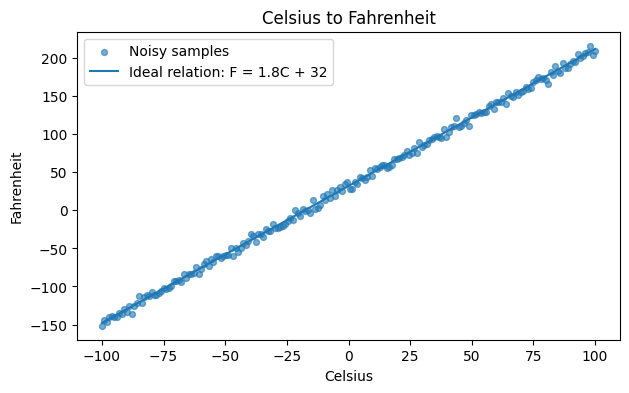
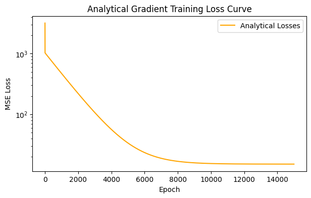
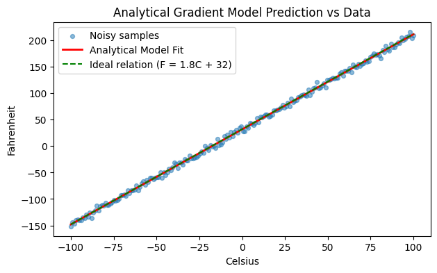

# PyTorch 딥러닝 모델 구현 실습: 선형회귀부터 ANN 학습·평가까지

[TOC]


## 실습 구성표

| 항목 | 실습 구성 |
| --- | --- |
| Task | Regression |
| Model | Linear → CelsiusANN · 1→32→32→1 |
| nn.Module | 초반 미사용 → nn.Linear / nn.Module |
| Autograd | 수동 gradient → backward |
| Loss | 직접 MSE → MSELoss |
| Optimizer | 수동 갱신 → SGD → Adam |
| Activation | Linear 구간 없음 / ANN ReLU |


관련 이론: [Classification과 Regression](../../theory/foundations/a03.md) · [Gradient Descent와 Learning Rate: Linear Regression과 Logistic Regression까지](../../theory/gradients/a11.md) · [딥러닝 손실함수의 확률적 이해: MLE·NLL부터 Cross-Entropy, MSE, MAE, L1·L2 정규화까지](../../theory/loss/a18.md) · [머신러닝 회귀 성능평가 완전 정리: MAE·MSE·RMSE·MAPE부터 결정계수 R²까지](../../theory/evaluation/a21.md)


---

딥러닝을 이해하기 위해서는 이론적인 개념뿐 아니라, 실제로 데이터를 생성하고 모델을 학습시키는 전체 과정을 구현해 볼 필요가 있다.

이번 실습에서는 **PyTorch를 이용하여 가장 기본적인 선형회귀(Linear Regression)부터 인공신경망(ANN)의 학습과 평가까지** 단계적으로 구현하였다.

처음에는 Weight와 Bias를 직접 정의하고 Gradient를 계산하였다. 이후 PyTorch가 제공하는 `autograd`, `Optimizer`, `nn.Linear`, `nn.Module`을 활용하면서 동일한 학습 과정을 점차 간결하게 구현하였다.

마지막으로 **이상기체 상태방정식(Ideal Gas Law)** 을 이용한 회귀 문제를 구성하여 데이터 생성부터 전처리, 모델 학습, Validation, Test까지 진행하였다.

### 실습 목표

이번 실습의 목표는 다음과 같다.

1. PyTorch Tensor의 기본적인 생성과 Shape 변경을 이해한다.
2. 선형회귀 모델과 MSE Loss를 직접 구현한다.
3. Analytical Gradient와 Numerical Gradient를 비교한다.
4. Gradient Descent를 이용해 Weight와 Bias를 직접 업데이트한다.
5. PyTorch `autograd`와 Optimizer의 동작을 이해한다.
6. `nn.Linear`와 `nn.Module`을 이용해 모델을 정의한다.
7. Custom Dataset과 DataLoader를 구현한다.
8. Mini-batch Learning을 수행한다.
9. 이상기체 상태방정식을 학습하는 ANN을 구현한다.
10. Train / Validation / Test 분리와 모델 성능 평가를 수행한다.

### 이번 실습의 모델 및 구현 구성

이번 실습에서는 PyTorch를 이용하여 **Linear Regression과 Artificial Neural Network(ANN)** 를 구현하고, 데이터를 준비하는 단계부터 Model Training과 Evaluation까지 전체 과정을 학습한다.

단순히 Neural Network의 구조를 정의하는 데 그치지 않고, Loss를 계산하고 Backpropagation을 통해 Parameter를 업데이트하는 **전체 학습 과정(Training Loop)** 을 이해하는 것이 목적이다.

| 항목 | 사용 기술 및 구성 | 역할 |
| --- | --- | --- |
| Framework | PyTorch | Neural Network 구현 및 학습 |
| Model 1 | Linear Regression | 기본적인 선형 예측 모델 |
| Model 2 | ANN (Artificial Neural Network) | 여러 Layer를 이용한 신경망 |
| Model Definition | `nn.Module` | 사용자 정의 모델 구현 |
| Layer | `nn.Linear` | 선형 변환 및 Fully Connected Layer |
| Forward Propagation | `forward()` | 입력 데이터로 예측값 계산 |
| Loss Function | Loss 계산 | 예측값과 실제값의 오차 측정 |
| Optimizer | Parameter Optimization | Gradient를 이용한 Weight 업데이트 |
| Backpropagation | `loss.backward()` | Parameter의 Gradient 계산 |
| Gradient Initialization | `optimizer.zero_grad()` | 이전 Gradient 초기화 |
| Parameter Update | `optimizer.step()` | Model Parameter 업데이트 |
| Training / Evaluation | `model.train()`, `model.eval()` | 학습 및 평가 모드 전환 |

#### 전체 학습 과정

```text
Input Data (X, y)
        │
        ▼
    PyTorch Tensor
        │
        ▼
     Model Definition
        │
        ├── Linear Regression
        │
        └── ANN
        │
        ▼
  Forward Propagation
        │
        ▼
     Prediction (ŷ)
        │
        ▼
     Loss Calculation
        │
        ▼
      loss.backward()
        │
        ▼
      optimizer.step()
        │
        ▼
     Parameter Update
        │
        ▼
    Model Evaluation
```

이번 실습에서 구분해야 할 핵심 개념은 다음과 같다.

- **Linear Regression**은 Input과 Output 사이의 선형적인 관계를 학습하는 모델이다.
- **ANN**은 여러 Neuron과 Layer를 연결하여 데이터의 관계를 학습하는 신경망이다.
- **Loss Function**은 모델의 예측값과 실제값 사이의 오차를 계산한다.
- **Backpropagation**은 Loss를 각 Parameter에 대해 미분하여 Gradient를 계산한다.
- **Optimizer**는 계산된 Gradient를 이용하여 Parameter를 업데이트한다.

따라서 이번 글의 핵심은 **PyTorch 모델을 직접 구현하고, Forward Propagation → Loss Calculation → Backpropagation → Parameter Update → Evaluation으로 이어지는 전체 학습 과정을 이해하는 것**이다.

---

## 1. 실습에 필요한 핵심 개념

본격적인 구현에 앞서 이번 실습에서 사용하는 핵심 개념을 정리한다.

| 키워드 | 설명 |
| --- | --- |
| Tensor | PyTorch에서 데이터를 저장하고 연산하는 기본 자료구조 |
| Parameter | 학습 과정에서 업데이트되는 모델의 Weight와 Bias |
| Forward Propagation | 입력 데이터를 모델에 전달하여 예측값을 계산하는 과정 |
| Loss Function | 모델 예측과 정답 사이의 차이를 수치화하는 함수 |
| MSE | 예측값과 실제값의 차이를 제곱하여 평균한 값 |
| Gradient | Parameter 변화에 대한 Loss의 변화율 |
| Autograd | 연산 그래프와 Chain Rule을 이용해 Gradient를 자동 계산하는 기능 |
| Optimizer | 계산된 Gradient를 이용해 Parameter를 업데이트하는 객체 |
| Dataset | 데이터에 접근하는 방식을 정의하는 객체 |
| DataLoader | Dataset에서 데이터를 Batch 단위로 불러오는 객체 |
| nn.Module | PyTorch에서 신경망 모델을 정의하는 기본 클래스 |
| Epoch | 전체 학습 데이터를 한 번 사용하는 학습 단위 |

전체 학습 과정은 다음과 같이 표현할 수 있다.

```text
데이터 생성
    ↓
Tensor 변환
    ↓
Dataset / DataLoader
    ↓
Model
    ↓
Forward Propagation
    ↓
Prediction
    ↓
Loss Calculation
    ↓
Backward Propagation
    ↓
Gradient Calculation
    ↓
Optimizer
    ↓
Parameter Update
    ↓
Validation / Test
```

이 구조는 선형회귀뿐 아니라 대부분의 딥러닝 모델에서 공통적으로 사용된다.

---

## 2. 실습 환경 설정

이번 실습에서는 다음 라이브러리를 사용하였다.

```python
import copy
import math
import random

import torch
import torch.nn as nn
import torch.optim as optim
import matplotlib.pyplot as plt

from torch.utils.data import Dataset, DataLoader
```

각 라이브러리의 역할은 다음과 같다.

| 라이브러리 | 역할 |
| --- | --- |
| `torch` | Tensor 연산 및 자동 미분 |
| `torch.nn` | Neural Network Layer 및 Loss Function |
| `torch.optim` | SGD, Adam 등 Optimizer |
| `matplotlib.pyplot` | 학습 결과 시각화 |
| `Dataset` | 사용자 정의 데이터셋 |
| `DataLoader` | Mini-batch 데이터 로딩 |
| `copy` | 모델 Parameter의 독립적인 복사본 생성 |
| `math` | 수학 연산 |
| `random` | Python 난수 설정 |

### 2-1. Random Seed 설정

실험의 재현성을 높이기 위해 Random Seed를 설정하였다.

```python
SEED = 23

random.seed(SEED)
torch.manual_seed(SEED)
```

`torch.manual_seed()`는 PyTorch의 난수 생성기를 초기화한다.

따라서 같은 환경에서 실험할 경우 유사한 결과를 재현하는 데 도움이 된다.

다만 GPU 연산이나 라이브러리 버전 등에 따라 일부 결과는 달라질 수 있다.

### 2-2. Device 설정

PyTorch는 CPU뿐 아니라 지원되는 GPU에서도 Tensor 연산을 수행할 수 있다.

```python
device = torch.device(
    "cuda" if torch.cuda.is_available()
    else "mps" if torch.backends.mps.is_available()
    else "cpu"
)

print("PyTorch version:", torch.__version__)
print("Device:", device)
```

NVIDIA GPU의 경우 실행 결과는 다음과 같다.

```text
PyTorch version: 2.11.0+cu130
Device: cuda
```

여기서

- `cuda`: NVIDIA GPU
- `mps`: Apple Silicon GPU
- `cpu`: CPU

를 의미한다.

위 코드는 사용 가능한 장치를 자동으로 선택한다.

---

## 3. Tensor 기본 연습

딥러닝에서 입력 데이터와 모델의 Parameter는 Tensor 형태로 표현된다.

따라서 Tensor의 `dtype`과 `shape`을 이해하는 것이 중요하다.

### 3-1. Tensor 생성

```python
a = torch.tensor([1, 2, 3])

b = torch.tensor(
    [1.0, 2.0, 3.0],
    dtype=torch.float32
)

print("a:", a)
print("dtype:", a.dtype)
print("shape:", a.shape)

print()

print("b:", b)
print("dtype:", b.dtype)
print("shape:", b.shape)
```

실행 결과:

```text
a: tensor([1, 2, 3])
dtype: torch.int64
shape: torch.Size([3])

b: tensor([1., 2., 3.])
dtype: torch.float32
shape: torch.Size([3])
```

`dtype`은 Tensor 원소의 자료형을 나타낸다.

`shape`은 Tensor의 각 차원에 존재하는 원소의 개수를 나타낸다.

### 3-2. Reshape

딥러닝에서는 입력 데이터의 Shape를 모델이 요구하는 형태로 변환해야 하는 경우가 많다.

```python
x = torch.linspace(-10, 10, 5)

x_col = x.reshape(-1, 1)

print("Original:", x.shape)
print("Reshaped:", x_col.shape)
print(x_col)
```

실행 결과:

```text
Original: torch.Size([5])
Reshaped: torch.Size([5, 1])

tensor([[-10.],
        [ -5.],
        [  0.],
        [  5.],
        [ 10.]])
```

여기서

```python
reshape(-1, 1)
```

은 다음을 의미한다.

- `-1`: 해당 차원의 크기를 자동으로 계산한다.
- `1`: 두 번째 차원의 크기를 1로 고정한다.

따라서

$$
(5,)\rightarrow(5,1)
$$

로 Shape가 변경된다.

특히 입력 Feature가 하나인 회귀 모델에서는 다음 형태를 자주 사용한다.

$$
X\in\mathbb{R}^{N\times1}
$$

여기서 $N$은 Sample 개수이다.

---

## 4. 여러 Feature를 하나의 Tensor로 결합하기

하나의 Sample이 여러 Feature를 가질 수도 있다.

예를 들어 온도와 몰수를 이용해 기체의 부피를 예측하려면 입력 Feature는 두 개이다.

- Temperature
- Mole

각 데이터를 다음과 같이 정의하자.

```python
temperature = torch.tensor([
    [250.0],
    [300.0],
    [350.0]
])

mole = torch.tensor([
    [1.0],
    [2.0],
    [3.0]
])
```

이 두 Tensor를 하나로 결합하려면 `torch.cat()`을 사용할 수 있다.

```python
X = torch.cat(
    [temperature, mole],
    dim=1
)

print("X shape:", X.shape)
print(X)
```

실행 결과:

```text
X shape: torch.Size([3, 2])

tensor([[250.,   1.],
        [300.,   2.],
        [350.,   3.]])
```

즉,

$$
X= \begin{bmatrix} 250&1\\ 300&2\\ 350&3 \end{bmatrix}
$$

이다.

각 행은 하나의 Sample이고 각 열은 하나의 Feature이다.

따라서

$$
\boxed{ X\in\mathbb{R}^{N\times D} }
$$

로 표현할 수 있다.

여기서

- $N$: Sample 개수
- $D$: Feature 개수

이다.

이번 예제에서는

$$
N=3,\qquad D=2
$$

이다.

이 개념은 이후 ANN의 Input Layer를 정의할 때 중요하게 사용된다.

---

## 5. 선형회귀 실습 데이터 생성

첫 번째 모델 구현 실습에서는 섭씨온도를 화씨온도로 변환하는 관계를 학습하였다.

섭씨온도 $C$와 화씨온도 $F$ 사이의 관계는 다음과 같다.

$$
\boxed{ F=1.8C+32 }
$$

이는 선형 함수이다.

따라서 Linear Regression을 이용하여 학습할 수 있다.

### 5-1. 데이터 생성

실제 측정 상황을 모사하기 위해 이상적인 관계식에 Gaussian Noise를 추가하였다.

```python
def generate_celsius_data(
    n_samples=200,
    noise_std=4.0
):
    # Celsius
    x = torch.linspace(
        -100,
        100,
        n_samples
    ).reshape(-1, 1)

    # Ideal Fahrenheit
    y_ideal = 1.8 * x + 32.0

    # Add Gaussian noise
    y = (
        y_ideal
        + torch.randn_like(y_ideal) * noise_std
    )

    return (
        x.float(),
        y.float(),
        y_ideal.float()
    )


x, y, y_ideal = generate_celsius_data()

print("x shape:", x.shape)
print("y shape:", y.shape)
```

실행 결과:

```text
x shape: torch.Size([200, 1])
y shape: torch.Size([200, 1])
```

생성된 데이터는 총 200개이다.

여기서

- `x`: 섭씨온도
- `y_ideal`: 이론적인 화씨온도
- `y`: Noise가 추가된 화씨온도

이다.

데이터 생성식을 수학적으로 표현하면

$$
\boxed{ y_i=1.8x_i+32+\epsilon_i }
$$

이다.

여기서

$$
\epsilon_i\sim\mathcal{N}(0,4^2)
$$

이다.

즉 Noise는 평균 0, 표준편차 4인 Gaussian Distribution을 따른다.

> 이번 데이터는 실제 측정 데이터가 아니라, 선형회귀 실습을 위해 생성한 **Synthetic Dataset**이다.

### 5-2. 데이터 시각화

```python
plt.figure(figsize=(7, 4))

plt.scatter(
    x.squeeze(),
    y.squeeze(),
    s=18,
    alpha=0.6,
    label="Noisy samples"
)

plt.plot(
    x.squeeze(),
    y_ideal.squeeze(),
    label="Ideal relation: F = 1.8C + 32"
)

plt.xlabel("Celsius")
plt.ylabel("Fahrenheit")
plt.title("Celsius to Fahrenheit")
plt.legend()
plt.show()
```

그래프에서는 이상적인 선형 관계 주변에 Noise가 포함된 Sample들이 분포하는 것을 확인할 수 있다.  


이후 모델은 이 데이터의 전체적인 선형 관계를 학습하게 된다.

---

## 6. 선형회귀 직접 구현

선형회귀 모델은 다음과 같이 표현할 수 있다.

$$
\boxed{ \hat{y}=wx+b }
$$

여기서

- $x$: 입력 데이터
- $w$: Weight
- $b$: Bias
- $\hat{y}$: 모델의 예측값

이다.

모델의 목적은 실제 데이터와 예측값 사이의 차이를 최소화하는 $w$와 $b$를 찾는 것이다.

### 6-1. Linear Model 함수

이번 실습에서는 `nn.Linear`를 사용하지 않고 직접 선형 모델을 구현하였다.

```python
def linear_model(x, w, b):
    return x @ w + b
```

`@`는 Matrix Multiplication을 의미한다.

입력 Tensor의 Shape가

$$
(N,1)
$$

이고 Weight의 Shape가

$$
(1,1)
$$

이라면

$$
(N,1)@(1,1)\rightarrow(N,1)
$$

의 결과를 얻는다.

Bias는 Broadcasting을 통해 각 Sample에 더해진다.

---

## 7. MSE Loss 직접 구현

모델이 얼마나 정확하게 예측했는지 평가하려면 Loss Function이 필요하다.

이번 실습에서는 **Mean Squared Error(MSE)** 를 사용하였다.

$$
\boxed{ L(w,b) = \frac{1}{N} \sum_{i=1}^{N} (\hat{y}_i-y_i)^2 }
$$

여기서

- $\hat{y}_i$: 모델 예측값
- $y_i$: 실제값
- $N$: Sample 개수

이다.

Python에서는 다음과 같이 구현한다.

```python
def mse_loss(pred, target):
    return ((pred - target) ** 2).mean()
```

먼저 Weight와 Bias를 초기화하였다.

```python
w = torch.ones((1, 1))
b = torch.zeros(1)

pred = linear_model(x, w, b)

loss = mse_loss(pred, y)

print("Initial w:", w.item())
print("Initial b:", b.item())
print("Initial loss:", loss.item())
```

노트북 실행 결과:

```text
Initial w: 1.0
Initial b: 0.0
Initial loss: 3171.4631
```

실제 관계식은

$$
F=1.8C+32
$$

이지만 초기 모델은

$$
\hat{F}=1.0C+0
$$

이므로 Loss가 크게 나타난다.

따라서 학습을 통해 $w$와 $b$를 수정해야 한다.

---

## 8. Gradient 계산

Loss를 최소화하기 위해서는 각 Parameter에 대한 Gradient가 필요하다.

$$
\frac{\partial L}{\partial w}
$$

$$
\frac{\partial L}{\partial b}
$$

Gradient는 Parameter가 조금 변했을 때 Loss가 얼마나 변화하는지를 나타낸다.

이번 실습에서는 두 가지 방법을 먼저 비교하였다.

- Analytical Gradient
- Numerical Gradient

---

### 8-1. Analytical Gradient

MSE Loss는 다음과 같다.

$$
L(w,b) = \frac{1}{N} \sum_{i=1}^{N} (wx_i+b-y_i)^2
$$

이를 Weight $w$에 대해 편미분하면

$$
\boxed{ \frac{\partial L}{\partial w} = \frac{2}{N} \sum_{i=1}^{N} (wx_i+b-y_i)x_i }
$$

이다.

Bias $b$에 대해 편미분하면

$$
\boxed{ \frac{\partial L}{\partial b} = \frac{2}{N} \sum_{i=1}^{N} (wx_i+b-y_i) }
$$

이다.

이렇게 수학적으로 유도한 미분 공식을 코드로 직접 구현할 수 있다.

```python
def analytical_gradients(x, y, w, b):
    pred = linear_model(x, w, b)

    error = pred - y

    grad_w = (
        2.0 * error * x
    ).mean().reshape_as(w)

    grad_b = (
        2.0 * error
    ).mean().reshape_as(b)

    return grad_w, grad_b
```

여기서

```python
error = pred - y
```

는 예측값과 정답의 차이이다.

Weight Gradient에서는 여기에 입력 $x$가 추가로 곱해진다.

---

### 8-2. Numerical Gradient

Numerical Gradient는 Parameter를 조금 변화시켰을 때의 Loss 차이를 이용하여 미분값을 근사한다.

이번 실습에서는 Central Difference를 사용하였다.

$$
\boxed{ \frac{\partial L}{\partial w} \approx \frac{L(w+\epsilon)-L(w-\epsilon)} {2\epsilon} }
$$

이를 코드로 구현하면 다음과 같다.

```python
def numerical_gradients(
    x, y, w, b, eps=1e-3
):
    w_plus = w.clone()
    w_minus = w.clone()

    w_plus[0, 0] += eps
    w_minus[0, 0] -= eps

    loss_plus = mse_loss(
        linear_model(x, w_plus, b),
        y
    )

    loss_minus = mse_loss(
        linear_model(x, w_minus, b),
        y
    )

    return (
        loss_plus - loss_minus
    ) / (2 * eps)
```

Numerical Gradient는 직접 미분식을 유도하지 않고도 기울기를 근사할 수 있다는 장점이 있다.

하지만 Parameter가 많아질수록 Loss Function을 반복적으로 계산해야 하므로 연산 비용이 증가한다.

---

### 8-3. Gradient 비교 결과

```python
grad_w_a, grad_b_a = analytical_gradients(
    x, y, w, b
)

grad_w_n = numerical_gradients(
    x, y, w, b
)

print(
    "Analytical grad_w:",
    grad_w_a.item()
)

print(
    "Numerical grad_w:",
    grad_w_n.item()
)

print(
    "Analytical grad_b:",
    grad_b_a.item()
)
```

실행 결과:

```text
Analytical grad_w: -5374.9033
Numerical grad_w: -5374.9995
Analytical grad_b: -63.5968
```

Analytical Gradient와 Numerical Gradient가 매우 유사한 값을 갖는 것을 확인할 수 있다.

완전히 동일하지 않은 이유는 Numerical Gradient가 작은 $\epsilon$을 사용하는 근사 방법이며, 부동소수점 연산의 영향을 받기 때문이다.

> 이 실습에서는 두 방법을 비교하여 직접 구현한 미분식이 올바르게 계산되는지 확인하였다.

---

## 9. Analytical Gradient로 직접 학습하기

이제 Analytical Gradient를 이용하여 Weight와 Bias를 직접 업데이트한다.

Gradient Descent의 기본 식은 다음과 같다.

$$
\boxed{ w_{t+1} = w_t-\eta\frac{\partial L}{\partial w} }
$$

$$
\boxed{ b_{t+1} = b_t-\eta\frac{\partial L}{\partial b} }
$$

여기서 $\eta$는 Learning Rate이다.

Learning Rate는 Parameter를 한 번 업데이트할 때 이동하는 크기를 결정한다.

### 9-1. 직접 구현

```python
w_analytical = torch.tensor([[1.0]])
b_analytical = torch.tensor([0.0])

lr = 2e-4
n_epochs = 15000

analytical_losses = []

for epoch in range(n_epochs):
    pred = linear_model(
        x,
        w_analytical,
        b_analytical
    )

    loss = mse_loss(pred, y)

    analytical_losses.append(loss.item())

    grad_w, grad_b = analytical_gradients(
        x,
        y,
        w_analytical,
        b_analytical
    )

    w_analytical -= lr * grad_w
    b_analytical -= lr * grad_b

    if (epoch + 1) % 1500 == 0:
        print(
            f"Epoch {epoch+1:5d} | "
            f"Loss {loss.item():.4f} | "
            f"w {w_analytical.item():.4f} | "
            f"b {b_analytical.item():.4f}"
        )
```

여기서는 `autograd`를 사용하지 않는다.

직접 유도한 Gradient 공식을 이용해 Parameter를 업데이트한다.

### 9-2. 학습 결과

노트북의 주요 실행 결과는 다음과 같다.

| Epoch | Loss | Weight | Bias |
| --- | --- | --- | --- |
| 1,500 | 319.8841 | 1.7982 | 14.3492 |
| 3,000 | 106.9225 | 1.7982 | 22.2232 |
| 6,000 | 23.4847 | 1.7982 | 28.9151 |
| 9,000 | 15.9190 | 1.7982 | 30.9302 |
| 12,000 | 15.2330 | 1.7982 | 31.5370 |
| 15,000 | 15.1708 | 1.7982 | 31.7197 |

최종적으로 얻은 모델은 대략

$$
\boxed{ \hat{F}=1.7982C+31.7197 }
$$

이다.

원래 관계식

$$
F=1.8C+32
$$

와 상당히 유사하다.

Noise가 포함된 데이터이므로 Parameter가 이론적인 값과 완전히 같아질 필요는 없다.

---

### 9-3. Learning Curve 시각화

```python
plt.figure(figsize=(7, 4))

plt.plot(
    analytical_losses,
    label="Analytical Gradient"
)

plt.xlabel("Epoch")
plt.ylabel("MSE Loss")
plt.title("Analytical Gradient Training")

plt.yscale("log")
plt.legend()
plt.show()
```

그래프에서는 Epoch가 증가함에 따라 Loss가 감소하는 것을 확인할 수 있다.

이는 모델이 Gradient Descent를 이용해 예측 오차를 줄이고 있다는 의미이다.  


### 9-4. 예측 결과 시각화

```python
with torch.no_grad():
    y_pred_analytical = linear_model(
        x,
        w_analytical,
        b_analytical
    )

plt.figure(figsize=(7, 4))

plt.scatter(
    x.squeeze(),
    y.squeeze(),
    s=18,
    alpha=0.5,
    label="Noisy samples"
)

plt.plot(
    x.squeeze(),
    y_pred_analytical.squeeze(),
    label="Analytical Model"
)

plt.plot(
    x.squeeze(),
    y_ideal.squeeze(),
    linestyle="--",
    label="Ideal Relation"
)

plt.xlabel("Celsius")
plt.ylabel("Fahrenheit")
plt.legend()
plt.show()
```



학습된 모델의 예측선이 이상적인 관계식과 거의 일치하는 것을 확인할 수 있다.

---

## 10. PyTorch Autograd 사용하기

앞에서는 직접 편미분 공식을 유도하였다.

하지만 실제 딥러닝 모델은 Parameter가 매우 많고 연산 구조도 복잡하다.

따라서 모든 Parameter의 미분식을 직접 유도하기 어렵다.

PyTorch는 이를 해결하기 위해 **Automatic Differentiation**을 제공한다.

대표적인 기능이 `autograd`이다.

---

### 10-1. requires_grad

```python
w_auto = torch.tensor(
    [[1.0]],
    requires_grad=True
)

b_auto = torch.tensor(
    [[0.0]],
    requires_grad=True
)
```

`requires_grad=True`를 설정하면 PyTorch가 해당 Tensor와 관련된 연산을 추적할 수 있다.

이후 Loss를 계산한다.

```python
pred_auto = linear_model(
    x,
    w_auto,
    b_auto
)

loss_auto = mse_loss(
    pred_auto,
    y
)
```

현재는 Forward Propagation만 수행한 상태이다.

따라서 아직 Gradient는 계산되지 않았다.

```python
print(w_auto.grad)
print(b_auto.grad)
```

출력:

```text
None
None
```

---

### 10-2. backward()

이제 다음 명령어를 실행한다.

```python
loss_auto.backward()
```

이 명령어는 계산 그래프를 역방향으로 따라가면서 Chain Rule을 적용하여 Gradient를 계산한다.

```python
print(w_auto.grad)
print(b_auto.grad)
```

노트북 실행 결과:

```text
tensor([[-5374.9028]])

tensor([[-63.5968]])
```

즉,

$$
\frac{\partial L}{\partial w} \approx-5374.9028
$$

$$
\frac{\partial L}{\partial b} \approx-63.5968
$$

이다.

앞에서 직접 계산한 Analytical Gradient와 비교하면 거의 동일하다.

---

### 10-3. Analytical Gradient와 비교

```python
grad_w_manual, grad_b_manual = analytical_gradients(
    x,
    y,
    w_auto.detach(),
    b_auto.detach()
)

print(
    "AutoGrad w:",
    w_auto.grad.item()
)

print(
    "Analytical w:",
    grad_w_manual.item()
)

print(
    "Weight close?:",
    torch.allclose(
        w_auto.grad,
        grad_w_manual,
        rtol=1e-4,
        atol=1e-4
    )
)

print(
    "AutoGrad b:",
    b_auto.grad.item()
)

print(
    "Analytical b:",
    grad_b_manual.item()
)

print(
    "Bias close?:",
    torch.allclose(
        b_auto.grad,
        grad_b_manual,
        rtol=1e-4,
        atol=1e-4
    )
)
```

실행 결과에서는 두 Gradient가 모두 `torch.allclose()` 조건을 만족하였다.

이는 PyTorch가 계산한 Gradient가 직접 유도한 편미분 결과와 일치한다는 것을 보여준다.

#### 여기서 중요한 개념

`autograd`는 Numerical Differentiation처럼 $\epsilon$만큼 Parameter를 바꾸면서 Loss를 비교하는 방식이 아니다.

**각 연산의 미분 규칙과 Chain Rule을 이용하는 Automatic Differentiation** 방식이다.

따라서 복잡한 모델에서도 효율적으로 Gradient를 계산할 수 있다.

---

## 11. Autograd를 이용한 수동 Parameter Update

이번에는 Gradient 계산은 `autograd`에 맡기되, Weight와 Bias 업데이트는 직접 구현한다.

### 11-1. 구현 코드

```python
w_manual = torch.tensor(
    [[1.0]],
    requires_grad=True
)

b_manual = torch.tensor(
    [0.0],
    requires_grad=True
)

lr = 2e-4
n_epochs = 15000

manual_losses = []

for epoch in range(n_epochs):
    # Forward
    pred = linear_model(
        x,
        w_manual,
        b_manual
    )

    # Loss
    loss = mse_loss(pred, y)

    # Backward
    loss.backward()

    # Parameter Update
    with torch.no_grad():
        w_manual -= lr * w_manual.grad
        b_manual -= lr * b_manual.grad

    # Gradient 초기화
    w_manual.grad.zero_()
    b_manual.grad.zero_()

    manual_losses.append(loss.item())

    if (epoch + 1) % 1500 == 0:
        print(
            f"Epoch {epoch+1:5d} | "
            f"Loss {loss.item():.4f} | "
            f"w {w_manual.item():.4f} | "
            f"b {b_manual.item():.4f}"
        )
```

---

### 11-2. 코드 분석

#### Forward Propagation

```python
pred = linear_model(x, w_manual, b_manual)
```

입력 데이터를 이용해 예측값을 계산한다.

#### Loss Calculation

```python
loss = mse_loss(pred, y)
```

예측값과 실제값 사이의 MSE를 계산한다.

#### Backward Propagation

```python
loss.backward()
```

Loss를 Parameter에 대해 미분하여 Gradient를 계산한다.

#### Parameter Update

```python
with torch.no_grad():
    w_manual -= lr * w_manual.grad
    b_manual -= lr * b_manual.grad
```

`torch.no_grad()`는 해당 영역에서 연산 그래프 생성을 비활성화한다.

Parameter Update 과정 자체를 다시 미분할 필요가 없으므로 사용한다.

#### Gradient Initialization

```python
w_manual.grad.zero_()
b_manual.grad.zero_()
```

PyTorch에서는 Gradient가 기본적으로 누적된다.

따라서 이전 단계의 Gradient를 제거하지 않으면 다음 학습 단계에 영향을 줄 수 있다.

이 때문에 학습 반복마다 Gradient를 초기화해야 한다.

---

### 11-3. 학습 결과

노트북에서는 15,000 Epoch 학습 후 다음 값을 얻었다.

```text
Weight: 1.7982
Bias: 31.7197
Loss: 15.1708
```

Analytical Gradient를 직접 사용한 경우와 거의 동일한 결과이다.

이는 Gradient 계산 방법은 달라도 **같은 Gradient Descent 업데이트를 수행하면 동일한 학습 결과를 얻을 수 있다**는 것을 보여준다.

---

## 12. Optimizer 사용하기

앞에서는 다음 코드를 직접 작성하였다.

```python
with torch.no_grad():
    w -= lr * w.grad
    b -= lr * b.grad
```

하지만 Parameter가 수백만 개라면 이러한 업데이트를 일일이 작성할 수 없다.

PyTorch는 이를 위해 Optimizer를 제공한다.

이번 실습에서는 **Stochastic Gradient Descent(SGD)** 를 사용하였다.

### 12-1. SGD Optimizer 구현

```python
w_sgd = torch.tensor(
    [[1.0]],
    requires_grad=True
)

b_sgd = torch.tensor(
    [0.0],
    requires_grad=True
)

optimizer = optim.SGD(
    [w_sgd, b_sgd],
    lr=2e-4
)

sgd_losses = []

for epoch in range(15000):
    pred = linear_model(
        x,
        w_sgd,
        b_sgd
    )

    loss = mse_loss(pred, y)

    optimizer.zero_grad()

    loss.backward()

    optimizer.step()

    sgd_losses.append(loss.item())

print("w:", w_sgd.item())
print("b:", b_sgd.item())
print("loss:", sgd_losses[-1])
```

실행 결과:

```text
w: 1.7982
b: 31.7197
loss: 15.1708
```

앞에서 수동으로 Weight와 Bias를 업데이트한 결과와 거의 동일하다.

---

### 12-2. Optimizer의 역할

딥러닝 학습 코드는 일반적으로 다음 형태를 가진다.

```python
optimizer.zero_grad()

pred = model(X)

loss = criterion(pred, y)

loss.backward()

optimizer.step()
```

각 단계의 역할은 다음과 같다.

| 단계 | 역할 |
| --- | --- |
| `zero_grad()` | 이전 Gradient 초기화 |
| `model(X)` | Forward Propagation |
| `criterion()` | Loss Calculation |
| `backward()` | Gradient Calculation |
| `step()` | Parameter Update |

여기서 중요한 점은 다음과 같다.

**Autograd는 Gradient를 계산하고, Optimizer는 계산된 Gradient를 이용해 Parameter를 업데이트한다.**

즉 두 기능은 서로 다른 역할을 담당한다.

> 참고로 이번 선형회귀 실습에서는 전체 데이터를 한 번에 사용하면서 `optim.SGD`를 적용하였다. 따라서 실제 업데이트 방식은 Full-batch Gradient Descent에 해당한다. PyTorch의 SGD Optimizer를 사용했다고 해서 반드시 Mini-batch SGD가 되는 것은 아니다.

---

## 13. nn.Linear를 이용한 선형회귀

지금까지는 Weight와 Bias를 직접 정의하였다.

하지만 PyTorch에서는 Linear Layer를 제공하므로 이를 직접 구현할 필요가 없다.

```python
nn.Linear(
    in_features=1,
    out_features=1
)
```

이는 입력 Feature가 1개이고 출력 Feature가 1개인 Linear Layer를 의미한다.

수학적으로는

$$
\boxed{ y=xW^T+b }
$$

형태의 연산을 수행한다.

### 13-1. 구현 코드

```python
linear = nn.Linear(
    in_features=1,
    out_features=1
)

criterion = nn.MSELoss()

optimizer = optim.SGD(
    linear.parameters(),
    lr=2e-4
)

linear_losses = []

for epoch in range(15000):
    pred = linear(x)

    loss = criterion(pred, y)

    optimizer.zero_grad()

    loss.backward()

    optimizer.step()

    linear_losses.append(loss.item())

print(linear)

print("w:", linear.weight.item())
print("b:", linear.bias.item())
print("loss:", linear_losses[-1])
```

실행 결과:

```text
Linear(in_features=1, out_features=1, bias=True)

w: 1.7982
b: 31.7176
loss: 15.1711
```

`nn.Linear`를 사용한 경우에도 이전 실습과 비슷한 결과를 얻었다.

#### 핵심 차이

직접 구현에서는

```python
w = torch.tensor(...)
b = torch.tensor(...)
```

로 Parameter를 생성해야 했다.

반면 `nn.Linear`에서는 내부적으로 Weight와 Bias가 생성되고, 학습 가능한 Parameter로 등록된다.

따라서

```python
linear.parameters()
```

를 Optimizer에 전달하면 해당 Parameter들이 자동으로 업데이트된다.

---

## 14. nn.Module을 이용한 ANN 구성

이제 단순한 선형회귀를 넘어 여러 Layer를 가진 인공신경망을 구현한다.

PyTorch에서는 일반적으로 `nn.Module`을 상속하여 모델을 정의한다.

### 14-1. ANN 구조

이번 실습에서 사용한 모델은 다음과 같다.

```text
Input
  1
  ↓
Linear(1, 32)
  ↓
ReLU
  ↓
Linear(32, 32)
  ↓
ReLU
  ↓
Linear(32, 1)
  ↓
Output
  1
```

즉,

- Input Feature: 1
- Hidden Layer 1: 32 Neurons
- Hidden Layer 2: 32 Neurons
- Output Feature: 1

의 구조이다.

---

### 14-2. 모델 구현

```python
class CelsiusANN(nn.Module):
    def __init__(self):
        super().__init__()

        self.linear0 = nn.Linear(1, 32)
        self.relu0 = nn.ReLU()

        self.linear1 = nn.Linear(32, 32)
        self.relu1 = nn.ReLU()

        self.linear2 = nn.Linear(32, 1)

        # Weight Initialization
        with torch.no_grad():
            nn.init.constant_(
                self.linear0.bias,
                0.0
            )

            nn.init.xavier_uniform_(
                self.linear0.weight
            )

    def forward(self, x):
        x = self.linear0(x)
        x = self.relu0(x)

        x = self.linear1(x)
        x = self.relu1(x)

        return self.linear2(x)
```

이 코드에서 중요한 부분은 다음과 같다.

#### `nn.Module` 상속

```python
class CelsiusANN(nn.Module):
```

`nn.Module`은 PyTorch Neural Network를 정의할 때 사용하는 기본 클래스이다.

이를 상속하면 Parameter 관리, Device 이동, Training/Evaluation Mode 설정 등의 기능을 사용할 수 있다.

#### `super().__init__()`

```python
super().__init__()
```

부모 클래스인 `nn.Module`의 초기화 메서드를 실행한다.

이 과정을 통해 Layer 및 Parameter 등록 기능 등이 올바르게 동작할 수 있다.

#### Layer 정의

```python
self.linear0 = nn.Linear(1, 32)
self.relu0 = nn.ReLU()
```

`__init__()`에서는 모델이 사용할 Layer들을 정의한다.

#### Forward 정의

```python
def forward(self, x):
```

`forward()`는 입력 데이터가 Layer들을 어떤 순서로 통과할지 정의한다.

모델을 호출할 때는 일반적으로

```python
output = model(x)
```

형태를 사용한다.

PyTorch는 내부적으로 `forward()`를 실행한다.

---

## 15. Model Parameter 확인하기

모델을 정의한 뒤 내부 구조를 확인할 수 있다.

```python
ann = CelsiusANN()

print(ann)
```

또한 `named_parameters()`를 이용하면 각 Parameter의 이름과 Shape를 확인할 수 있다.

```python
for name, param in ann.named_parameters():
    print(
        name,
        tuple(param.shape)
    )
```

실행 결과:

```text
linear0.weight (32, 1)
linear0.bias   (32,)

linear1.weight (32, 32)
linear1.bias   (32,)

linear2.weight (1, 32)
linear2.bias   (1,)
```

각 Linear Layer에는 Weight와 Bias가 존재한다.

예를 들어

```python
nn.Linear(1, 32)
```

는 입력 Feature 1개를 받아 출력 Feature 32개를 생성한다.

따라서 Weight Shape는

$$
(32,1)
$$

이고 Bias Shape는

$$
(32,)
$$

이다.

### 15-1. children()과 modules()

```python
print("=== Children ===")

for child in ann.children():
    print(child)

print("=== Modules ===")

for module in ann.modules():
    print(module.__class__.__name__)
```

- `children()`: 현재 Module에 직접 등록된 하위 Module을 순회한다.
- `modules()`: 자기 자신을 포함해 내부에 등록된 모든 하위 Module을 재귀적으로 순회한다.

이러한 기능은 모델의 구조를 확인하거나 특정 Layer를 분석할 때 유용하다.

---

## 16. Custom Dataset 구현

실제 딥러닝 학습에서는 데이터를 효율적으로 관리하기 위해 `Dataset`을 사용한다.

PyTorch에서는 `torch.utils.data.Dataset`을 상속하여 사용자 정의 데이터셋을 만들 수 있다.

일반적으로 다음 세 메서드를 구현한다.

| 메서드 | 역할 |
| --- | --- |
| `__init__()` | 데이터 및 설정값 초기화 |
| `__len__()` | 전체 Sample 개수 반환 |
| `__getitem__()` | 지정된 Index의 Sample 반환 |

### 16-1. Custom Dataset 코드

```python
class RegressionDataset(Dataset):
    def __init__(
        self,
        X,
        y,
        transform=None,
        target_transform=None
    ):
        self.X = torch.as_tensor(
            X,
            dtype=torch.float32
        )

        self.y = torch.as_tensor(
            y,
            dtype=torch.float32
        )

        self.transform = transform
        self.target_transform = target_transform

    def __len__(self):
        return len(self.X)

    def __getitem__(self, idx):
        sample = self.X[idx]
        target = self.y[idx]

        if self.transform is not None:
            sample = self.transform(sample)

        if self.target_transform is not None:
            target = self.target_transform(target)

        return sample, target
```

#### `__init__()`

Dataset 객체를 생성할 때 데이터를 초기화한다.

#### `__len__()`

전체 데이터 개수를 반환한다.

#### `__getitem__()`

Index를 입력받아 해당 Sample을 반환한다.

이번 회귀 문제에서는

```python
return sample, target
```

을 통해 입력과 정답을 함께 반환한다.

---

### 16-2. Dataset 생성

```python
dataset = RegressionDataset(x, y)

print("Dataset length:", len(dataset))

print("First sample:", dataset[0])
```

실행 결과:

```text
Dataset length: 200
```

즉 앞에서 생성한 200개의 Sample을 Dataset으로 구성하였다.

---

## 17. DataLoader 구현

Dataset은 데이터를 저장하고 개별 Sample에 접근하는 방법을 정의한다.

하지만 학습 과정에서는 여러 Sample을 묶은 **Batch**가 필요하다.

이를 위해 `DataLoader`를 사용한다.

```python
loader = DataLoader(
    dataset,
    batch_size=16,
    shuffle=True
)
```

여기서

- `batch_size=16`: 한 번에 16개 Sample을 사용한다.
- `shuffle=True`: Epoch마다 데이터 순서를 섞는다.

다음과 같이 한 Batch를 확인할 수 있다.

```python
X_batch, y_batch = next(iter(loader))

print("X shape:", X_batch.shape)
print("y shape:", y_batch.shape)
```

실행 결과:

```text
X shape: torch.Size([16, 1])
y shape: torch.Size([16, 1])
```

원래 Dataset에는 200개 Sample이 존재한다.

Batch Size가 16이면 한 Epoch에서 필요한 Batch 수는

$$
\left\lceil \frac{200}{16} \right\rceil = 13
$$

개이다.

마지막 Batch에는 8개 Sample이 포함된다.

---

## 18. Mini-batch를 이용한 ANN 학습

이제 앞에서 구현한 `CelsiusANN`, `Dataset`, `DataLoader`를 이용하여 실제 ANN을 학습한다.

Optimizer는 Adam을 사용하였다.

### 18-1. 모델과 Optimizer 설정

```python
ann = CelsiusANN()

criterion = nn.MSELoss()

optimizer = optim.Adam(
    ann.parameters(),
    lr=1e-3
)
```

`Adam`은 Gradient의 1차 및 2차 모멘트 추정값을 이용하여 Parameter를 업데이트하는 Optimizer이다.

이번 실습에서는 Adam의 내부 수식을 직접 구현하지 않고 PyTorch에서 제공하는 기능을 사용하였다.

---

### 18-2. Mini-batch Training Loop

```python
ann_losses = []

for epoch in range(300):
    ann.train()

    running_loss = 0.0

    for X_batch, y_batch in loader:
        pred = ann(X_batch)

        loss = criterion(pred, y_batch)

        optimizer.zero_grad()

        loss.backward()

        optimizer.step()

        running_loss += (
            loss.item() * X_batch.size(0)
        )

    epoch_loss = (
        running_loss / len(dataset)
    )

    ann_losses.append(epoch_loss)

    if (epoch + 1) % 100 == 0:
        print(
            f"Epoch {epoch+1:3d} | "
            f"Loss {epoch_loss:.4f}"
        )
```

---

### 18-3. 코드 분석

#### `ann.train()`

모델을 Training Mode로 설정한다.

Dropout이나 Batch Normalization처럼 학습 모드와 평가 모드에서 동작이 달라지는 Layer에 영향을 준다.

이번 모델에는 이러한 Layer가 없지만, 일반적인 PyTorch 학습 코드를 작성하는 습관으로 중요하다.

#### Mini-batch 반복

```python
for X_batch, y_batch in loader:
```

DataLoader가 제공하는 각 Batch에 대해 학습을 반복한다.

#### Loss 누적

```python
running_loss += (
    loss.item() * X_batch.size(0)
)
```

`nn.MSELoss()`의 기본 `reduction`은 `mean`이다.

따라서 각 Batch의 Loss는 평균값이다.

Epoch 전체의 평균 Loss를 계산하려면 Batch마다 실제 Sample 개수를 곱해 누적한 뒤 전체 Sample 개수로 나누어야 한다.

이 방법을 사용하면 마지막 Batch의 크기가 달라도 전체 Sample 기준 평균을 계산할 수 있다.

---

### 18-4. 학습 결과

노트북 실행 결과는 다음과 같다.

| Epoch | Loss |
| --- | --- |
| 100 | 143.0879 |
| 200 | 24.5830 |
| 300 | 16.5955 |

학습이 진행되면서 Loss가 감소하였다.

이를 통해 ANN이 입력과 출력 사이의 관계를 학습하고 있음을 확인할 수 있다.

다만 이번 문제의 실제 관계식은 선형 함수이므로, 이 문제를 해결하기 위해 반드시 여러 Hidden Layer가 필요한 것은 아니다.

이번 ANN 구현의 목적은 **비선형 신경망 모델의 기본 구조와 Mini-batch Training Pipeline을 익히는 것**이다.

---

## 19. 모델 평가와 예측 결과 시각화

학습이 완료되면 모델을 Evaluation Mode로 변경한다.

```python
ann.eval()
```

이후 Gradient 계산 없이 예측을 수행한다.

```python
with torch.no_grad():
    ann_pred = ann(x)
```

결과를 시각화한다.

```python
plt.figure(figsize=(7, 4))

plt.scatter(
    x.squeeze(),
    y.squeeze(),
    s=16,
    alpha=0.4,
    label="Data"
)

plt.plot(
    x.squeeze(),
    ann_pred.squeeze(),
    label="ANN Prediction"
)

plt.plot(
    x.squeeze(),
    y_ideal.squeeze(),
    linestyle="--",
    label="Ideal Relation"
)

plt.xlabel("Celsius")
plt.ylabel("Fahrenheit")
plt.legend()
plt.show()
```

그래프에서는 ANN의 예측선과 원래 데이터의 관계를 비교할 수 있다.

여기까지의 실습을 통해 선형회귀와 ANN 모두 다음 구조를 사용한다는 것을 확인하였다.

$$
\boxed{ \text{Forward} \rightarrow \text{Loss} \rightarrow \text{Backward} \rightarrow \text{Update} }
$$

---

## 20. 이상기체 상태방정식 ANN 실습

앞에서는 입력 Feature가 하나인 회귀 문제를 다루었다.

이번에는 입력 Feature가 두 개인 문제를 구현한다.

실습에서는 이상기체 상태방정식을 이용하여 온도와 몰수로부터 부피를 예측하는 ANN을 학습하였다.

### 20-1. 이상기체 상태방정식

이상기체 상태방정식은 다음과 같다.

$$
\boxed{ PV=nRT }
$$

여기서

- $P$: Pressure
- $V$: Volume
- $n$: Amount of Substance
- $R$: Gas Constant
- $T$: Absolute Temperature

이다.

압력을

$$
P=1\,\mathrm{atm}
$$

으로 고정하면

$$
V=nRT
$$

가 된다.

실습에서는

$$
R=0.08206 \frac{\mathrm{L\cdot atm}} {\mathrm{mol\cdot K}}
$$

를 사용하였다.

따라서 모델의 입력과 출력은 다음과 같다.

**입력 Feature**

$$
X=[T,n]
$$

**예측 Target**

$$
y=V
$$

즉,

$$
\boxed{ (T,n)\rightarrow V }
$$

의 관계를 학습하는 회귀 문제이다.

---

## 21. 이상기체 Dataset 생성

이번에는 3,000개의 Synthetic Sample을 생성하였다.

온도는

$$
200\le T<400\,\mathrm{K}
$$

범위에서 생성하였다.

몰수는

$$
1\le n<5\,\mathrm{mol}
$$

범위에서 생성하였다.

이론적인 부피에 Gaussian Noise를 추가하여 학습 데이터를 구성하였다.

### 21-1. Custom Dataset 구현

```python
class GasDataset(Dataset):
    def __init__(
        self,
        n_samples=3000,
        noise_std=1.0,
        transform=None
    ):
        # Temperature: 200 ~ 400 K
        T = (
            torch.rand(n_samples, 1) * 200
            + 200
        )

        # Mole: 1 ~ 5 mol
        n = (
            torch.rand(n_samples, 1) * 4
            + 1
        )

        P = 1.0
        R = 0.08206

        # Ideal Gas Law
        V = n * R * T / P

        # Add Gaussian Noise
        V += (
            torch.randn_like(V) * noise_std
        )

        V = torch.clamp(V, min=0)

        self.X = torch.cat(
            [T, n],
            dim=1
        ).float()

        self.y = V.float()

        self.transform = transform

    def __len__(self):
        return len(self.X)

    def __getitem__(self, idx):
        X = self.X[idx]
        y = self.y[idx]

        if self.transform is not None:
            X = self.transform(X)

        return X, y
```

Dataset을 생성한다.

```python
gas_dataset = GasDataset(
    n_samples=3000,
    noise_std=1.0
)

print("X:", gas_dataset.X.shape)
print("y:", gas_dataset.y.shape)
```

실행 결과:

```text
X: torch.Size([3000, 2])
y: torch.Size([3000, 1])
```

입력 Tensor는

$$
X\in\mathbb{R}^{3000\times2}
$$

이다.

출력 Tensor는

$$
y\in\mathbb{R}^{3000\times1}
$$

이다.

---

## 22. Train / Validation / Test 분리

모델을 학습하고 성능을 평가할 때 전체 데이터를 하나의 Dataset으로만 사용하면 안 된다.

이번 실습에서는 데이터를 세 집합으로 나누었다.

| 데이터 | 목적 | 비율 |
| --- | --- | --- |
| Train | Parameter 학습 | 70% |
| Validation | 학습 과정에서 모델 성능 확인 및 설정 조정 | 15% |
| Test | 최종 모델 성능 평가 | 15% |

각 데이터의 역할은 다음과 같다.

#### Training Dataset

모델의 Weight와 Bias를 업데이트하는 데 사용한다.

#### Validation Dataset

학습 중 모델의 일반화 성능을 확인하고 Learning Rate 조절 및 Early Stopping에 사용한다.

#### Test Dataset

학습과 모델 선택이 끝난 후 최종 성능을 평가하는 데 사용한다.

---

### 22-1. 데이터 분리 구현

```python
from sklearn.model_selection import train_test_split

indices = list(range(len(gas_dataset)))

train_indices, temp_indices = train_test_split(
    indices,
    test_size=0.3,
    random_state=SEED
)

valid_indices, test_indices = train_test_split(
    temp_indices,
    test_size=0.5,
    random_state=SEED
)

print("Train:", len(train_indices))
print("Validation:", len(valid_indices))
print("Test:", len(test_indices))
```

실행 결과:

```text
Train: 2100
Validation: 450
Test: 450
```

전체 3,000개의 Sample 중

$$
3000\times0.7=2100
$$

개를 Training에 사용한다.

Validation과 Test에는 각각

$$
3000\times0.15=450
$$

개를 사용한다.

---

## 23. 데이터 표준화

이번 실습에서는 서로 다른 단위를 가진 두 Feature를 사용한다.

- Temperature: 약 200~400 K
- Mole: 약 1~5 mol

두 Feature는 값의 범위가 크게 다르다.

이러한 차이는 Gradient 기반 최적화에 영향을 줄 수 있으므로 입력 데이터를 표준화하였다.

표준화(Standardization)는 다음 식을 사용한다.

$$
\boxed{ x'=\frac{x-\mu}{\sigma} }
$$

여기서

- $\mu$: 평균
- $\sigma$: 표준편차

이다.

표준화된 데이터는 평균이 0, 표준편차가 1에 가깝도록 변환된다.

---

### 23-1. Training Dataset에서 통계량 계산

```python
X_train_raw = gas_dataset.X[train_indices]

train_mean = X_train_raw.mean(dim=0)
train_std = X_train_raw.std(dim=0)

print("Train Mean:", train_mean)
print("Train Std:", train_std)
```

노트북 실행 결과:

```text
Train Mean: tensor([299.7136,   2.9921])

Train Std: tensor([57.5857,  1.1576])
```

즉 입력 데이터의 각 Feature에 대해 평균과 표준편차를 계산하였다.

#### 중요한 점

표준화에 사용할 평균과 표준편차는 **Training Dataset에서만 계산해야 한다.**

Validation과 Test Dataset까지 포함하여 평균과 표준편차를 계산하면 평가 데이터의 정보가 학습 과정에 사용되는 **Data Leakage**가 발생할 수 있다.

따라서 Validation과 Test에도 Training Dataset에서 계산한 평균과 표준편차를 동일하게 적용한다.

---

## 24. 표준화된 Dataset 구현

이번에는 기존 Dataset을 감싸는 새로운 Dataset 클래스를 구현하였다.

```python
class StandardizedSubset(Dataset):
    def __init__(
        self,
        base_dataset,
        indices,
        mean,
        std
    ):
        self.base_dataset = base_dataset

        self.indices = torch.as_tensor(indices)

        self.mean = mean
        self.std = std

    def __len__(self):
        return len(self.indices)

    def __getitem__(self, idx):
        real_idx = self.indices[idx]

        X, y = self.base_dataset[real_idx]

        X = (X - self.mean) / self.std

        return X, y
```

이 클래스는 기존 Dataset에서 지정된 Index의 데이터를 가져온 다음 표준화한다.

### 24-1. Dataset 생성

```python
train_dataset = StandardizedSubset(
    gas_dataset,
    train_indices,
    train_mean,
    train_std
)

valid_dataset = StandardizedSubset(
    gas_dataset,
    valid_indices,
    train_mean,
    train_std
)

test_dataset = StandardizedSubset(
    gas_dataset,
    test_indices,
    train_mean,
    train_std
)
```

세 Dataset에 동일한 `train_mean`과 `train_std`를 사용하였다.

따라서 다음 원칙을 만족한다.

$$
\boxed{ \text{Train 통계량 계산} \rightarrow \text{Train/Validation/Test에 동일하게 적용} }
$$

---

## 25. DataLoader 구성

이제 데이터를 Batch 단위로 불러올 수 있도록 DataLoader를 구성한다.

```python
train_loader = DataLoader(
    train_dataset,
    batch_size=32,
    shuffle=True
)

valid_loader = DataLoader(
    valid_dataset,
    batch_size=32,
    shuffle=False
)

test_loader = DataLoader(
    test_dataset,
    batch_size=32,
    shuffle=False
)
```

Training에서는 `shuffle=True`를 사용한다.

반면 Validation과 Test에서는 일반적으로 데이터 순서를 섞을 필요가 없으므로 `shuffle=False`를 사용한다.

Batch Shape를 확인하면 다음과 같다.

```python
X_batch, y_batch = next(iter(train_loader))

print("X batch:", X_batch.shape)
print("y batch:", y_batch.shape)
```

출력:

```text
X batch: torch.Size([32, 2])
y batch: torch.Size([32, 1])
```

즉 한 Batch는 32개의 Sample을 포함하며, 각 Sample에는 두 개의 입력 Feature가 존재한다.

---

## 26. 이상기체 ANN 모델 정의

이번 실습에서는 다음 구조의 ANN을 사용하였다.

```text
Input Layer
  T, n
   ↓
Linear(2, 32)
   ↓
ReLU
   ↓
Linear(32, 32)
   ↓
ReLU
   ↓
Linear(32, 1)
   ↓
Output
   V
```

입력 Feature가 두 개이므로 첫 번째 Linear Layer는 다음과 같이 정의한다.

```python
nn.Linear(2, 32)
```

출력은 부피 $V$ 하나이므로 마지막 Layer의 출력 크기는 1이다.

---

### 26-1. GasANN 구현

```python
class GasANN(nn.Module):
    def __init__(self):
        super().__init__()

        self.net = nn.Sequential(
            nn.Linear(2, 32),
            nn.ReLU(),

            nn.Linear(32, 32),
            nn.ReLU(),

            nn.Linear(32, 1)
        )

    def forward(self, x):
        return self.net(x)


gas_model = GasANN().to(device)

print(gas_model)
```

여기서는 `nn.Sequential()`을 사용하여 Layer들을 순서대로 연결하였다.

`nn.Sequential()`은 순차적으로 실행되는 Layer들을 간단하게 정의할 수 있는 방법이다.

---

## 27. Computational Graph 시각화

이번 노트북에서는 `torchviz`를 이용하여 ANN의 Computational Graph도 확인하였다.

`torchviz`는 PyTorch의 연산 그래프를 시각화하는 데 사용할 수 있는 라이브러리이다.

Jupyter Notebook에서는 다음과 같이 설치할 수 있다.

```python
%pip install torchviz
```

이후 그래프를 생성한다.

```python
from torchviz import make_dot

param = next(gas_model.parameters())

dummy_x = torch.randn(
    1,
    2,
    device=param.device,
    dtype=param.dtype
)

dummy_y = gas_model(dummy_x)

graph = make_dot(
    dummy_y,
    params=dict(gas_model.named_parameters())
)

graph
```

입력 Tensor의 Shape는

$$
(1,2)
$$

이다.

즉 하나의 Sample에 두 개의 Feature가 존재한다.

Computational Graph를 통해 연산이 어떤 순서로 연결되고, Gradient 계산에 어떤 Parameter들이 참여하는지 확인할 수 있다.

> `torchviz`는 학습에 필수적인 도구는 아니며, 시각화를 위해서는 환경에 따라 Graphviz 프로그램 설치가 추가로 필요할 수 있다.

---

## 28. Loss Function과 Optimizer 설정

이번 ANN은 연속적인 부피를 예측하는 **Regression Model**이다.

따라서 Loss Function으로 MSE를 사용하였다.

```python
criterion = nn.MSELoss()
```

Optimizer는 Adam을 사용하였다.

```python
optimizer = optim.Adam(
    gas_model.parameters(),
    lr=1e-3
)
```

또한 Validation Loss가 일정 기간 개선되지 않으면 Learning Rate를 감소시키도록 Scheduler를 설정하였다.

```python
scheduler = optim.lr_scheduler.ReduceLROnPlateau(
    optimizer,
    mode="min",
    factor=0.5,
    patience=5
)
```

각 Parameter는 다음을 의미한다.

| Parameter | 의미 |
| --- | --- |
| `mode="min"` | Validation Loss 최소화 |
| `factor=0.5` | Learning Rate를 기존의 절반으로 감소 |
| `patience=5` | 일정 기간 개선되지 않을 때 LR 감소를 고려 |

즉 Validation Loss가 개선되지 않으면 Learning Rate를 줄여 학습을 보다 세밀하게 진행하도록 한다.

---

## 29. Training 및 Validation 구현

이번 실습에서는 Training과 Validation을 각 Epoch마다 수행하였다.

또한 Validation Loss가 가장 좋았던 모델의 Parameter를 저장하고, 일정 기간 개선이 없으면 학습을 중단하도록 **Early Stopping**을 구현하였다.

### 29-1. 전체 학습 코드

```python
n_epochs = 100

train_losses = []
valid_losses = []

best_valid_loss = float("inf")
best_state = None

early_stopping_patience = 15
min_delta = 1e-3
early_stopping_counter = 0

for epoch in range(n_epochs):

    # -------------------------
    # Training
    # -------------------------
    gas_model.train()

    train_loss_sum = 0.0

    for X_batch, y_batch in train_loader:
        X_batch = X_batch.to(device)
        y_batch = y_batch.to(device)

        y_pred = gas_model(X_batch)

        loss = criterion(y_pred, y_batch)

        optimizer.zero_grad()

        loss.backward()

        optimizer.step()

        train_loss_sum += (
            loss.item() * X_batch.size(0)
        )

    train_loss = (
        train_loss_sum / len(train_dataset)
    )

    # -------------------------
    # Validation
    # -------------------------
    gas_model.eval()

    valid_loss_sum = 0.0

    with torch.no_grad():
        for X_batch, y_batch in valid_loader:
            X_batch = X_batch.to(device)
            y_batch = y_batch.to(device)

            y_pred = gas_model(X_batch)

            loss = criterion(y_pred, y_batch)

            valid_loss_sum += (
                loss.item() * X_batch.size(0)
            )

    valid_loss = (
        valid_loss_sum / len(valid_dataset)
    )

    train_losses.append(train_loss)
    valid_losses.append(valid_loss)

    # Learning Rate Scheduler
    scheduler.step(valid_loss)

    # Save Best Model
    if valid_loss < best_valid_loss - min_delta:
        best_valid_loss = valid_loss

        best_state = copy.deepcopy(
            gas_model.state_dict()
        )

        early_stopping_counter = 0

    else:
        early_stopping_counter += 1

    # Log
    if (epoch + 1) % 10 == 0:
        current_lr = optimizer.param_groups[0]["lr"]

        print(
            f"Epoch {epoch+1:3d} | "
            f"Train {train_loss:.4f} | "
            f"Valid {valid_loss:.4f} | "
            f"LR {current_lr:.6f}"
        )

    # Early Stopping
    if early_stopping_counter >= early_stopping_patience:
        print(
            f"Early stopping at epoch {epoch+1}"
        )

        break

# Restore Best Model
if best_state is not None:
    gas_model.load_state_dict(best_state)
```

---

## 30. Training Loop 분석

이번 코드에서 핵심적인 부분을 구분하여 살펴보자.

### 30-1. Training Mode

```python
gas_model.train()
```

모델을 Training Mode로 전환한다.

이후 DataLoader에서 Mini-batch를 가져와 학습한다.

```python
for X_batch, y_batch in train_loader:
```

각 Batch를 GPU 또는 CPU로 이동한다.

```python
X_batch = X_batch.to(device)
y_batch = y_batch.to(device)
```

Forward Propagation을 수행한다.

```python
y_pred = gas_model(X_batch)
```

Loss를 계산한다.

```python
loss = criterion(y_pred, y_batch)
```

이후 Gradient를 계산하고 Parameter를 업데이트한다.

```python
optimizer.zero_grad()

loss.backward()

optimizer.step()
```

이 과정이 한 Batch에 대한 학습이다.

---

### 30-2. Validation Mode

```python
gas_model.eval()
```

모델을 Evaluation Mode로 전환한다.

Validation에서는 Parameter를 업데이트하지 않는다.

따라서 다음 코드를 사용한다.

```python
with torch.no_grad():
```

이 영역에서는 Gradient 계산을 위한 연산 그래프를 생성하지 않는다.

이렇게 하면 불필요한 메모리 사용과 연산을 줄일 수 있다.

---

## 31. Learning Rate Scheduler

Learning Rate는 Gradient Descent에서 Parameter 업데이트 크기를 결정한다.

$$
\theta_{t+1} = \theta_t-\eta\nabla_\theta L
$$

여기서 $\eta$가 Learning Rate이다.

Learning Rate가 너무 크면 Loss가 불안정하게 변하거나 최적값 주변에서 진동할 수 있다.

반대로 너무 작으면 학습 속도가 느려질 수 있다.

이번 실습에서는 Validation Loss를 기준으로 Learning Rate를 조절하였다.

```python
scheduler.step(valid_loss)
```

`ReduceLROnPlateau`는 Validation Loss가 일정 기간 개선되지 않으면 Learning Rate를 감소시킨다.

이번 실습에서 초기 Learning Rate는

$$
10^{-3}
$$

이었다.

학습이 진행되면서 Learning Rate가

$$
5\times10^{-4}
$$

로 감소한 것을 확인할 수 있었다.

---

## 32. Early Stopping

Early Stopping은 Validation 성능이 일정 기간 개선되지 않으면 학습을 중단하는 방법이다.

이번 실습에서는 다음과 같이 설정하였다.

```python
early_stopping_patience = 15
min_delta = 1e-3
```

즉 Validation Loss가 최소한 `min_delta`만큼 개선되지 않는 Epoch가 연속해서 15번 발생하면 학습을 중단한다.

또한 Validation Loss가 개선되었을 때의 모델 Parameter를 저장한다.

```python
best_state = copy.deepcopy(
    gas_model.state_dict()
)
```

이후 학습이 끝나면 해당 Parameter를 복원한다.

```python
gas_model.load_state_dict(best_state)
```

여기서 `copy.deepcopy()`를 사용하는 이유는 모델 Parameter의 상태를 독립적인 복사본으로 보존하기 위해서이다.

> 이번 노트북 실행에서는 설정한 최대 100 Epoch까지 학습하였다. Early Stopping 기능은 구현했지만, 실제로 조기 종료가 발생하지는 않았다.

---

## 33. ANN 학습 결과

첨부된 노트북에서 확인된 학습 결과는 다음과 같다.

| Epoch | Training Loss | Validation Loss | Learning Rate |
| --- | --- | --- | --- |
| 10 | 65.8725 | 66.2571 | 0.001000 |
| 20 | 9.4190 | 9.0361 | 0.001000 |
| 30 | 3.5217 | 3.4150 | 0.001000 |
| 40 | 2.7291 | 2.6130 | 0.001000 |
| 50 | 2.2584 | 2.2323 | 0.001000 |
| 60 | 1.9139 | 1.8783 | 0.001000 |
| 70 | 1.7182 | 1.6954 | 0.001000 |
| 80 | 1.5495 | 1.5877 | 0.001000 |
| 90 | 1.4211 | 1.4785 | 0.000500 |
| 100 | 1.3458 | 1.4360 | 0.000500 |

학습 초기에는 Loss가 상당히 높았다.

그러나 학습이 진행되면서 Training Loss와 Validation Loss가 모두 감소하였다.

100 Epoch에서 Training Loss는 약 1.35, Validation Loss는 약 1.44로 감소하였다.

두 Loss가 비슷한 수준이라는 점에서 이번 실행에서는 학습 데이터에만 지나치게 적합되는 현상이 뚜렷하게 나타나지 않았다.

다만 이 결과만으로 모든 형태의 Overfitting 가능성을 배제할 수 있는 것은 아니다.

---

## 34. Learning Curve 시각화

Training Loss와 Validation Loss를 그래프로 나타내면 학습 과정이 어떻게 진행되었는지 확인할 수 있다.

```python
epochs = range(
    1,
    len(train_losses) + 1
)

plt.figure(figsize=(7, 4))

plt.plot(
    epochs,
    train_losses,
    label="Train Loss"
)

plt.plot(
    epochs,
    valid_losses,
    label="Validation Loss"
)

plt.xlabel("Epoch")
plt.ylabel("MSE Loss")

plt.title("Gas ANN Learning Curve")

plt.yscale("log")

plt.legend()
plt.show()
```

이번 실습에서는 두 Loss가 전반적으로 감소하였다.

이는 모델이 온도와 몰수로부터 기체 부피를 예측하는 관계를 학습하고 있음을 보여준다.

---

## 35. Test Dataset 평가

이제 학습과 Validation에 사용하지 않은 Test Dataset으로 모델 성능을 평가한다.

모델을 Evaluation Mode로 설정한다.

```python
gas_model.eval()
```

이후 Gradient를 계산하지 않고 예측을 수행한다.

```python
test_loss_sum = 0.0

with torch.no_grad():
    for X_batch, y_batch in test_loader:
        X_batch = X_batch.to(device)
        y_batch = y_batch.to(device)

        y_pred = gas_model(X_batch)

        loss = criterion(y_pred, y_batch)

        test_loss_sum += (
            loss.item() * X_batch.size(0)
        )

test_loss = (
    test_loss_sum / len(test_dataset)
)

print(f"Test MSE: {test_loss:.4f}")
print(
    f"Test RMSE: {math.sqrt(test_loss):.4f} L"
)
```

실행 결과:

```text
Test MSE: 1.4898
Test RMSE: 1.2206 L
```

---

## 36. MSE와 RMSE의 차이

MSE는 다음과 같다.

$$
\boxed{ MSE= \frac{1}{N} \sum_{i=1}^{N} (\hat{y}_i-y_i)^2 }
$$

MSE는 오차를 제곱하기 때문에 Target의 단위를 제곱한 단위를 가진다.

이번 실습에서는 부피를 예측하므로 MSE의 단위는

$$
\mathrm{L}^2
$$

이다.

RMSE는 MSE에 제곱근을 적용한 값이다.

$$
\boxed{ RMSE=\sqrt{MSE} }
$$

따라서 RMSE는 실제 Target과 동일한 단위를 가진다.

이번 실습에서는

$$
RMSE\approx1.2206\,\mathrm{L}
$$

이다.

즉 모델의 예측 오차 크기를 부피 단위로 해석할 수 있다.

다만 RMSE는 오차의 평균 절댓값이 아니라 **제곱 오차 평균의 제곱근**이라는 점에 주의해야 한다.

---

## 37. 새로운 입력 데이터 예측

학습이 완료된 모델에 새로운 온도와 몰수를 입력하여 기체 부피를 예측하였다.

입력 데이터는 다음과 같다.

| Temperature | Mole |
| --- | --- |
| 250 K | 1.5 mol |
| 300 K | 2.0 mol |
| 350 K | 4.0 mol |

이번 모델은 표준화된 입력 데이터로 학습되었으므로 새로운 데이터에도 동일한 표준화를 적용해야 한다.

### 37-1. 예측 코드

```python
gas_model.eval()

X_example_raw = torch.tensor([
    [250.0, 1.5],
    [300.0, 2.0],
    [350.0, 4.0]
])

# Training 통계량으로 표준화
X_example = (
    X_example_raw - train_mean
) / train_std

X_example = X_example.to(device)

with torch.no_grad():
    pred_volume = gas_model(
        X_example
    ).cpu()

# Ideal Gas Law
R = 0.08206

ideal_volume = (
    X_example_raw[:, 0:1]
    * X_example_raw[:, 1:2]
    * R
)

for raw, pred, ideal in zip(
    X_example_raw,
    pred_volume,
    ideal_volume
):
    print(
        f"T={raw[0].item():.0f} K, "
        f"n={raw[1].item():.1f} mol | "
        f"ANN={pred.item():.2f} L | "
        f"Ideal={ideal.item():.2f} L"
    )
```

---

### 37-2. 실행 결과

| Temperature | Mole | ANN Prediction | Ideal Gas Law |
| --- | --- | --- | --- |
| 250 K | 1.5 mol | 30.60 L | 30.77 L |
| 300 K | 2.0 mol | 49.15 L | 49.24 L |
| 350 K | 4.0 mol | 116.32 L | 114.88 L |

ANN이 예측한 부피와 이상기체 상태방정식으로 계산한 부피가 유사한 값을 보였다.

특히 첫 번째와 두 번째 Sample에서는 차이가 작았으며, 세 번째 Sample에서는 상대적으로 큰 차이가 나타났다.

이는 신경망의 예측이 모든 입력 조건에서 완전히 정확한 것은 아니지만, **온도와 몰수에 따른 부피의 관계를 근사적으로 학습했다**는 것을 보여준다.

---

## 38. 실습 결과 종합

이번 실습은 크게 두 단계로 나눌 수 있다.

### 38-1. 선형회귀 구현

처음에는 다음 관계를 학습하였다.

$$
F=1.8C+32
$$

이때 여러 구현 방법을 비교하였다.

| 구현 방법 | 특징 |
| --- | --- |
| Manual Linear Regression | Weight와 Bias를 직접 생성 |
| Analytical Gradient | 편미분 공식을 직접 구현 |
| Numerical Gradient | Finite Difference로 기울기 근사 |
| Autograd | Gradient 자동 계산 |
| Manual Parameter Update | Gradient를 이용해 직접 업데이트 |
| SGD Optimizer | Optimizer를 이용해 Parameter 업데이트 |
| nn.Linear | Linear Layer를 이용한 간결한 구현 |

각 방법의 결과를 비교하면서 **PyTorch가 자동으로 처리해 주는 기능이 무엇인지** 이해할 수 있었다.

---

### 38-2. ANN 구현

이후 다음 과정으로 ANN 학습을 수행하였다.

```text
Synthetic Dataset
       ↓
Custom Dataset
       ↓
DataLoader
       ↓
Mini-batch
       ↓
ANN Model
       ↓
Forward
       ↓
Loss
       ↓
Autograd
       ↓
Optimizer
       ↓
Parameter Update
       ↓
Validation
       ↓
Learning Rate Scheduler
       ↓
Early Stopping
       ↓
Test
```

특히 이상기체 ANN에서는 다음과 같은 학습 요소를 추가하였다.

- 다중 Feature 입력
- Train / Validation / Test 분리
- Training Dataset 기반 표준화
- Mini-batch Training
- Adam Optimizer
- Learning Rate Scheduler
- Early Stopping
- Best Model 복원
- Test MSE 및 RMSE 계산

이를 통해 단순히 신경망을 정의하는 것뿐 아니라 **실제 모델 학습 파이프라인의 기본 구조**를 구현해 볼 수 있었다.

---

## 39. 실습하면서 이해한 핵심 개념

### 39-1. Gradient 계산과 Parameter Update는 다른 과정이다

Gradient 계산은 Loss가 Parameter에 대해 얼마나 변화하는지 구하는 과정이다.

Parameter Update는 계산된 Gradient를 이용하여 모델의 Parameter를 수정하는 과정이다.

따라서

```python
loss.backward()
```

와

```python
optimizer.step()
```

은 서로 다른 역할을 수행한다.

- `backward()`: Gradient 계산
- `step()`: Parameter Update

이 두 과정을 구분하는 것이 중요하다.

---

### 39-2. Dataset과 DataLoader의 역할은 다르다

Dataset은 개별 데이터에 접근하는 방식을 정의한다.

DataLoader는 Dataset을 Batch 단위로 불러오는 기능을 제공한다.

즉,

```text
Dataset
   ↓
DataLoader
   ↓
Mini-batch
   ↓
Model
```

의 관계를 가진다.

---

### 39-3. Training과 Evaluation을 구분해야 한다

Training에서는 Gradient를 계산하고 Parameter를 업데이트한다.

반면 Validation과 Test에서는 일반적으로 Parameter를 업데이트하지 않는다.

따라서

```python
model.train()
```

과

```python
model.eval()
```

을 구분해야 한다.

또한 평가 단계에서는 다음 코드를 활용하여 불필요한 Gradient 계산을 비활성화할 수 있다.

```python
with torch.no_grad():
```

---

### 39-4. 입력 Feature의 Scale이 중요하다

온도와 몰수처럼 값의 범위가 다른 Feature를 그대로 학습하면 최적화 과정에 영향을 줄 수 있다.

따라서 입력 데이터의 Scale을 조절하는 전처리가 중요하다.

이번 실습에서는 Standardization을 사용하였다.

$$
x'=\frac{x-\mu}{\sigma}
$$

특히 Training Dataset에서 계산한 통계량을 Validation과 Test에도 동일하게 적용해야 한다는 점을 확인하였다.

---

### 39-5. Layer가 많다고 항상 좋은 모델은 아니다

ANN의 Hidden Layer와 Neuron 수를 늘리면 표현 가능한 함수의 복잡도도 증가할 수 있다.

하지만 모델의 복잡도가 증가한다고 해서 항상 성능이 향상되는 것은 아니다.

오히려

- Overfitting
- Training Instability
- Computational Cost 증가

등의 문제가 발생할 수 있다.

따라서 모델 구조를 변경할 때는 Validation 결과를 함께 확인해야 한다.

---

## 40. 추가 실험 아이디어

이번 실습에서 구현한 코드를 바탕으로 다음 실험을 진행할 수 있다.

#### Learning Rate 변경

$$
\eta=10^{-2},10^{-3},10^{-4}
$$

등의 값을 사용하고 Learning Curve를 비교한다.

#### Noise 크기 변경

Synthetic Dataset의 `noise_std`를 변경하여 Noise가 모델 학습과 평가에 미치는 영향을 확인한다.

#### Batch Size 변경

```python
batch_size = 16
batch_size = 32
batch_size = 64
```

등으로 변경하여 학습 과정과 Loss 변화를 비교한다.

#### Optimizer 변경

SGD와 Adam을 동일한 Dataset에서 비교한다.

#### Hidden Layer 변경

Hidden Layer의 수와 Neuron 수를 조절하여 Validation Loss가 어떻게 변화하는지 확인한다.

이때 여러 설정을 비교할 때는 가능하면 Random Seed, 데이터 분할, 학습 조건 등을 동일하게 유지하는 것이 좋다.

---

## 41. 최종 정리

이번 실습에서는 PyTorch를 이용해 **선형회귀의 기본 수학적 원리부터 ANN의 전체 학습 파이프라인까지** 단계적으로 구현하였다.

가장 먼저 Linear Regression을 직접 정의하여 Weight, Bias, MSE Loss, Gradient의 관계를 확인하였다.

이후 Analytical Gradient와 Numerical Gradient를 비교하면서 Gradient 계산의 원리를 이해하였다.

다음으로 PyTorch `autograd`를 사용해 동일한 Gradient를 자동으로 계산하고, Optimizer를 통해 Parameter를 업데이트하였다.

이 과정을 `nn.Linear`와 `nn.Module`로 확장하면서 PyTorch가 제공하는 Neural Network 구성 기능을 익혔다.

마지막으로 이상기체 상태방정식

$$
PV=nRT
$$

을 이용하여 온도와 몰수로부터 부피를 예측하는 ANN을 구현하였다.

전체 데이터를 Train / Validation / Test로 분리하고, 입력 데이터를 표준화한 뒤 Mini-batch 학습을 수행하였다.

또한 Scheduler와 Early Stopping을 적용하고 Test Dataset을 통해 모델 성능을 평가하였다.

첨부 노트북의 최종 Test 결과는 다음과 같다.

$$
\boxed{ MSE=1.4898\,\mathrm{L}^2 }
$$

$$
\boxed{ RMSE=1.2206\,\mathrm{L} }
$$

이다.

이번 실습을 통해 확인한 가장 중요한 점은 **모델의 종류가 달라져도 PyTorch의 기본적인 학습 구조는 크게 달라지지 않는다**는 것이다.

$$
\boxed{ \text{Data} \rightarrow \text{Model} \rightarrow \text{Prediction} \rightarrow \text{Loss} \rightarrow \text{Gradient} \rightarrow \text{Optimizer} \rightarrow \text{Update} }
$$

이 흐름을 이해하면 이후 CNN, RNN, Transformer 등 더욱 복잡한 Neural Network를 구현할 때도 동일한 학습 원리를 적용할 수 있다.

---

### 한 문장으로 정리

> **PyTorch 모델 학습의 핵심은 데이터를 Tensor와 Dataset으로 구성하고, Forward Propagation으로 예측값을 계산한 뒤 Loss와 Gradient를 이용하여 Parameter를 업데이트하는 과정을 반복하는 것이며, 실제 모델의 성능을 평가하기 위해서는 Training뿐 아니라 Validation과 Test 과정까지 함께 설계해야 한다.**
