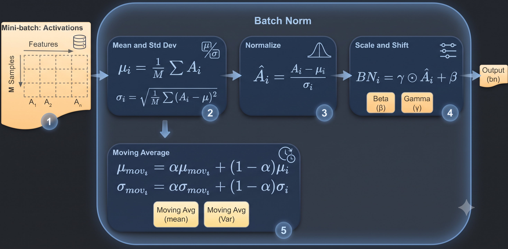

# PyTorch Batch Normalization 완전 정리: 동작 원리부터 Running Statistics와 학습·추론까지

[TOC]


## 실습 구성표

| 항목 | 실습 구성 |
| --- | --- |
| Task | 정규화 기법 · 분류 예제 포함 |
| Model | BatchNorm / MLP / CNN 구조 예제 |
| nn.Module | 사용 |
| Autograd | backward 예제 |
| Loss | CrossEntropyLoss 예제 |
| Optimizer | Adam 예제 |
| Activation | ReLU 예제 |


관련 이론: [Activation Function](../../theory/architectures/a09.md) · [Parameter vs Hyperparameter: 모델이 학습하는 값과 사람이 정하는 값](../../theory/weight/a10.md)


---



딥러닝 모델을 학습할 때는 여러 Layer를 통과하는 과정에서 Activation과 Gradient의 크기가 변화한다.

특히 깊은 신경망에서는 이러한 변화가 학습 안정성에 영향을 줄 수 있다.

대표적인 문제는 다음과 같다.

- Vanishing Gradient
- Exploding Gradient
- 불안정한 학습 과정
- Learning Rate 설정의 어려움

이러한 문제를 완화하기 위한 대표적인 방법으로 Weight Initialization과 Activation Function의 선택이 있다.

하지만 Weight Initialization은 학습을 시작하기 전에 Parameter의 초기값을 결정하는 과정이다.

학습이 진행되면서 Weight가 변경되면 각 Layer에서 생성되는 Activation의 분포도 변화할 수 있다.

이러한 환경에서 신경망의 학습을 안정화하기 위해 제안된 대표적인 방법이 **Batch Normalization(BN)** 이다.

Batch Normalization은 Mini-batch의 통계량을 이용하여 Feature를 정규화하고, 학습 가능한 Scale과 Shift를 적용하는 기법이다.

이 글에서는 다음 내용을 살펴본다.

1. Batch Normalization의 개념과 필요성
2. Internal Covariate Shift(ICS)
3. Batch Normalization의 수학적 동작 원리
4. Learnable Parameter인 $\gamma$와 $\beta$
5. Batch Normalization과 Whitening의 차이
6. ICS 가설에 대한 후속 연구
7. Batch Normalization의 장단점
8. Training과 Inference의 차이
9. Running Mean과 Running Variance
10. Exponential Moving Average와 Momentum
11. CNN에서의 Batch Normalization
12. Batch Normalization과 Layer Normalization
13. Weight Initialization 및 Gradient Clipping과의 비교
14. PyTorch를 이용한 Batch Normalization 구현
15. Iris ANN에 Batch Normalization 적용

---

## 1. Batch Normalization이란?

Batch Normalization은 2015년 Sergey Ioffe와 Christian Szegedy가 제안한 신경망 정규화 기법이다.

신경망의 각 Layer에서 처리되는 Feature의 분포를 Mini-batch 단위로 정규화하여 학습을 안정화하는 것이 핵심이다.

일반적인 Layer의 연산은 다음과 같다.

$$
\boxed{ \mathbf{z}^{(l)} = W^{(l)}\mathbf{a}^{(l-1)} + \mathbf{b}^{(l)} }
$$

이후 Activation Function을 적용한다.

$$
\boxed{ \mathbf{a}^{(l)} = f\left(\mathbf{z}^{(l)}\right) }
$$

Batch Normalization을 사용하는 경우에는 Linear Transformation과 Activation Function 사이에 정규화 연산을 추가할 수 있다.

```text
Input
  │
  ▼
Linear Transformation
  │
  ▼
Batch Normalization
  │
  ▼
Activation Function
  │
  ▼
Next Layer
```

따라서 다음과 같은 구조가 된다.

$$
\mathbf{z}^{(l)} = W^{(l)}\mathbf{a}^{(l-1)} + \mathbf{b}^{(l)}
$$

$$
\tilde{\mathbf{z}}^{(l)} = BN\left(\mathbf{z}^{(l)}\right)
$$

$$
\boxed{ \mathbf{a}^{(l)} = f\left(\tilde{\mathbf{z}}^{(l)}\right) }
$$

여기서 $BN(\cdot)$은 Batch Normalization 연산을 의미한다.

즉 **각 Layer에서 생성되는 Feature를 정규화한 후, 학습 가능한 변환을 적용하여 다음 연산에 전달하는 것**이다.

---

## 2. Batch Normalization이 필요한 이유

Batch Normalization의 필요성을 이해하려면 깊은 신경망에서 발생하는 문제를 먼저 살펴볼 필요가 있다.

### 2.1 깊은 신경망의 Parameter Update

신경망은 여러 개의 Layer로 구성된다.

예를 들어 다음과 같은 모델을 생각하자.

```text
Input
  │
  ▼
Layer 1
  │
  ▼
Layer 2
  │
  ▼
Layer 3
  │
  ▼
Layer 4
  │
  ▼
Output
```

각 Layer의 출력은 다음 Layer의 입력이 된다.

$$
\boxed{ \mathbf{a}^{(l)} = f\left( W^{(l)}\mathbf{a}^{(l-1)} + \mathbf{b}^{(l)} \right) }
$$

학습 과정에서는 Backpropagation을 통해 Weight와 Bias가 갱신된다.

$$
W^{(l)} \leftarrow W^{(l)} - \eta \frac{\partial L}{\partial W^{(l)}}
$$

따라서 앞선 Layer의 Parameter가 변경되면 해당 Layer의 출력도 달라질 수 있다.

예를 들어 Layer 1의 Weight가 변경되면 Layer 2에 전달되는 입력의 분포가 변화할 수 있다.

이러한 변화는 이후 Layer에도 영향을 미친다.

---

## 3. Internal Covariate Shift(ICS)

Batch Normalization이 처음 제안될 당시에는 **Internal Covariate Shift(ICS)** 라는 개념이 주요 동기로 제시되었다.

ICS는 학습 과정에서 앞선 Layer의 Parameter가 변화하면서 뒤쪽 Layer에 전달되는 입력 분포가 달라지는 현상을 의미한다.

예를 들어 다음 구조를 생각하자.

```text
Input
  │
  ▼
Layer 1
  │
  │ Parameter Update
  ▼
Activation Distribution 변화
  │
  ▼
Layer 2
  │
  ▼
Layer 3
```

Layer 2는 Layer 1의 출력을 입력으로 받는다.

그런데 Layer 1의 Parameter가 변경되면 Layer 2의 입력 분포가 달라질 수 있다.

BN을 제안한 초기 연구에서는 이러한 분포의 변화가 신경망의 최적화를 어렵게 하는 요인이라고 보았다.

따라서 Mini-batch 단위로 Activation을 정규화하여 이러한 문제를 완화하고자 하였다.

다만 **ICS를 줄이는 것이 BN의 성능 향상을 설명하는 유일하거나 확정적인 원인이라고 이해해서는 안 된다.**

이에 대해서는 후속 연구를 통해 다른 해석이 제시되었다.

---

## 4. Batch Normalization의 동작 원리

Batch Normalization은 다음 네 가지 과정으로 구성된다.

1. Mini-batch Mean 계산
2. Mini-batch Variance 계산
3. Standardization
4. Learnable Scaling과 Shifting

이 과정을 수학적으로 유도해 보자.

---

### 4.1 Mini-batch 정의

하나의 Mini-batch에 $m$개의 Sample이 존재한다고 하자.

$$
\boxed{ B= \left\{ \mathbf{x}^{(1)}, \mathbf{x}^{(2)}, \cdots, \mathbf{x}^{(m)} \right\} }
$$

여기서 각 Sample은 $d$개의 Feature를 가진다.

$$
\mathbf{x}^{(i)} = \begin{bmatrix} x_1^{(i)}\\ x_2^{(i)}\\ \vdots\\ x_d^{(i)} \end{bmatrix}
$$

이다.

따라서 Mini-batch 전체는 다음 Tensor로 표현할 수 있다.

$$
\boxed{ X\in\mathbb{R}^{m\times d} }
$$

예를 들어 Batch Size가 16이고 Feature가 4개라면

$$
X\in\mathbb{R}^{16\times4}
$$

이다.

PyTorch Tensor Shape는 다음과 같다.

```text
torch.Size([16, 4])
```

Batch Normalization은 각 Feature에 대해 Mini-batch 방향으로 통계량을 계산한다.

---

### 4.2 Step 1: Mini-batch Mean

먼저 $j$번째 Feature의 평균을 계산한다.

$$
\boxed{ \mu_{B,j} = \frac{1}{m} \sum_{i=1}^{m} x_j^{(i)} }
$$

여기서

- $m$: Batch Size
- $j$: Feature Index
- $i$: Sample Index

이다.

즉 각 Feature에 대해 $m$개 Sample의 평균을 계산한다.

모든 Feature의 평균을 모으면 다음과 같은 벡터가 된다.

$$
\boxed{ \boldsymbol{\mu}_B = \begin{bmatrix} \mu_{B,1}\\ \mu_{B,2}\\ \vdots\\ \mu_{B,d} \end{bmatrix} }
$$

따라서 평균 벡터의 Shape는 다음과 같다.

$$
\boxed{ (d,) }
$$

이다.

PyTorch에서는 다음과 같이 계산할 수 있다.

```python
batch_mean = X.mean(dim=0)
```

여기서 `dim=0`은 Batch Dimension을 따라 평균을 계산한다는 의미이다.

---

### 4.3 Step 2: Mini-batch Variance

각 Feature의 분산을 계산한다.

$$
\boxed{ \sigma_{B,j}^{2} = \frac{1}{m} \sum_{i=1}^{m} \left( x_j^{(i)}-\mu_{B,j} \right)^2 }
$$

분산은 각 Feature가 평균으로부터 얼마나 퍼져 있는지를 나타낸다.

모든 Feature의 분산을 모으면 다음과 같다.

$$
\boxed{ \boldsymbol{\sigma}_B^2 = \begin{bmatrix} \sigma_{B,1}^2\\ \sigma_{B,2}^2\\ \vdots\\ \sigma_{B,d}^2 \end{bmatrix} }
$$

PyTorch에서는 다음과 같이 계산할 수 있다.

```python
batch_var = X.var(
    dim=0,
    correction=0
)
```

여기서 `correction=0`은 분산을 계산할 때 $m$으로 나누는 방식을 의미한다.

PyTorch의 BatchNorm은 Training Forward 과정에서 이러한 분산 계산 방식을 사용한다.

---

### 4.4 Step 3: Standardization

이제 평균과 분산을 이용하여 입력값을 표준화한다.

$$
\boxed{ \hat{x}_j^{(i)} = \frac{ x_j^{(i)}-\mu_{B,j} }{ \sqrt{\sigma_{B,j}^{2}+\epsilon} } }
$$

여기서 $\epsilon$은 수치적 안정성을 위한 작은 상수이다.

특히 분산이 매우 작은 경우 분모가 0에 가까워질 수 있으므로 이를 방지하는 역할을 한다.

PyTorch의 BatchNorm에서 기본적으로 사용하는 값은 다음과 같다.

$$
\boxed{ \epsilon=10^{-5} }
$$

표준화 이후에는 각 Feature의 Mini-batch 평균이 0에 가까워진다.

또한 분산은 1에 가까워진다.

다만 $\epsilon$이 추가되므로 정규화된 Feature의 분산이 반드시 정확하게 1이 되는 것은 아니다.

PyTorch에서는 다음과 같이 구현할 수 있다.

```python
X_normalized = (
    X - batch_mean
) / torch.sqrt(
    batch_var + 1e-5
)
```

이 과정까지는 일반적인 Standardization과 유사하다.

하지만 Batch Normalization에는 한 단계가 더 존재한다.

---

## 5. Learnable Scaling과 Shifting

Batch Normalization은 표준화된 Feature를 그대로 다음 Layer에 전달하지 않는다.

표준화 이후 Learnable Parameter를 이용하여 Scaling과 Shifting을 수행한다.

수식은 다음과 같다.

$$
\boxed{ y_j^{(i)} = \gamma_j\hat{x}_j^{(i)} + \beta_j }
$$

여기서

- $\gamma_j$: Learnable Scale Parameter
- $\beta_j$: Learnable Shift Parameter

이다.

따라서 Batch Normalization의 전체 수식은 다음과 같다.

$$
\boxed{ y_j^{(i)} = \gamma_j \frac{ x_j^{(i)}-\mu_{B,j} }{ \sqrt{\sigma_{B,j}^{2}+\epsilon} } + \beta_j }
$$

이 식이 Batch Normalization의 핵심이다.

---

### 5.1 왜 Standardization 이후 Scaling을 수행할까?

Standardization은 입력 Feature의 평균을 0에 가깝게 만들고 분산을 1에 가깝게 만든다.

하지만 신경망이 항상 평균 0, 분산 1인 Feature를 필요로 하는 것은 아니다.

예를 들어 어떤 Layer에서는 평균이 2인 Feature가 다음 연산에 더 유리할 수도 있다.

또한 Feature의 크기를 조절하는 것이 최적화에 도움이 될 수도 있다.

따라서 Batch Normalization은 정규화 이후의 분포를 학습 가능한 Parameter로 조정할 수 있도록 한다.

$$
\boxed{ \text{Standardization} \rightarrow \text{Learnable Scale} \rightarrow \text{Learnable Shift} }
$$

즉 Batch Normalization은 단순한 Standardization과 다르다.

---

### 5.2 Gamma의 역할

$\gamma$는 정규화된 Feature의 크기를 조절한다.

$$
y=\gamma\hat{x}+\beta
$$

여기서 $\gamma$가 커지면 정규화된 Feature의 크기가 증가할 수 있다.

반대로 $\gamma$가 작아지면 Feature의 크기가 감소한다.

즉 $\gamma$는 Scaling을 담당한다.

---

### 5.3 Beta의 역할

$\beta$는 정규화된 Feature를 일정한 값만큼 이동시킨다.

$$
y=\gamma\hat{x}+\beta
$$

따라서 $\beta$는 Shifting을 담당한다.

예를 들어

$$
\gamma=2,\qquad\beta=3
$$

이라면

$$
\boxed{ y=2\hat{x}+3 }
$$

이다.

이는 정규화된 Feature를 두 배 확대하고 3만큼 이동시키는 연산이다.

---

### 5.4 Gamma와 Beta는 어떻게 결정될까?

$\gamma$와 $\beta$는 모델의 학습 가능한 Parameter이다.

따라서 Backpropagation을 통해 Gradient가 계산되고 Optimizer에 의해 갱신된다.

$$
\gamma \leftarrow \gamma - \eta \frac{\partial L}{\partial\gamma}
$$

$$
\beta \leftarrow \beta - \eta \frac{\partial L}{\partial\beta}
$$

이다.

일반적으로 초기값은 다음과 같다.

$$
\boxed{ \gamma=1 }
$$

$$
\boxed{ \beta=0 }
$$

따라서 초기에는 표준화된 Feature에 항등적인 Affine Transformation을 적용한다.

하지만 학습이 진행되면서 $\gamma$와 $\beta$가 변경된다.

이것이 **Batch Normalization이 학습 가능한 정규화 Layer**라는 의미이다.

---

## 6. Batch Normalization과 Whitening의 차이

Batch Normalization을 이해할 때 Standardization과 Whitening을 구분할 필요가 있다.

### 6.1 Standardization

Standardization은 각 Feature의 평균과 분산을 조절한다.

$$
\boxed{ z_j= \frac{x_j-\mu_j}{\sigma_j} }
$$

이 과정에서는 Feature마다 평균과 분산을 계산한다.

하지만 서로 다른 Feature 사이의 상관관계가 반드시 제거되는 것은 아니다.

---

### 6.2 Whitening

Whitening은 데이터의 공분산 구조까지 고려하여 Feature 사이의 상관관계를 제거하고 분산을 정규화하는 변환이다.

예를 들어 입력 데이터의 Covariance Matrix를 다음과 같이 정의하자.

$$
\Sigma = \operatorname{Cov}(\mathbf{x})
$$

Whitening을 수행하면 이상적으로 변환된 데이터의 공분산 행렬이 단위행렬이 되도록 할 수 있다.

$$
\boxed{ \operatorname{Cov}(\mathbf{z})=I }
$$

그러나 Whitening은 일반적으로 Covariance Matrix와 행렬 연산 등을 필요로 한다.

따라서 계산 비용이 상대적으로 크다.

Batch Normalization은 완전한 Whitening 대신 **Feature별 Mean과 Variance를 이용한 정규화**를 적용한다.

| 구분 | Standardization | Whitening | Batch Normalization |
| --- | --- | --- | --- |
| Mean 조절 | O | O | O |
| Variance 조절 | O | O | O |
| Feature 간 상관관계 제거 | X | O | X |
| Learnable Scale/Shift | 일반적으로 X | 일반적으로 X | O |
| Mini-batch 기반 | 구현에 따라 다름 | 구현에 따라 다름 | 일반적으로 O |

따라서 BN을 적용했다고 해서 Feature 사이의 상관관계가 모두 제거되는 것은 아니다.

---

## 7. Batch Normalization과 ICS 가설의 재해석

Batch Normalization은 처음 제안될 당시 ICS를 감소시키는 방법으로 설명되었다.

하지만 후속 연구에서는 BN의 효과를 다른 관점에서 해석하였다.

대표적인 연구는 다음과 같다.

**How Does Batch Normalization Help Optimization?**

이 연구에서는 BN의 성능 향상이 단순히 Layer 입력 분포의 변화를 감소시키는 것만으로 설명되지 않는다는 결과를 제시하였다.

대신 BN이 **Optimization Landscape를 더 부드럽게 만들어 Gradient 기반 최적화를 안정화하는 효과**에 주목하였다.

---

### 7.1 Optimization Landscape란?

Optimization Landscape는 모델 Parameter의 변화에 따라 Loss Function이 어떻게 달라지는지를 나타내는 개념이다.

일반적인 Loss Function을 다음과 같이 표현하자.

$$
L(\theta)
$$

여기서 $\theta$는 모델 Parameter이다.

학습에서는 이 함수의 기울기를 계산하여 Parameter를 갱신한다.

$$
\theta_{t+1} = \theta_t - \eta\nabla_\theta L(\theta_t)
$$

그런데 Loss Function의 변화가 매우 급격하거나 Gradient가 불안정하면 적절한 Learning Rate를 설정하기 어려울 수 있다.

BN은 이러한 최적화 과정의 안정성을 개선할 수 있다.

---

### 7.2 BN의 효과를 어떻게 이해해야 할까?

초기 설명은 다음과 같았다.

```text
Batch Normalization
        │
        ▼
Internal Covariate Shift 감소
        │
        ▼
Training Stability 향상
```

후속 연구에서는 다음과 같은 해석이 제시되었다.

```text
Batch Normalization
        │
        ▼
Optimization Landscape의
Smoothness 개선
        │
        ▼
Gradient의 안정적인 변화
        │
        ▼
Training Stability 향상
```

따라서 BN의 효과를 ICS 감소만으로 설명하기보다는, **정규화가 최적화 과정에 미치는 영향**까지 함께 고려하는 것이 적절하다.

다만 Optimization Landscape의 Smoothing 역시 모든 상황을 완전히 설명하는 단일 원리로 받아들이기보다는, BN의 효과를 이해하기 위한 중요한 연구 결과 중 하나로 보는 것이 정확하다.

---

## 8. Batch Normalization의 장점

Batch Normalization은 여러 신경망 구조에서 학습을 안정화하는 데 도움이 될 수 있다.

대표적인 장점은 다음과 같다.

### 8.1 Gradient 문제 완화

깊은 신경망에서는 Vanishing Gradient와 Exploding Gradient가 발생할 수 있다.

BN은 Layer 내부의 Feature Scale을 조절하여 이러한 문제가 발생할 위험을 완화하는 데 도움이 될 수 있다.

다만 BN을 적용한다고 해서 모든 Gradient 문제가 해결되는 것은 아니다.

---

### 8.2 Learning Rate 설정의 유연성

BN을 사용하면 일부 신경망에서 BN을 사용하지 않는 경우보다 높은 Learning Rate로 안정적인 학습이 가능할 수 있다.

이는 최적화 과정의 안정성이 개선될 수 있기 때문이다.

하지만 모든 모델에서 Learning Rate를 크게 설정해도 된다는 의미는 아니다.

실제로는 모델 구조와 Optimizer에 따라 적절한 Learning Rate를 선택해야 한다.

---

### 8.3 Weight Initialization에 대한 민감도 감소

Weight Initialization은 초기 Activation과 Gradient의 크기에 영향을 준다.

BN은 학습 과정에서 Feature를 정규화하므로 초기 Weight Scale에 대한 민감도를 일부 줄일 수 있다.

하지만 그렇다고 Weight Initialization이 필요 없어지는 것은 아니다.

Xavier Initialization이나 He Initialization과 BN은 함께 사용할 수 있다.

---

### 8.4 Regularization 효과

Training 과정에서 BN은 Mini-batch의 Mean과 Variance를 사용한다.

Mini-batch가 달라지면 계산되는 통계량도 달라질 수 있다.

따라서 동일한 Sample이라도 함께 구성된 Mini-batch에 따라 정규화 결과가 달라질 수 있다.

이러한 변동은 학습 과정에서 일종의 Regularization 효과를 제공할 수 있다.

다만 BN의 Regularization 효과는 Batch Size와 데이터 구성에 영향을 받는다.

또한 BN을 사용한다고 해서 Dropout이나 다른 Regularization 기법이 항상 불필요해지는 것은 아니다.

---

## 9. Batch Normalization의 단점

BN은 학습 안정성에 도움이 될 수 있지만 모든 상황에서 최선의 선택은 아니다.

### 9.1 추가 연산 비용

BN은 각 Layer에서 다음 연산을 추가한다.

- Mean 계산
- Variance 계산
- Standardization
- Scaling
- Shifting

따라서 계산 및 메모리 접근 비용이 증가할 수 있다.

다만 BN으로 인해 학습이 더 빠르게 수렴한다면 전체 학습 시간이 감소할 가능성도 있다.

---

### 9.2 Mini-batch 크기의 영향

BN은 Mini-batch의 통계량을 사용한다.

따라서 Batch Size가 지나치게 작으면 Mean과 Variance의 추정이 불안정해질 수 있다.

예를 들어 Batch Size가 2라면 각 Feature의 통계량을 매우 적은 Sample로 계산한다.

반면 Batch Size가 충분히 크면 통계량 추정이 상대적으로 안정적일 수 있다.

그러나 Batch Size가 크다고 해서 항상 더 좋은 학습 성능을 보장하는 것은 아니다.

---

### 9.3 Training과 Inference의 동작 차이

BN은 Training 과정과 Inference 과정에서 사용하는 통계량이 다르다.

따라서 모델의 학습 모드와 평가 모드를 올바르게 설정해야 한다.

이 부분은 이후 자세히 살펴본다.

---

### 9.4 Sequence Model에서의 한계

RNN이나 Transformer처럼 Sequence Data를 처리하는 모델에서는 일반적인 Batch Normalization을 적용하기 어려운 경우가 있다.

특히 다음 요소들이 영향을 줄 수 있다.

- 서로 다른 Sequence Length
- Padding
- 시간에 따른 입력 분포의 변화
- 작은 Batch Size
- Batch 간 통계적 차이

따라서 이러한 모델에서는 Layer Normalization 등이 자주 사용된다.

---

## 10. Training과 Inference의 차이

Batch Normalization을 구현할 때 가장 중요한 부분 중 하나이다.

**Training과 Inference에서는 정규화에 사용하는 Mean과 Variance가 다르다.**

---

### 10.1 Training Mode

Training Mode에서는 현재 Mini-batch에서 Mean과 Variance를 계산한다.

$$
\boxed{ \mu_B = \frac{1}{m} \sum_{i=1}^{m}x^{(i)} }
$$

$$
\boxed{ \sigma_B^2 = \frac{1}{m} \sum_{i=1}^{m} (x^{(i)}-\mu_B)^2 }
$$

이 값으로 입력을 정규화한다.

$$
\hat{x} = \frac{x-\mu_B} {\sqrt{\sigma_B^2+\epsilon}}
$$

그리고 Learnable Parameter를 적용한다.

$$
\boxed{ y=\gamma\hat{x}+\beta }
$$

동시에 Training 과정에서는 향후 Inference에 사용할 Running Statistics를 관리한다.

---

### 10.2 Inference Mode

Inference에서는 일반적으로 현재 입력 Batch의 Mean과 Variance를 사용하지 않는다.

대신 Training 과정에서 추적한 Running Statistics를 사용한다.

$$
\boxed{ \hat{x} = \frac{ x-\mu_{\mathrm{running}} }{ \sqrt{ \sigma_{\mathrm{running}}^2+\epsilon } } }
$$

이후 동일한 $\gamma$와 $\beta$를 적용한다.

$$
\boxed{ y = \gamma\hat{x}+\beta }
$$

따라서 다음과 같이 구분할 수 있다.

| 구분 | Training | Inference |
| --- | --- | --- |
| Mean | 현재 Mini-batch Mean | Running Mean |
| Variance | 현재 Mini-batch Variance | Running Variance |
| $\gamma$ | 학습 및 사용 | 학습된 값 사용 |
| $\beta$ | 학습 및 사용 | 학습된 값 사용 |
| Running Statistics 갱신 | 일반적으로 O | X |

위 표는 PyTorch에서 기본 설정인 `track_running_stats=True`를 사용하는 경우에 해당한다.

---

## 11. Running Mean과 Running Variance

Training 과정에서 계산되는 Mini-batch 통계량은 Batch마다 달라진다.

따라서 Inference에 사용할 대표적인 통계량을 별도로 관리한다.

이를 Running Statistics라고 한다.

대표적인 값은 다음과 같다.

- `running_mean`
- `running_var`

여기서 `running_var`는 표준편차가 아니라 **분산(Variance)** 을 의미한다.

---

### 11.1 Exponential Moving Average(EMA)

Running Statistics는 일반적으로 Exponential Moving Average를 이용해 갱신한다.

PyTorch에서 사용하는 대표적인 갱신식은 다음과 같다.

$$
\boxed{ \mu_{\mathrm{running,new}} = (1-m)\mu_{\mathrm{running,old}} + m\mu_B }
$$

여기서

- $m$: Momentum
- $\mu_B$: 현재 Mini-batch Mean
- $\mu_{\mathrm{running}}$: Running Mean

이다.

분산도 Running Variance를 갱신하는 데 같은 형태의 이동평균을 사용한다.

---

### 11.2 Momentum의 의미

PyTorch의 BatchNorm은 기본적으로 다음 값을 사용한다.

$$
\boxed{ m=0.1 }
$$

따라서 Running Mean은 다음과 같이 갱신된다.

$$
\mu_{\mathrm{running,new}} = 0.9\mu_{\mathrm{running,old}} + 0.1\mu_B
$$

즉 이전 Running Mean에 90%의 가중치를 부여하고, 현재 Batch Mean에 10%의 가중치를 부여한다.

여기서 중요한 점은 **PyTorch BatchNorm의 Momentum은 일반적인 Optimizer의 Momentum과 의미가 다르다**는 것이다.

---

### 11.3 TensorFlow와 PyTorch의 Momentum 비교

Framework에 따라 Momentum Parameter를 정의하는 방식이 다를 수 있다.

PyTorch에서는 다음 형태를 사용한다.

$$
\boxed{ v_{\mathrm{new}} = (1-m)v_{\mathrm{old}} + mv_{\mathrm{batch}} }
$$

반면 Keras의 BatchNormalization에서는 다음 형태를 사용한다.

$$
\boxed{ v_{\mathrm{new}} = mv_{\mathrm{old}} + (1-m)v_{\mathrm{batch}} }
$$

따라서 같은 갱신 비율을 사용하려면 Momentum 값이 달라질 수 있다.

예를 들어

| Framework | Momentum | 이전 통계량 비중 | 현재 Batch 비중 |
| --- | --- | --- | --- |
| PyTorch | 0.1 | 90% | 10% |
| Keras | 0.9 | 90% | 10% |

즉 두 Framework의 Momentum 값을 그대로 비교해서는 안 된다.

---

### 11.4 Running Variance에 대한 PyTorch의 구현 세부사항

PyTorch의 BatchNorm은 Training Forward 과정에서 현재 Batch의 분산을 계산할 때 다음 형태를 사용한다.

$$
\sigma_B^2 = \frac{1}{m} \sum_{i=1}^{m} (x_i-\mu_B)^2
$$

이는 `correction=0`에 대응한다.

반면 Running Variance를 갱신하는 데 사용되는 분산 추정량은 일반적으로 `correction=1`에 대응하는 불편분산 추정량이다.

따라서 **현재 Batch를 정규화하는 데 사용하는 분산과 Running Variance를 갱신하는 데 사용하는 분산 추정 방식은 구분해야 한다.**

이 부분은 PyTorch의 구현 세부사항이므로 단순한 BN 수식과 실제 `running_var` 값을 비교할 때 중요하다.

---

## 12. Learnable Parameter와 Buffer의 차이

PyTorch의 Batch Normalization에서는 다음 값들을 구분해야 한다.

**Learnable Parameters**

- `weight` : $\gamma$
- `bias` : $\beta$

**Buffers**

- `running_mean`
- `running_var`
- `num_batches_tracked`

이 둘은 관리 방식이 다르다.

---

### 12.1 Learnable Parameter

$\gamma$와 $\beta$는 Gradient 기반 학습을 통해 갱신된다.

PyTorch에서는 각각 다음에 대응한다.

```python
bn.weight
```
```python
bn.bias
```

일반적인 BN 초기화에서는

```text
weight = 1
bias   = 0
```

으로 설정된다.

여기서 BatchNorm의 `weight`는 일반적인 Linear Layer의 Weight Matrix와 같은 의미가 아니다.

**BatchNorm의 `weight`는 Feature별 Scaling Parameter인 $\gamma$이다.**

---

### 12.2 Buffer

Running Mean과 Running Variance는 학습 과정에서 상태가 갱신되지만 일반적인 Weight처럼 Optimizer를 통해 학습되는 Parameter는 아니다.

따라서 PyTorch에서는 Buffer로 관리한다.

```python
bn.running_mean
```
```python
bn.running_var
```

이 값들은 Gradient를 이용하는 Optimizer Update가 아니라 Running Statistics의 갱신 규칙을 통해 변경된다.

---

### 12.3 state_dict()와의 관계

PyTorch의 `state_dict()`는 모델의 Parameter와 Persistent Buffer를 저장한다.

따라서 BatchNorm의 상태를 저장하면 일반적으로 다음 값들이 포함된다.

```text
weight
bias
running_mean
running_var
num_batches_tracked
```

이 점은 모델을 저장하고 불러올 때 중요하다.

**BatchNorm 모델의 Weight만 복원하고 Running Statistics를 복원하지 않으면 Inference 결과가 달라질 수 있다.**

따라서 일반적인 모델 저장에서는 `state_dict()`를 사용하여 Parameter와 Buffer를 함께 관리하는 것이 적절하다.

---

## 13. CNN에서 Batch Normalization

Batch Normalization은 CNN에서 널리 사용되는 정규화 기법이다.

CNN에서는 Feature Map이 일반적으로 다음 Shape를 가진다.

$$
\boxed{ X\in\mathbb{R}^{N\times C\times H\times W} }
$$

여기서

- $N$: Batch Size
- $C$: Channel
- $H$: Height
- $W$: Width

이다.

예를 들어 다음과 같은 Tensor를 생각하자.

```text
[16, 32, 28, 28]
```

이는 다음을 의미한다.

- Batch Size: 16
- Channel: 32
- Height: 28
- Width: 28

---

### 13.1 CNN에서 통계량은 어떻게 계산할까?

CNN에서는 일반적으로 각 Channel에 대해 Mean과 Variance를 계산한다.

이때 Batch Dimension과 Spatial Dimension을 함께 사용한다.

즉 $c$번째 Channel의 평균은 다음과 같다.

$$
\boxed{ \mu_c = \frac{1}{NHW} \sum_{n=1}^{N} \sum_{h=1}^{H} \sum_{w=1}^{W} x_{n,c,h,w} }
$$

분산은 다음과 같다.

$$
\boxed{ \sigma_c^2 = \frac{1}{NHW} \sum_{n=1}^{N} \sum_{h=1}^{H} \sum_{w=1}^{W} (x_{n,c,h,w}-\mu_c)^2 }
$$

이다.

따라서 Channel이 32개라면 Mean과 Variance도 각각 32개 계산된다.

---

### 13.2 CNN에서 BN의 기본 구조

CNN에서는 다음과 같은 구조를 사용할 수 있다.

```text
Input Feature Map
        │
        ▼
      Conv2d
        │
        ▼
   BatchNorm2d
        │
        ▼
       ReLU
        │
        ▼
 Next Convolution
```

이를 PyTorch로 구현하면 다음과 같다.

```python
import torch.nn as nn

block = nn.Sequential(
    nn.Conv2d(
        in_channels=3,
        out_channels=32,
        kernel_size=3,
        padding=1,
        bias=False
    ),

    nn.BatchNorm2d(32),

    nn.ReLU()
)
```

여기서

```python
nn.BatchNorm2d(32)
```

는 32개 Channel에 대한 Batch Normalization을 수행한다.

---

### 13.3 Conv2d의 Bias를 False로 설정하는 이유

Convolution Layer 다음에 BatchNorm이 바로 위치하는 경우 다음과 같이 설정하는 일이 많다.

```python
nn.Conv2d(
    3,
    32,
    kernel_size=3,
    bias=False
)
```

그 이유는 BatchNorm이 평균을 제거하고, 별도의 Learnable Shift Parameter인 $\beta$를 가지고 있기 때문이다.

따라서 Convolution의 Bias가 중복적인 역할을 할 수 있다.

특히 일반적인 `Conv → BN` 구조에서는 Convolution의 Bias를 생략해도 충분한 경우가 많다.

다만 모든 구조에서 Bias를 제거해야 하는 것은 아니다.

---

## 14. Batch Normalization과 Layer Normalization

Batch Normalization과 Layer Normalization은 모두 Feature를 정규화하지만, **어느 차원에서 Mean과 Variance를 계산하는지**가 다르다.

---

### 14.1 Batch Normalization

다음 Tensor를 생각하자.

$$
X\in\mathbb{R}^{N\times C}
$$

Batch Normalization은 일반적으로 각 Feature에 대해 Batch Dimension을 따라 통계량을 계산한다.

```text
           Features
          F1  F2  F3

Sample 1   x   x   x
Sample 2   x   x   x
Sample 3   x   x   x
Sample 4   x   x   x

       ↓
각 Feature의 열 방향으로
Mean / Variance 계산
```

즉 다른 Sample의 값이 현재 Sample의 정규화 결과에 영향을 줄 수 있다.

---

### 14.2 Layer Normalization

Layer Normalization은 일반적으로 각 Sample 내부의 지정된 Feature Dimension에 대해 통계량을 계산한다.

```text
           Features
          F1  F2  F3

Sample 1   x───x───x
Sample 2   x───x───x
Sample 3   x───x───x
Sample 4   x───x───x

       ↓
각 Sample의 행 방향으로
Mean / Variance 계산
```

따라서 일반적인 LayerNorm은 Batch Size에 직접 의존하지 않는다.

---

### 14.3 비교

| 구분 | Batch Normalization | Layer Normalization |
| --- | --- | --- |
| 통계량 계산 기준 | Batch 및 지정된 축 | Sample 내부의 지정된 축 |
| Batch Size 영향 | 상대적으로 큼 | 상대적으로 작음 |
| Running Statistics | 일반적으로 사용 | 일반적으로 사용하지 않음 |
| Training / Eval 통계량 | 다를 수 있음 | 일반적으로 동일한 방식 |
| 대표 활용 | CNN, MLP | Transformer, Sequence Model |

Transformer에서는 일반적으로 Layer Normalization을 많이 사용한다.

이는 Sequence와 Token 단위의 표현을 처리할 때 Batch 전체의 통계량에 의존하지 않는 방식이 유리하기 때문이다.

다만 특정 신경망 구조에서 BatchNorm을 사용할 수 없다는 의미는 아니다.

---

## 15. Batch Normalization과 Weight Initialization

Weight Initialization과 Batch Normalization은 모두 학습 안정성과 관련이 있다.

하지만 역할이 다르다.

**Weight Initialization**

학습 시작 전에 Weight의 초기 분산을 설정한다.

**Batch Normalization**

학습 과정에서 Mini-batch 통계량을 이용해 중간 Feature를 정규화하고, 학습 가능한 Affine Transformation을 적용한다.

따라서 두 방법은 서로 다른 시점에서 작동한다.

```text
Weight Initialization
        │
        ▼
Initial Parameters
        │
        ▼
Forward Propagation
        │
        ▼
Batch Normalization
        │
        ▼
Loss Calculation
        │
        ▼
Backpropagation
        │
        ▼
Parameter Update
```

적절한 Weight Initialization과 BN을 함께 사용하면 학습을 안정화하는 데 도움이 될 수 있다.

하지만 BN이 Weight Initialization의 필요성을 완전히 제거하는 것은 아니다.

---

## 16. Batch Normalization과 Gradient Clipping

Gradient Clipping은 Gradient의 크기가 지나치게 커지는 것을 제한하는 기법이다.

예를 들어 Gradient Vector를 다음과 같이 정의하자.

$$
\mathbf{g} = \nabla_\theta L
$$

Gradient Norm이 일정한 기준 $c$를 초과하면 크기를 제한할 수 있다.

대표적인 방식은 다음과 같다.

$$
\boxed{ \mathbf{g}_{clip} = \mathbf{g} \cdot \min\left( 1, \frac{c}{\|\mathbf{g}\|} \right) }
$$

이 방식은 Gradient의 방향을 유지하면서 Norm이 기준값을 초과하지 않도록 만든다.

PyTorch에서는 다음과 같이 사용할 수 있다.

```python
import torch

torch.nn.utils.clip_grad_norm_(
    model.parameters(),
    max_norm=1.0
)
```

일반적으로 `loss.backward()` 이후, `optimizer.step()` 이전에 호출한다.

```python
optimizer.zero_grad()

loss.backward()

torch.nn.utils.clip_grad_norm_(
    model.parameters(),
    max_norm=1.0
)

optimizer.step()
```

BN과 Gradient Clipping은 다음과 같이 구분할 수 있다.

| 구분 | Batch Normalization | Gradient Clipping |
| --- | --- | --- |
| 적용 대상 | 중간 Feature / Activation | Gradient |
| 적용 시점 | Forward 과정 | Backward 이후 |
| 주요 목적 | 학습 안정성 개선 | 과도한 Gradient 제한 |
| 통계량 사용 | Mini-batch Mean/Variance | Gradient Norm 또는 값 |

두 방법은 서로 다른 문제를 다루므로 필요에 따라 함께 사용할 수 있다.

---

## 17. PyTorch 실습: BatchNorm1d

이제 PyTorch에서 Batch Normalization을 직접 구현해 보자.

이하 내용은 BN의 동작을 이해하기 위한 추가 실습이다.

먼저 다음 모듈을 불러온다.

```python
import torch
import torch.nn as nn
```

Batch Normalization을 적용할 Feature 수가 3개라고 하자.

```python
bn = nn.BatchNorm1d(3)
```

이 코드는 3개의 Feature를 정규화하는 BatchNorm Layer를 생성한다.

---

### 17.1 입력 Tensor 생성

```python
torch.manual_seed(42)

x = torch.randn(8, 3)

print(x.shape)
```

출력:

```text
torch.Size([8, 3])
```

즉

- Batch Size: 8
- Features: 3

이다.

BatchNorm을 적용한다.

```python
bn.train()

y = bn(x)

print(y.shape)
```

출력:

```text
torch.Size([8, 3])
```

Batch Normalization은 입력과 출력의 Shape를 유지한다.

---

## 18. PyTorch 실습: BN 수식 직접 구현

Batch Normalization이 실제로 어떤 계산을 수행하는지 직접 구현해 보자.

먼저 4개의 Sample과 3개의 Feature를 가진 Tensor를 만든다.

```python
import torch

x = torch.tensor([
    [1.0, 10.0, 100.0],
    [2.0, 20.0, 200.0],
    [3.0, 30.0, 300.0],
    [4.0, 40.0, 400.0]
])
```

Shape는 다음과 같다.

```python
print(x.shape)
```

출력:

```text
torch.Size([4, 3])
```

---

### 18.1 Mean 계산

```python
mean = x.mean(dim=0)

print(mean)
```

결과:

```text
tensor([  2.5000,  25.0000, 250.0000])
```

각 Feature의 평균은 다음과 같다.

$$
\boxed{ \boldsymbol{\mu} = (2.5,25,250) }
$$

이다.

---

### 18.2 Variance 계산

```python
var = x.var(
    dim=0,
    correction=0
)

print(var)
```

결과:

```text
tensor([   1.2500,  125.0000, 12500.0000])
```

각 Feature의 분산은 다음과 같다.

$$
\boxed{ \boldsymbol{\sigma}^2 = (1.25,125,12500) }
$$

이다.

---

### 18.3 Standardization

```python
eps = 1e-5

x_normalized = (
    x - mean
) / torch.sqrt(
    var + eps
)

print(x_normalized)
```

이제 Feature별로 평균과 분산을 확인해 보자.

```python
print(
    "Mean:",
    x_normalized.mean(dim=0)
)

print(
    "Variance:",
    x_normalized.var(
        dim=0,
        correction=0
    )
)
```

평균은 0에 가까운 값이 나온다.

분산은 1에 가까운 값이 나온다.

단, $\epsilon$이 포함되므로 정확하게 1과 일치하지 않을 수 있다.

---

### 18.4 PyTorch BatchNorm 결과와 비교

이번에는 같은 입력에 PyTorch BatchNorm을 적용해 보자.

```python
import torch.nn as nn

bn = nn.BatchNorm1d(
    num_features=3,
    affine=False,
    track_running_stats=False
)

bn.train()

y = bn(x)

print(y)
```

여기서

```python
affine=False
```

는 Learnable Scaling과 Shifting을 사용하지 않는다는 의미이다.

따라서 $\gamma$와 $\beta$를 적용하지 않고 정규화만 수행한다.

또한

```python
track_running_stats=False
```

는 Running Statistics를 추적하지 않는다는 의미이다.

수동으로 계산한 결과와 PyTorch BatchNorm의 결과를 비교할 수 있다.

```python
print(
    torch.allclose(
        x_normalized,
        y,
        atol=1e-5
    )
)
```

부동소수점 계산에 따른 작은 차이를 허용하면 두 결과가 거의 같다는 사실을 확인할 수 있다.

---

## 19. PyTorch 실습: Gamma와 Beta 확인

BatchNorm의 Learnable Parameter를 직접 확인해 보자.

```python
import torch
import torch.nn as nn

bn = nn.BatchNorm1d(4)

print("Gamma:")
print(bn.weight)

print("Beta:")
print(bn.bias)
```

초기값은 일반적으로 다음과 같다.

```text
Gamma:
tensor([1., 1., 1., 1.])

Beta:
tensor([0., 0., 0., 0.])
```

여기서

```python
bn.weight
```

는 $\gamma$에 해당한다.

```python
bn.bias
```

는 $\beta$에 해당한다.

두 값은 `nn.Parameter`로 등록되어 있다.

따라서 Gradient를 계산하고 Optimizer를 통해 갱신할 수 있다.

---

### 19.1 Parameter 조회

```python
for name, param in bn.named_parameters():

    print(
        name,
        param.shape
    )
```

출력:

```text
weight torch.Size([4])
bias torch.Size([4])
```

즉 4개의 Feature에 대해 각각 Scaling과 Shifting Parameter가 존재한다.

---

## 20. PyTorch 실습: Running Statistics 확인

이번에는 BatchNorm의 Buffer를 확인해 보자.

```python
bn = nn.BatchNorm1d(4)

for name, buffer in bn.named_buffers():

    print(
        name,
        buffer
    )
```

초기 상태에서는 일반적으로 다음 값을 가진다.

```text
running_mean tensor([0., 0., 0., 0.])

running_var tensor([1., 1., 1., 1.])

num_batches_tracked tensor(0)
```

각 Buffer의 의미는 다음과 같다.

| Buffer | 의미 |
| --- | --- |
| `running_mean` | Training 과정에서 추적한 Mean |
| `running_var` | Training 과정에서 추적한 Variance |
| `num_batches_tracked` | 처리한 Batch 수 |

---

### 20.1 Training 이후 Running Statistics

다음과 같이 입력 Tensor를 생성한다.

```python
torch.manual_seed(42)

x = torch.randn(16, 4) * 3 + 5
```

이 Tensor는 각 Feature의 값이 대체로 평균 5, 표준편차 3인 분포에서 생성된다.

BatchNorm을 Training Mode로 설정한다.

```python
bn.train()
```

Forward Propagation을 수행한다.

```python
y = bn(x)
```

이후 Running Statistics를 확인한다.

```python
print(
    "Running Mean:",
    bn.running_mean
)

print(
    "Running Variance:",
    bn.running_var
)
```

초기값과 비교하면 값이 변경되었음을 확인할 수 있다.

이는 Training Forward 과정에서 Mini-batch Statistics를 이용해 Running Statistics를 갱신했기 때문이다.

---

## 21. PyTorch 실습: train()과 eval()의 차이

Training과 Inference의 차이를 직접 확인해 보자.

```python
import torch
import torch.nn as nn

torch.manual_seed(42)

bn = nn.BatchNorm1d(3)

x_train = torch.randn(32, 3) * 2 + 4
```

먼저 Training Mode로 설정한다.

```python
bn.train()
```

Forward Propagation을 수행한다.

```python
train_output = bn(x_train)
```

이때 현재 Mini-batch의 Mean과 Variance가 사용된다.

또한 Running Statistics가 갱신된다.

이제 Evaluation Mode로 변경한다.

```python
bn.eval()
```

새로운 입력을 만든다.

```python
x_test = torch.randn(8, 3) * 2 + 4
```

Inference를 수행한다.

```python
with torch.no_grad():

    test_output = bn(x_test)
```

이때는 현재 Test Batch의 Mean과 Variance 대신 Training 과정에서 추적한 Running Statistics를 사용한다.

---

### 21.1 같은 입력을 사용해도 결과가 달라질까?

다음과 같이 확인할 수 있다.

```python
bn.eval()

with torch.no_grad():

    output_eval = bn(x_test)


bn.train()

with torch.no_grad():

    output_train = bn(x_test)


print(
    torch.allclose(
        output_eval,
        output_train
    )
)
```

일반적으로 결과가 달라질 수 있다.

그 이유는 다음과 같다.

- `eval()`에서는 Running Statistics를 사용한다.
- `train()`에서는 현재 Batch Statistics를 사용한다.

또한 `torch.no_grad()`를 사용하더라도 `train()` 상태에서는 Running Statistics가 갱신될 수 있다.

따라서 **Gradient 계산을 비활성화하는 것과 BatchNorm을 평가 모드로 설정하는 것은 서로 다른 작업**이다.

실제 Inference에서는 일반적으로 다음과 같이 사용한다.

```python
model.eval()

with torch.inference_mode():

    predictions = model(x)
```

---

## 22. PyTorch 실습: BatchNorm2d

CNN에서는 `nn.BatchNorm2d`를 사용한다.

다음과 같은 Feature Map을 생각하자.

```python
import torch
import torch.nn as nn

x = torch.randn(
    8,
    16,
    32,
    32
)
```

Tensor Shape는 다음과 같다.

```text
[8, 16, 32, 32]
```

각 Dimension은 다음을 의미한다.

- Batch Size: 8
- Channel: 16
- Height: 32
- Width: 32

BatchNorm2d를 생성한다.

```python
bn = nn.BatchNorm2d(16)
```

Forward Propagation을 수행한다.

```python
y = bn(x)

print(y.shape)
```

출력:

```text
torch.Size([8, 16, 32, 32])
```

BatchNorm2d는 Channel별로 Mean과 Variance를 계산한다.

이때 각 Channel에 대해 Batch, Height, Width Dimension의 값을 함께 사용한다.

---

## 23. PyTorch 실습: CNN에 BatchNorm 적용

간단한 CNN을 구현해 보자.

```python
import torch
import torch.nn as nn


class SimpleCNN(nn.Module):

    def __init__(self):

        super().__init__()

        self.features = nn.Sequential(

            nn.Conv2d(
                1,
                16,
                kernel_size=3,
                padding=1,
                bias=False
            ),

            nn.BatchNorm2d(16),

            nn.ReLU(),

            nn.MaxPool2d(2),

            nn.Conv2d(
                16,
                32,
                kernel_size=3,
                padding=1,
                bias=False
            ),

            nn.BatchNorm2d(32),

            nn.ReLU(),

            nn.AdaptiveAvgPool2d(1)
        )

        self.classifier = nn.Linear(
            32,
            10
        )

    def forward(self, x):

        x = self.features(x)

        x = torch.flatten(
            x,
            start_dim=1
        )

        x = self.classifier(x)

        return x
```

이 모델의 구조는 다음과 같다.

```text
Input
  │
  ▼
Conv2d
  │
  ▼
BatchNorm2d
  │
  ▼
ReLU
  │
  ▼
MaxPool2d
  │
  ▼
Conv2d
  │
  ▼
BatchNorm2d
  │
  ▼
ReLU
  │
  ▼
AdaptiveAvgPool2d
  │
  ▼
Flatten
  │
  ▼
Linear
  │
  ▼
Output
```

모델을 생성한다.

```python
model = SimpleCNN()
```

입력 데이터를 생성한다.

```python
x = torch.randn(
    8,
    1,
    28,
    28
)
```

Forward Propagation을 수행한다.

```python
output = model(x)

print(output.shape)
```

출력:

```text
torch.Size([8, 10])
```

즉 8개의 Sample에 대해 10개의 Class Logit이 출력된다.

---

## 24. Iris Dataset ANN에 BatchNorm 적용

기존 Iris Dataset Classification 실습과 Batch Normalization을 연결해 보자.

Iris Dataset은 4개의 Feature를 이용하여 세 가지 붓꽃 품종을 분류하는 문제이다.

따라서 다음과 같은 MLP 구조를 사용할 수 있다.

```text
Input(4)
   │
   ▼
Linear(4, 16)
   │
   ▼
BatchNorm1d(16)
   │
   ▼
ReLU
   │
   ▼
Linear(16, 16)
   │
   ▼
BatchNorm1d(16)
   │
   ▼
ReLU
   │
   ▼
Linear(16, 3)
   │
   ▼
Output Logits
```

이를 PyTorch로 구현하면 다음과 같다.

```python
import torch
import torch.nn as nn


class IrisANN_BN(nn.Module):

    def __init__(self):

        super().__init__()

        self.net = nn.Sequential(

            nn.Linear(4, 16),

            nn.BatchNorm1d(16),

            nn.ReLU(),

            nn.Linear(16, 16),

            nn.BatchNorm1d(16),

            nn.ReLU(),

            nn.Linear(16, 3)
        )

    def forward(self, x):

        return self.net(x)
```

모델을 생성한다.

```python
model = IrisANN_BN()

print(model)
```

이 모델에서는 각 Hidden Layer의 Linear Transformation 이후 BatchNorm을 적용한다.

그다음 ReLU Activation Function을 적용한다.

---

### 24.1 Training Loop

앞서 구성한 `train_loader`를 사용한다고 가정하자.

```python
criterion = nn.CrossEntropyLoss()

optimizer = torch.optim.Adam(
    model.parameters(),
    lr=0.001
)

model.train()

for X, y in train_loader:

    optimizer.zero_grad()

    logits = model(X)

    loss = criterion(
        logits,
        y
    )

    loss.backward()

    optimizer.step()
```

이 과정에서 다음 Parameter들이 함께 학습된다.

- Linear Layer Weight
- Linear Layer Bias
- BatchNorm $\gamma$
- BatchNorm $\beta$

반면 Running Mean과 Running Variance는 Optimizer가 아니라 BatchNorm의 통계량 갱신 규칙에 따라 업데이트된다.

---

### 24.2 Batch Size 주의사항

`BatchNorm1d`의 Training Mode에서는 Feature마다 충분한 수의 값이 필요하다.

특히 입력 Shape가 `[1, C]`인 경우에는 Batch Dimension에 Sample이 하나뿐이므로 Training 과정에서 오류가 발생할 수 있다.

따라서 작은 Dataset에서 BatchNorm을 사용할 때는 Batch Size와 마지막 Batch의 크기를 확인해야 한다.

예를 들어 DataLoader에서 마지막 Batch가 1개 Sample만 포함하는 상황을 피하도록 다음 옵션을 사용할 수 있다.

```python
train_loader = DataLoader(
    train_dataset,
    batch_size=16,
    shuffle=True,
    drop_last=True
)
```

다만 `drop_last=True`를 설정하면 마지막의 불완전한 Batch는 해당 Epoch에서 사용하지 않는다.

따라서 데이터 크기와 학습 목적에 따라 적절하게 선택해야 한다.

---

## 25. BatchNorm 사용 시 주의사항

### 25.1 BatchNorm은 Data Standardization을 대체할까?

항상 그렇지는 않다.

Training Dataset의 입력 Feature를 표준화하는 작업과 신경망 내부의 BatchNorm은 서로 다른 역할을 가진다.

**Data Standardization**

일반적으로 Training Dataset에서 계산한 Mean과 Standard Deviation을 이용해 입력 데이터를 변환한다.

**Batch Normalization**

학습 중 중간 Feature에 대해 Mini-batch Statistics를 이용한 정규화 및 Learnable Affine Transformation을 수행한다.

따라서 두 방법을 함께 사용할 수 있다.

---

### 25.2 BatchNorm의 출력은 항상 평균 0, 분산 1일까?

그렇지 않다.

BN은 먼저 Standardization을 수행하지만 이후 다음 연산을 적용한다.

$$
y=\gamma\hat{x}+\beta
$$

따라서 $\gamma$와 $\beta$가 학습되면 최종 출력의 평균과 분산은 달라질 수 있다.

또한 Inference에서는 Running Statistics를 사용하므로 현재 입력 Batch를 기준으로 평균 0, 분산 1이 보장되지 않는다.

---

### 25.3 BatchNorm을 사용하면 Dropout이 필요 없을까?

항상 그렇지는 않다.

BN은 Mini-batch Statistics의 변동으로 인해 Regularization 효과를 제공할 수 있다.

하지만 이 효과만으로 모든 Overfitting을 방지할 수 있는 것은 아니다.

따라서 Dropout의 필요성은 모델 구조와 Dataset, Training 결과를 기준으로 판단해야 한다.

---

### 25.4 BatchNorm은 Weight Initialization을 대체할까?

그렇지 않다.

Weight Initialization은 학습 시작 시 Parameter의 초기 Scale을 결정한다.

BatchNorm은 Training 과정에서 Feature를 정규화한다.

따라서 두 기법은 서로 다른 역할을 수행하며 함께 사용할 수 있다.

---

## 26. 핵심 공식 총정리

### 26.1 Batch Mean

$$
\boxed{ \mu_B = \frac1m \sum_{i=1}^{m}x^{(i)} }
$$

### 26.2 Batch Variance

$$
\boxed{ \sigma_B^2 = \frac1m \sum_{i=1}^{m} (x^{(i)}-\mu_B)^2 }
$$

### 26.3 Standardization

$$
\boxed{ \hat{x}^{(i)} = \frac{ x^{(i)}-\mu_B }{ \sqrt{\sigma_B^2+\epsilon} } }
$$

### 26.4 Learnable Affine Transformation

$$
\boxed{ y^{(i)} = \gamma\hat{x}^{(i)} + \beta }
$$

### 26.5 Batch Normalization

$$
\boxed{ BN(x) = \gamma \frac{x-\mu_B} {\sqrt{\sigma_B^2+\epsilon}} + \beta }
$$

### 26.6 Running Mean

PyTorch의 Momentum을 $m$이라고 하면

$$
\boxed{ \mu_{\mathrm{running,new}} = (1-m)\mu_{\mathrm{running,old}} + m\mu_B }
$$

### 26.7 Inference

$$
\boxed{ BN_{\mathrm{eval}}(x) = \gamma \frac{ x-\mu_{\mathrm{running}} }{ \sqrt{ \sigma_{\mathrm{running}}^2+\epsilon } } + \beta }
$$

---

## 27. 핵심 개념 비교

| 개념 | 역할 |
| --- | --- |
| Batch Normalization | Mini-batch 기반 Feature 정규화 |
| Internal Covariate Shift | 학습 중 Layer 입력 분포의 변화 |
| Batch Mean | 현재 Batch의 Feature별 평균 |
| Batch Variance | 현재 Batch의 Feature별 분산 |
| $\epsilon$ | 수치적 안정성 확보 |
| $\gamma$ | Learnable Scaling Parameter |
| $\beta$ | Learnable Shifting Parameter |
| Running Mean | Inference용 Mean 추정값 |
| Running Variance | Inference용 Variance 추정값 |
| Momentum | Running Statistics 갱신 비율 |
| `BatchNorm1d` | 1D Feature 또는 시계열 Feature 정규화 |
| `BatchNorm2d` | CNN Feature Map 정규화 |
| `train()` | Training Mode 설정 |
| `eval()` | Evaluation Mode 설정 |
| Layer Normalization | Sample 내부 Feature 기반 정규화 |

---

## 28. 최종 정리

Batch Normalization은 신경망의 학습을 안정화하기 위해 Mini-batch Statistics를 이용하여 Feature를 정규화하는 기법이다.

BN은 먼저 각 Feature의 Mini-batch Mean과 Variance를 계산한다.

그다음 이를 이용하여 입력 Feature를 표준화한다.

$$
\hat{x} = \frac{x-\mu_B} {\sqrt{\sigma_B^2+\epsilon}}
$$

하지만 정규화만 수행하는 것이 아니라 Learnable Parameter인 $\gamma$와 $\beta$를 이용하여 추가적인 Scaling과 Shifting을 적용한다.

$$
\boxed{ y=\gamma\hat{x}+\beta }
$$

이 과정에서 $\gamma$와 $\beta$는 Backpropagation을 통해 학습된다.

또한 BN은 Training과 Inference에서 서로 다른 통계량을 사용할 수 있다.

Training에서는 현재 Mini-batch의 Mean과 Variance를 사용한다.

반면 일반적인 Inference에서는 Training 과정에서 추적한 Running Mean과 Running Variance를 사용한다.

이러한 Running Statistics는 PyTorch에서 Buffer로 관리되며, 모델의 Parameter와 함께 `state_dict()`에 포함된다.

BN이 처음 제안될 당시에는 Internal Covariate Shift를 감소시키는 것이 주요 동기로 제시되었다.

하지만 후속 연구에서는 BN의 효과를 Optimization Landscape의 Smoothness와 Gradient의 안정성 관점에서 설명하였다.

따라서 BN은 단순히 입력 분포를 일정하게 만드는 기법이라기보다 **신경망의 Feature Scale을 조절하고 최적화 과정을 안정화하는 학습 가능한 정규화 기법**으로 이해하는 것이 적절하다.

PyTorch에서는 다음과 같이 사용할 수 있다.

```python
nn.BatchNorm1d(num_features=16)
```
```python
nn.BatchNorm2d(num_features=32)
```

또한 실제 모델에서는 Training과 Inference Mode를 명확하게 구분해야 한다.

```python
model.train()
```
```python
model.eval()
```

이러한 원리를 이해하면 BatchNorm을 단순히 Layer 사이에 추가하는 것을 넘어, **모델의 학습 과정과 추론 과정에서 서로 다른 통계량이 사용되는 이유와 그 영향을 설명할 수 있다.**

---

### 핵심 요약

> Batch Normalization은 Mini-batch의 평균과 분산으로 Feature를 정규화한 뒤 Learnable Parameter인 $\gamma$와 $\beta$를 통해 Scale과 Shift를 조절하는 기법이다. Training에서는 현재 Batch의 통계량을 사용하고, 일반적인 Inference에서는 학습 중 추적한 Running Statistics를 사용한다. BN은 학습 안정성과 최적화에 도움이 될 수 있지만, 그 효과를 Internal Covariate Shift의 감소만으로 설명하는 것은 적절하지 않다.

---

## 참고 자료

#### 주요 학습 자료

- [Batch Normalization — Dsaint31](https://dsaint31.me/mkdocs_site/ML/ch09/batch_normalization/)
- [Weight Initialization — Dsaint31](https://dsaint31.me/mkdocs_site/ML/ch09/weight_initializations/)

#### 논문

- [Batch Normalization: Accelerating Deep Network Training by Reducing Internal Covariate Shift — Ioffe & Szegedy, 2015](https://arxiv.org/abs/1502.03167)
- [How Does Batch Normalization Help Optimization? — Santurkar et al., 2018](https://arxiv.org/abs/1805.11604)

#### PyTorch 공식 문서

- [torch.nn.BatchNorm1d](https://docs.pytorch.org/docs/stable/generated/torch.nn.BatchNorm1d.html)
- [torch.nn.BatchNorm2d](https://docs.pytorch.org/docs/stable/generated/torch.nn.BatchNorm2d.html)
- [torch.nn.LayerNorm](https://docs.pytorch.org/docs/stable/generated/torch.nn.LayerNorm.html)
- [torch.nn.Module](https://docs.pytorch.org/docs/stable/generated/torch.nn.Module.html)
