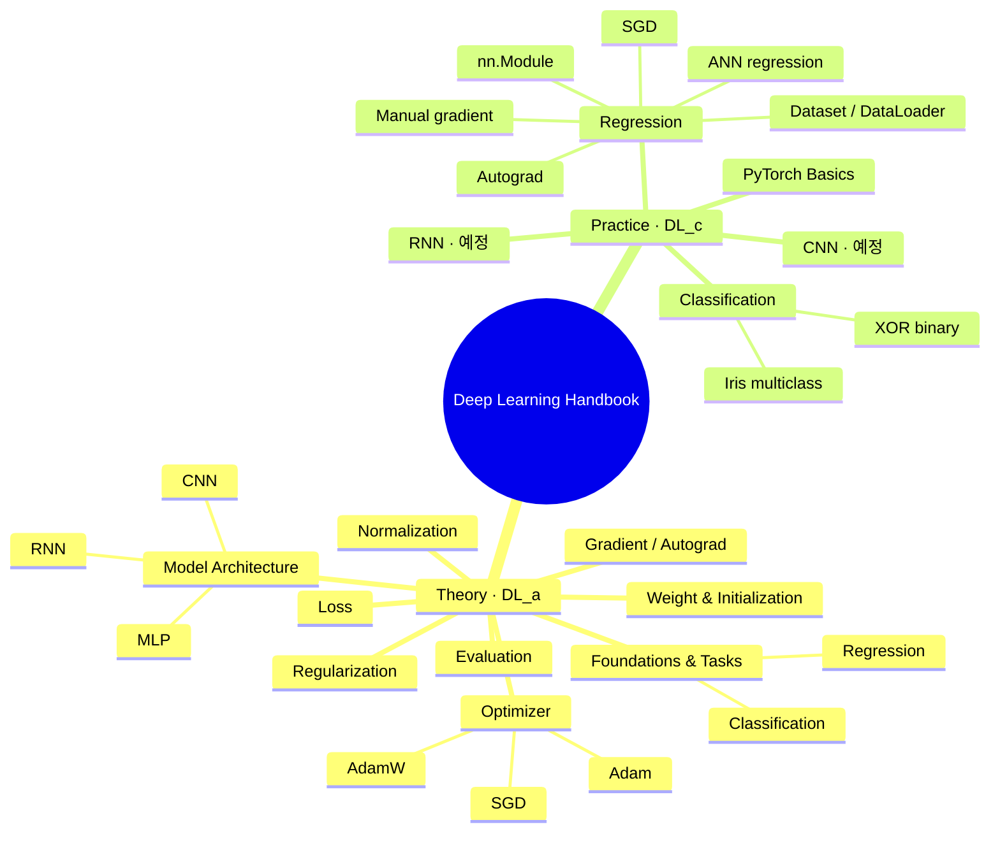

# Learning Roadmap

## 개념 지도

## 순서대로 읽기

1. [PyTorch Basics](practice/stages/basics.md)
2. [Regression · 수동 gradient](practice/stages/manual.md)
3. [Regression · Autograd](practice/stages/autograd.md)
4. [Regression · SGD](practice/stages/sgd.md)
5. [Regression · nn.Module](practice/stages/module.md)
6. [Regression · Dataset/DataLoader](practice/stages/data.md)
7. [Regression · ANN](practice/stages/ann.md)
8. [Classification · XOR](practice/stages/xor.md)
9. [Classification · Iris](practice/stages/iris.md)
10. [CNN · 예정](practice/stages/cnn.md)
11. [RNN · 예정](practice/stages/rnn.md)

scikit-learn 원문은 별도 입문 분류로 보존했습니다. 기술별 심화는 사이드바의 Weight·Optimizer·Normalization·Gradient에서 탐색하세요.
