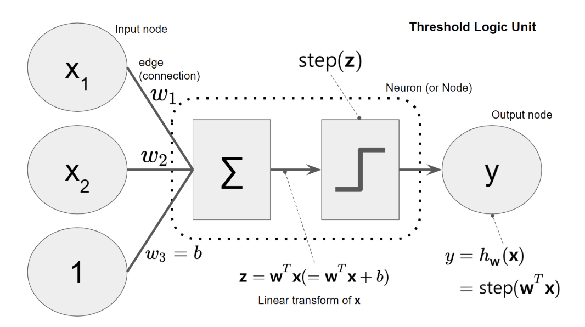

# TLU와 Perceptron의 기하학적 이해

원문: [TLU와 Perceptron의 기하학적 이해](https://velog.io/@haru02/TLU%EC%99%80-%ED%8D%BC%EC%85%89%ED%8A%B8%EB%A1%A0%EC%9D%98-%EA%B8%B0%ED%95%98%ED%95%99%EC%A0%81-%EC%9D%B4%ED%95%B4) · 수집: 2026-11-01 · 원문 보존 이관본

관련 실습: [scikit-learn으로 Perceptron 구현하기](../../practice/sklearn/c01.md)

[원본 목록·검증 범위](../../sources.md)

---



# TLU와 Perceptron의 기하학적 이해: Weight, Bias, Decision Boundary

TLU(Threshold Logic Unit)와 Perceptron을 수식으로 보면 단순히 입력값에 Weight를 곱하고 더한 뒤 Step Function을 적용하는 모델이다.

하지만 이를 **기하학적 관점**에서 바라보면 Perceptron이 실제로 무엇을 학습하는지 훨씬 직관적으로 이해할 수 있다.

Perceptron의 핵심 수식은 다음과 같다.

$$
z=\mathbf{w}^T\mathbf{x}+b
$$

그리고 Step Function을 적용하여

$$
\hat{y} = \begin{cases} 1 & z\ge0\\ 0 & z<0 \end{cases}
$$

으로 분류한다.

즉 Perceptron은 결국

> **입력 데이터가 특정 경계의 어느 쪽에 위치하는지를 판단하는 Binary Classifier**

라고 볼 수 있다.

---

# 1. TLU란?

TLU는 **Threshold Logic Unit**의 약자이다.

여러 입력값을 받아 각각 Weight를 곱한 후 모두 더하고, 그 결과가 특정 Threshold를 넘는지 판단하는 인공 뉴런이다.

구조는 다음과 같다.

```text
x1 ── w1 ─┐
x2 ── w2 ─┤
x3 ── w3 ─┤
           ↓
      Weighted Sum
           ↓
     + Bias
           ↓
    Step Function
           ↓
        0 or 1
```

수식으로는

$$
z = w_1x_1 + w_2x_2 + \cdots + w_nx_n + b
$$

이다.

벡터 표현을 사용하면

$$
\boxed{ z=\mathbf{w}^T\mathbf{x}+b }
$$

로 간단하게 표현할 수 있다.

---

# 2. Step Function

TLU에서는 계산한 $z$를 Step Function에 통과시킨다.

$$
\hat{y} = \begin{cases} 1 & z\ge0\\ 0 & z<0 \end{cases}
$$

즉,

```text
z < 0
→ OFF
→ Class 0

z ≥ 0
→ ON
→ Class 1
```

이다.

여기에서 중요한 것은 단순히 숫자가 양수인지 음수인지 판단하는 것처럼 보이지만, 기하학적으로는 **입력 데이터가 결정 경계의 어느 쪽에 존재하는지를 판단하는 과정**이라는 점이다.

---

# 3. Decision Boundary는 어디에서 생기는가?

두 Class가 바뀌는 기준은

$$
z=0
$$

인 지점이다.

따라서

$$
z=\mathbf{w}^T\mathbf{x}+b
$$

에서

$$
\boxed{ \mathbf{w}^T\mathbf{x}+b=0 }
$$

을 만족하는 점들의 집합이 Class를 나누는 경계가 된다.

이를 **Decision Boundary**라고 한다.

---

# 4. 입력이 2차원이라면

입력 Feature가 두 개라고 해보자.

$$
\mathbf{x} = \begin{bmatrix} x_1\\ x_2 \end{bmatrix}
$$

그러면 Decision Boundary는

$$
w_1x_1+w_2x_2+b=0
$$

이다.

이를 $x_2$에 대해 정리하면

$$
x_2 = -\frac{w_1}{w_2}x_1 - \frac{b}{w_2}
$$

가 된다.

이는 우리가 익숙하게 알고 있는 직선의 방정식

$$
y=mx+c
$$

와 같은 형태이다.

따라서 **입력이 2차원이라면 Perceptron의 Decision Boundary는 직선(Line)**이다.

---

# 5. 차원이 증가하면 어떻게 되는가?

입력 차원에 따라 Decision Boundary의 형태가 달라진다.

### 입력이 2개인 경우

$$
w_1x_1+w_2x_2+b=0
$$

→ 2차원 공간의 **직선(Line)**

### 입력이 3개인 경우

$$
w_1x_1+w_2x_2+w_3x_3+b=0
$$

→ 3차원 공간의 **평면(Plane)**

### 입력이 4개 이상인 경우

사람이 직접 시각화하기는 어렵지만 같은 개념이 계속 확장된다.

이를 일반적으로 **Hyperplane(초평면)**이라고 한다.

따라서

```text
2D → Line
3D → Plane
nD → Hyperplane
```

이라고 이해할 수 있다.

직선과 평면 역시 Hyperplane의 저차원 형태라고 볼 수 있다.

---

# 6. Hyperplane이 공간을 두 영역으로 나눈다

Decision Boundary는

$$
\mathbf{w}^T\mathbf{x}+b=0
$$

이다.

이 경계를 기준으로 공간은 두 영역으로 나뉜다.

한쪽 영역에서는

$$
\mathbf{w}^T\mathbf{x}+b>0
$$

이고,

반대쪽에서는

$$
\mathbf{w}^T\mathbf{x}+b<0
$$

이다.

```text
        z > 0
        Class 1

●   ●   ●   ●

----------------------  z = 0
     Decision Boundary

○   ○   ○   ○

        z < 0
        Class 0
```

Step Function은 이 부호를 보고 Class를 결정한다.

$$
z<0 \Rightarrow \hat{y}=0
$$

$$
z\ge0 \Rightarrow \hat{y}=1
$$

따라서 Perceptron의 Classification은 기하학적으로

> **Hyperplane을 하나 만든 뒤, 입력 데이터가 그 Hyperplane의 어느 쪽에 위치하는지 판단하는 과정**

이라고 볼 수 있다.

---

# 7. Weight의 기하학적 의미

Decision Boundary는

$$
\mathbf{w}^T\mathbf{x}+b=0
$$

이다.

여기서 Weight Vector

$$
\mathbf{w}
$$

는 단순히 각 Feature의 중요도만을 나타내는 것이 아니다.

기하학적으로 $\mathbf{w}$는 **Decision Boundary에 수직인 방향을 나타내는 벡터**이다.

즉 Weight Vector는 Hyperplane의 **Normal Vector(법선 벡터)**이다.

```text
             w
             ↑
             │
             │
-------------┼------------- Decision Boundary
```

따라서 Weight가 변하면 Decision Boundary의 방향도 변한다.

---

# 8. 2차원에서 Weight를 생각해보기

다음과 같은 Decision Boundary가 있다고 하자.

$$
w_1x_1+w_2x_2+b=0
$$

Weight Vector는

$$
\mathbf{w} = \begin{bmatrix} w_1\\ w_2 \end{bmatrix}
$$

이다.

이 벡터는 직선과 수직이다.

따라서 Training 과정에서

$$
w_1,\;w_2
$$

가 변경된다는 것은 기하학적으로 보면 **Decision Boundary의 방향이 조정되는 것**이라고 이해할 수 있다.

```text
Before Training

        /
       /
      /
     /


After Training

----------------
```

실제 변화는 데이터와 학습 결과에 따라 달라지지만, 핵심은 Weight가 경계의 방향을 결정한다는 것이다.

---

# 9. Bias의 기하학적 의미

이번에는 Bias $b$를 살펴보자.

Decision Boundary는

$$
\mathbf{w}^T\mathbf{x}+b=0
$$

이다.

Weight를 고정한 채 Bias만 변경하면 Hyperplane의 방향은 유지하면서 위치가 이동한다.

즉 Bias는 Decision Boundary를 **평행 이동**시키는 역할을 한다.

```text
b = b1

----------------------


b = b2

        ----------------------
```

따라서 기하학적으로

```text
Weight
→ Decision Boundary의 방향

Bias
→ Decision Boundary의 위치
```

라고 이해할 수 있다.

---

# 10. Weight와 Bias가 함께 하는 일

결국 Perceptron의 Parameter인

$$
\mathbf{w},b
$$

는 Decision Boundary를 결정한다.

Training을 통해 Weight와 Bias가 변경되면

```text
Weight 변화
→ 경계 방향 조정

Bias 변화
→ 경계 위치 조정
```

이 이루어진다.

따라서 Perceptron이 학습한다는 것을 기하학적으로 표현하면

> **데이터를 가장 잘 나눌 수 있도록 Hyperplane의 방향과 위치를 조정하는 과정**

이라고 볼 수 있다.

---

# 11. $z$의 부호는 무엇을 의미하는가?

Perceptron에서는

$$
z=\mathbf{w}^T\mathbf{x}+b
$$

를 계산한다.

이때 $z$의 부호는 입력 데이터가 Decision Boundary의 어느 쪽에 있는지를 나타낸다.

### $z>0$

$$
\mathbf{w}^T\mathbf{x}+b>0
$$

→ Weight Vector가 향하는 쪽의 영역

→ Class 1

### $z<0$

$$
\mathbf{w}^T\mathbf{x}+b<0
$$

→ 반대쪽 영역

→ Class 0

### $z=0$

$$
\mathbf{w}^T\mathbf{x}+b=0
$$

→ 정확히 Decision Boundary 위에 존재

이다.

따라서 단순히

```text
위쪽
아래쪽
```

이라고 생각하기보다는

```text
Hyperplane의 Positive Side
Hyperplane의 Negative Side
```

라고 이해하는 것이 더 정확하다.

Hyperplane은 고차원에서는 실제 의미의 위와 아래가 존재하지 않기 때문이다.

---

# 12. 간단한 예시

다음과 같은 Perceptron이 있다고 하자.

$$
z=x_1+x_2-1
$$

즉,

$$
w_1=1,\qquad w_2=1,\qquad b=-1
$$

이다.

Decision Boundary는

$$
x_1+x_2-1=0
$$

이므로

$$
x_2=-x_1+1
$$

이라는 직선이 된다.

---

## Point A

입력이

$$
(0,0)
$$

이라면

$$
z = 0+0-1 = -1
$$

이다.

따라서

$$
z<0
$$

이므로 Class 0으로 분류된다.

---

## Point B

입력이

$$
(1,1)
$$

이라면

$$
z = 1+1-1 = 1
$$

이다.

따라서

$$
z>0
$$

이므로 Class 1으로 분류된다.

즉 같은 식

$$
z=\mathbf{w}^T\mathbf{x}+b
$$

가 각 Point가 Decision Boundary의 어느 쪽에 위치하는지를 판단하고 있는 것이다.

---

# 13. Perceptron이 Linear Classifier인 이유

Perceptron의 Decision Boundary는 항상

$$
\mathbf{w}^T\mathbf{x}+b=0
$$

형태이다.

따라서

- 2차원에서는 직선
- 3차원에서는 평면
- 고차원에서는 Hyperplane

밖에 만들 수 없다.

즉 Decision Boundary 자체가 선형적인 형태로 제한되어 있다.

따라서 Perceptron을 **Linear Classifier**라고 부른다.

엄밀히 말하면 $b$가 포함된

$$
\mathbf{w}^T\mathbf{x}+b
$$

는 Affine Function이지만, 머신러닝에서는 이러한 모델을 일반적으로 Linear Classifier라고 부른다.

---

# 14. Linear Separability

어떤 데이터를 하나의 Hyperplane으로 완전히 분리할 수 있다면 그 데이터를 **Linearly Separable**하다고 한다.

예를 들어

```text
○ ○ ○ | ● ● ●
      |
      |
```

와 같이 하나의 직선으로 Class를 분리할 수 있다면 Single Perceptron으로 해결할 수 있다.

반면

```text
○       ●

●       ○
```

처럼 Class가 서로 교차되어 있다면 하나의 직선으로는 해결할 수 없다.

대표적인 예가 XOR이다.

---

# 15. XOR와 Perceptron의 한계

XOR의 데이터는 다음과 같다.

```text
(0,0) → 0
(0,1) → 1
(1,0) → 1
(1,1) → 0
```

좌표 공간에서는 같은 Class가 대각선에 위치한다.

```text
x2

1       ●           ○
        1           0


0       ○           ●
        0           1

        0           1        x1
```

이 네 개의 Point를 직선 하나로 완벽하게 나누는 것은 불가능하다.

따라서

$$
\boxed{ \text{Single Perceptron} \Rightarrow \text{Single Hyperplane} }
$$

이라는 구조 자체가 XOR 문제를 해결할 수 없는 원인이 된다.

XOR의 코드 실험과 MLP를 이용한 해결 과정은 별도의 글에서 자세히 확인할 수 있다.

---

# 16. MLP에서는 무엇이 달라지는가?

단일 Perceptron의 문제는 하나의 Hyperplane밖에 만들 수 없다는 것이다.

MLP에서는 여러 개의 Hidden Neuron을 사용한다.

각 Hidden Neuron 역시 각각

$$
\mathbf{w}_i^T\mathbf{x}+b_i
$$

와 같은 계산을 수행한다.

따라서 여러 개의 중간 경계를 만들 수 있다.

```text
Hyperplane 1
        \
         \

Hyperplane 2
----------------

Hyperplane 3
         /
        /
```

여기에 ReLU와 같은 Non-linear Activation Function을 결합하면 이러한 중간 표현들을 단순한 하나의 Hyperplane으로 합쳐버리지 않고 복잡하게 조합할 수 있다.

그 결과 MLP는 단일 Perceptron보다 훨씬 복잡한 Decision Boundary를 표현할 수 있다.

---

# 17. 공간 변환의 관점

Perceptron과 MLP의 차이를 또 다른 관점으로 볼 수도 있다.

### Single Perceptron

```text
Input Space
     ↓
Single Linear Boundary
     ↓
Classification
```

### MLP

```text
Input Space
     ↓
Linear Transformation
     ↓
Non-linear Activation
     ↓
New Representation
     ↓
Linear Transformation
     ↓
Classification
```

즉 MLP는 원본 공간에서 억지로 복잡한 데이터를 직선 하나로 나누려고 하는 것이 아니라, 데이터를 여러 Layer를 통해 **분류하기 쉬운 Representation으로 변환**할 수 있다.

---

# 18. 수식과 기하학을 연결하면

Perceptron의 가장 중요한 식은

$$
\boxed{ z=\mathbf{w}^T\mathbf{x}+b }
$$

이다.

이 식은 여러 관점에서 동시에 해석할 수 있다.

| 수식 요소 | 계산적 의미 | 기하학적 의미 |
| --- | --- | --- |
| $\mathbf{x}$ | Input Feature | 공간상의 Data Point |
| $\mathbf{w}$ | Weight | Hyperplane의 Normal Vector |
| $b$ | Bias | Hyperplane의 위치 조정 |
| $\mathbf{w}^T\mathbf{x}+b$ | Weighted Sum | Hyperplane의 어느 쪽에 있는지 나타내는 Score |
| $z=0$ | Threshold | Decision Boundary |
| $z>0$ | Positive Output 영역 | Hyperplane의 Positive Side |
| $z<0$ | Negative Output 영역 | Hyperplane의 Negative Side |
| Step Function | 0/1 출력 | 두 영역을 두 Class로 Mapping |

---

# 19. Training을 기하학적으로 바라보기

Perceptron의 Training에서는 데이터를 더 잘 분류하도록 Weight와 Bias를 수정한다.

수식적으로는 Parameter Update이지만, 기하학적으로 보면

```text
잘못된 Decision Boundary

      /
  ○  / ●
    /       ●
 ○ /


        ↓ Training


더 나은 Decision Boundary

○ ○  |  ● ●
     |
```

와 같이 경계를 이동시키고 회전시키는 과정으로 이해할 수 있다.

즉

$$
\boxed{ \text{Training} = \text{Decision Boundary를 데이터에 맞게 조정하는 과정} }
$$

이라는 직관을 얻을 수 있다.

---

# 핵심 정리

| 개념 | 기하학적 의미 |
| --- | --- |
| TLU | Threshold를 기준으로 두 Class를 구분하는 인공 뉴런 |
| $\mathbf{x}$ | 공간상의 입력 Data Point |
| $\mathbf{w}$ | Decision Boundary에 수직인 Normal Vector |
| $b$ | Decision Boundary의 위치를 조절 |
| $\mathbf{w}^T\mathbf{x}+b=0$ | Decision Boundary |
| 2D | Line |
| 3D | Plane |
| nD | Hyperplane |
| $z>0$ | Hyperplane의 한쪽 영역 |
| $z<0$ | Hyperplane의 반대쪽 영역 |
| Step Function | 두 영역을 0과 1로 변환 |
| Linear Classifier | 하나의 Hyperplane을 이용하는 분류 모델 |
| Linear Separability | 하나의 Hyperplane으로 Class를 분리할 수 있는 성질 |
| XOR | 하나의 Hyperplane으로 분리할 수 없는 대표적인 문제 |
| Perceptron Training | Weight와 Bias를 수정하여 Hyperplane의 방향과 위치를 조절 |

---

# 한 문장으로 정리

TLU와 Perceptron은

$$
\mathbf{w}^T\mathbf{x}+b=0
$$

이라는 **Hyperplane을 Decision Boundary로 사용하여 입력 공간을 두 영역으로 나누는 Linear Binary Classifier**이며, Weight는 경계의 방향을, Bias는 경계의 위치를 결정한다.
