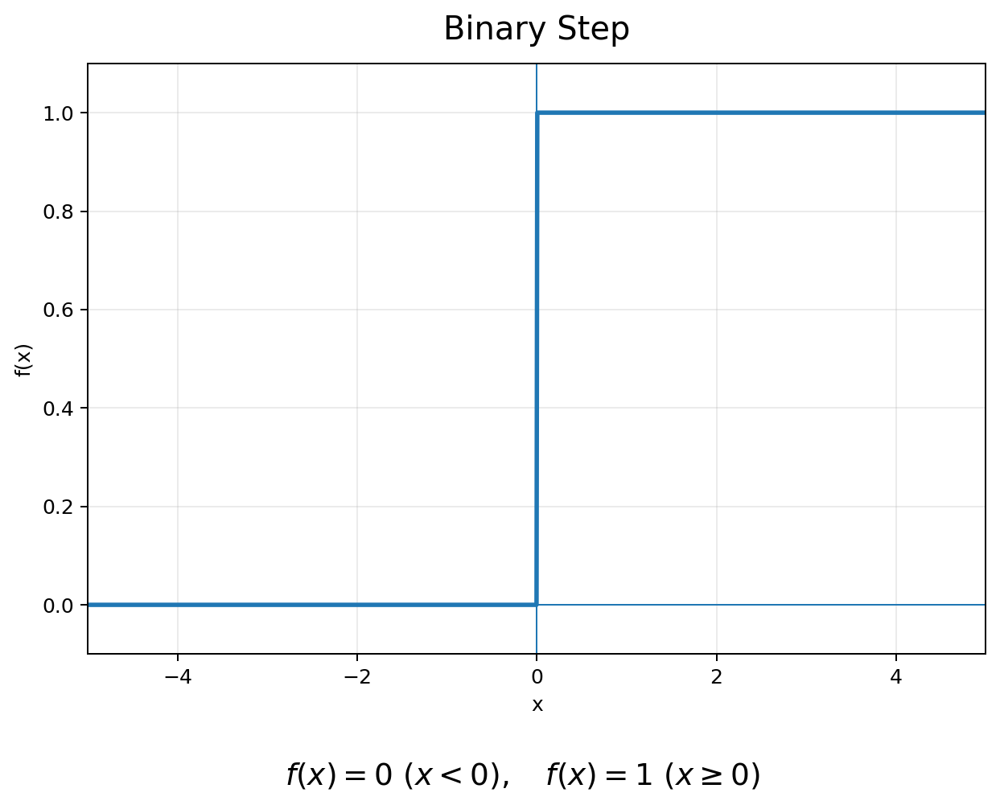
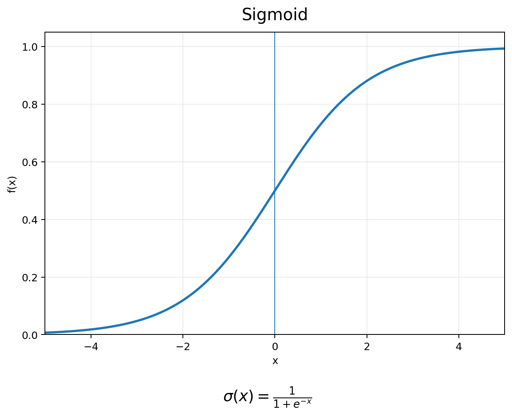
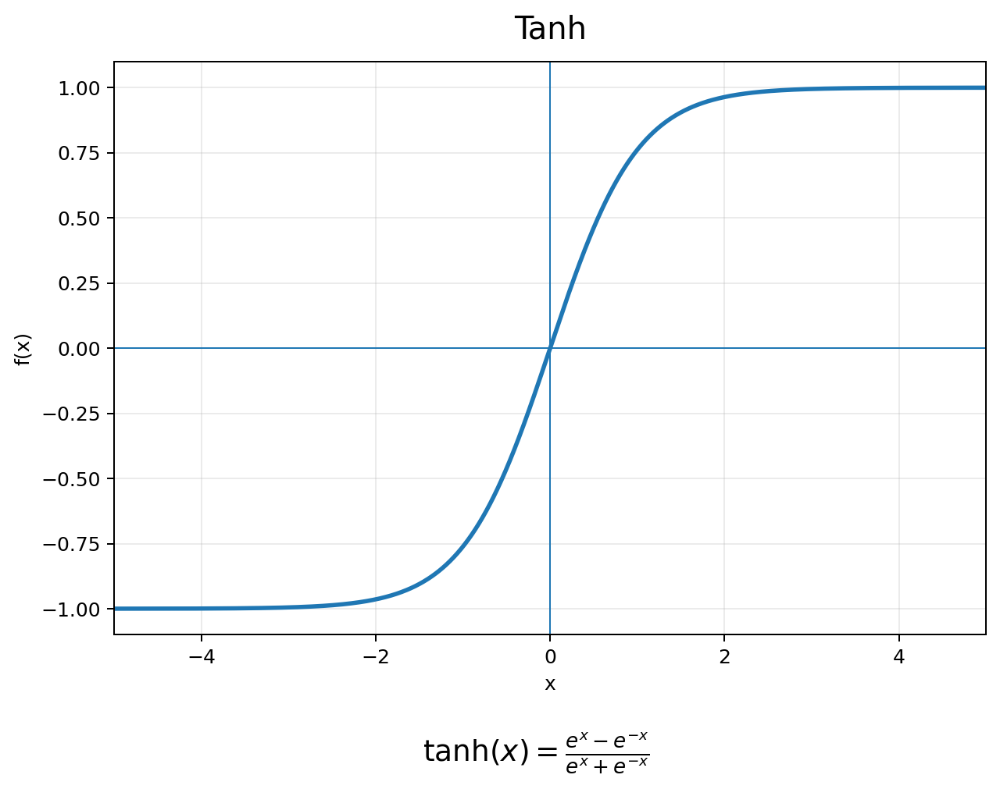
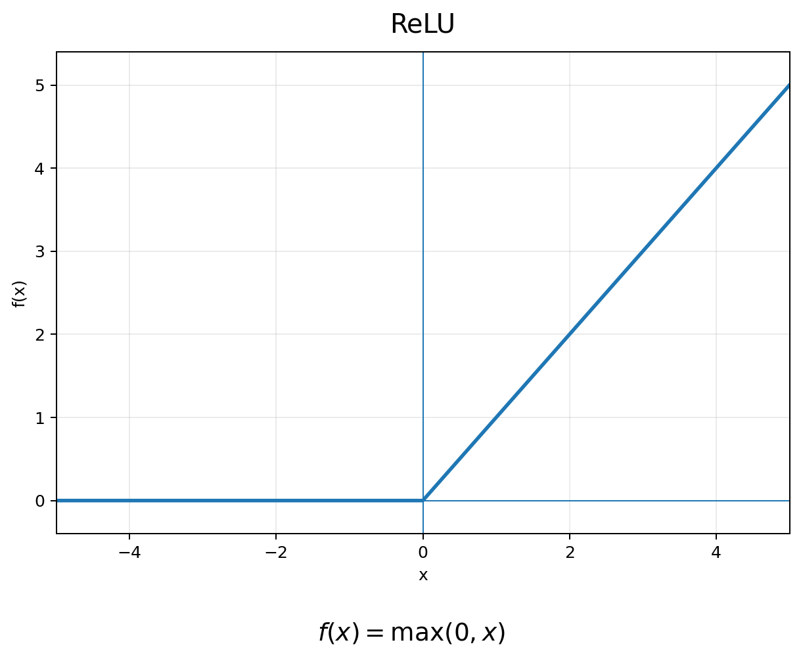
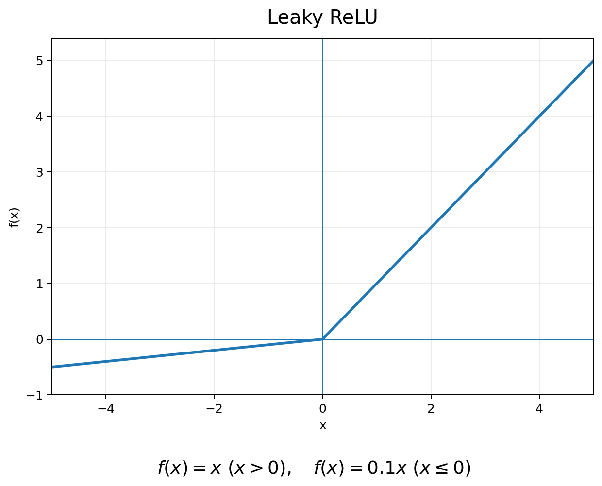
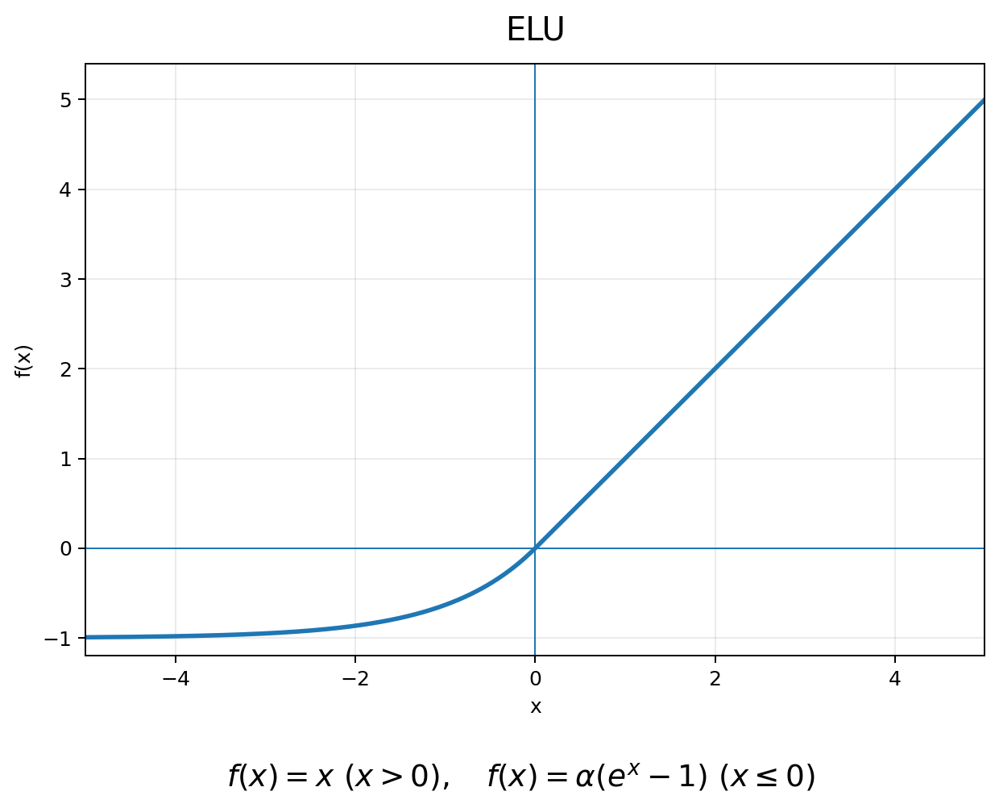
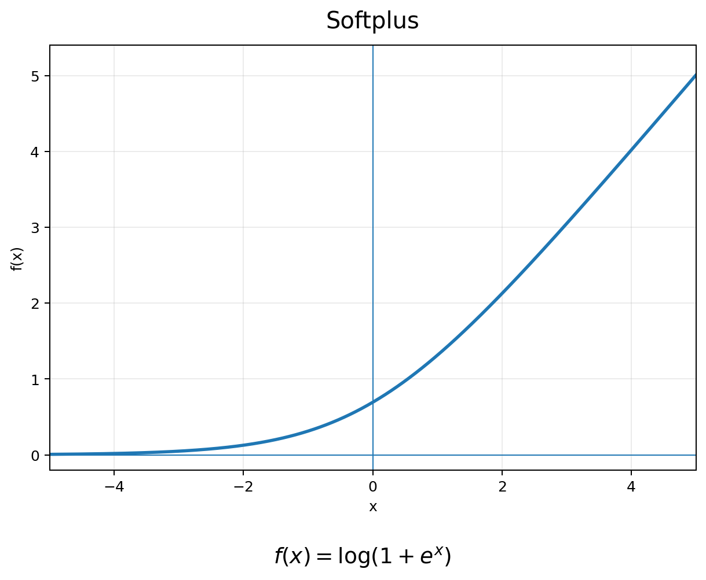
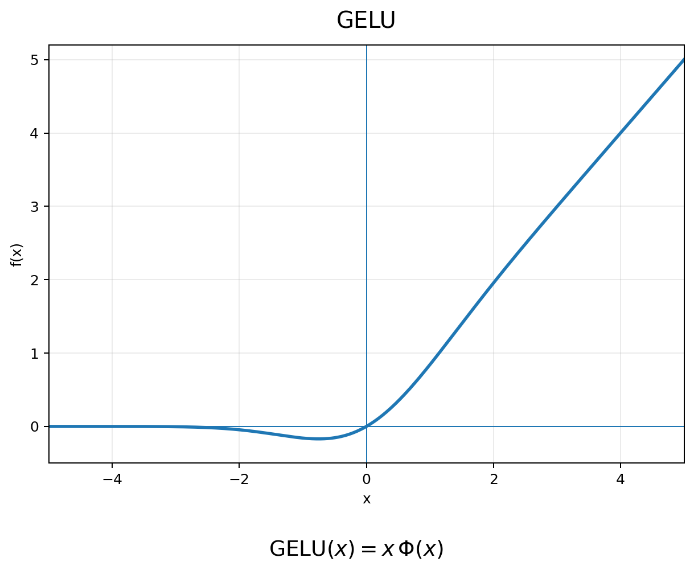
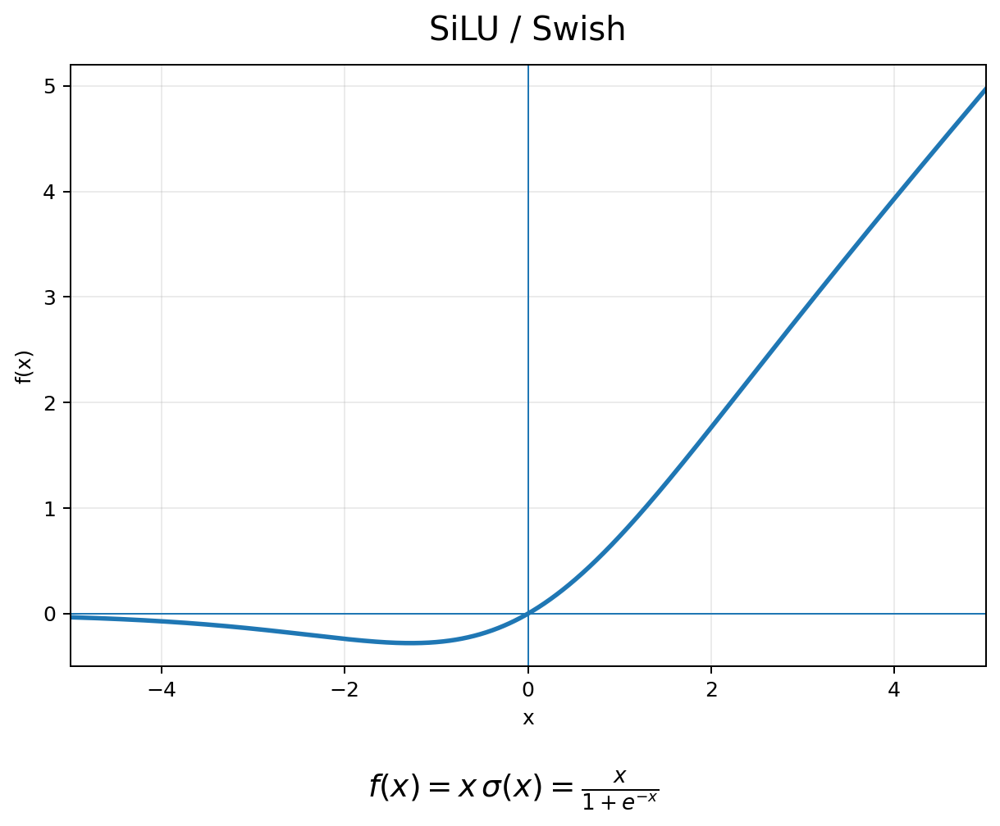

# Activation Function

원문: [Activation Function](https://velog.io/@haru02/Part-5.-Activation-Function) · 수집: 2026-11-01 · 원문 보존 이관본

관련 실습: [scikit-learn MLPClassifier 이해하기](../../practice/sklearn/c02.md) · [PyTorch로 MLP 직접 구현하기](../../practice/classification/c07.md) · [PyTorch 가중치 초기화 완전 정리: Xavier·He·LeCun Initialization과 Gradient 문제](../../practice/tech-weight/c12.md) · [PyTorch Batch Normalization 완전 정리: 동작 원리부터 Running Statistics와 학습·추론까지](../../practice/tech-normalization/c13.md)

[원본 목록·검증 범위](../../sources.md)

---

# Activation Function 정리: Step에서 ReLU, GELU까지

인공 뉴런의 기본 연산은 다음 두 단계로 표현할 수 있다.

$$
z=\mathbf{w}^T\mathbf{x}+b
$$

그리고 계산된 $z$에 **활성화 함수(Activation Function)** 를 적용한다.

$$
a=f(z)
$$

전체적인 흐름은 다음과 같다.

```text
Input
  ↓
Weighted Sum
  ↓
z = Wx + b
  ↓
Activation Function
  ↓
Output
```

즉 Activation Function은 뉴런에서 계산된 값을 **다음 Layer로 어떤 형태로 전달할지 결정하는 함수**이다.

그런데 Activation Function은 단순히 출력값의 모양을 바꾸기 위해 사용하는 것이 아니다.

딥러닝에서 훨씬 중요한 역할은 **Non-linearity를 추가하는 것**이다.

---

# 1. 왜 Activation Function이 필요한가?

Activation Function이 없는 Neural Network를 생각해보자.

첫 번째 Layer가

$$
\mathbf{h}=W_1\mathbf{x}+b_1
$$

이고 두 번째 Layer가

$$
\mathbf{y}=W_2\mathbf{h}+b_2
$$

라면,

$$
\mathbf{y} = W_2(W_1\mathbf{x}+b_1)+b_2
$$

이고 이를 다시 정리하면

$$
\mathbf{y}=W\mathbf{x}+b
$$

형태가 된다.

즉

```text
Linear
  ↓
Linear
  ↓
Linear
  ↓
Linear
```

처럼 Layer를 아무리 많이 쌓더라도 결국

```text
하나의 Linear Function
```

과 본질적으로 다르지 않다.

따라서 Neural Network가 복잡한 패턴이나 비선형적인 Decision Boundary를 학습하기 위해서는 Layer 사이에 **Non-linear Activation Function**이 필요하다.

```text
Linear Transformation
        ↓
Non-linear Activation
        ↓
Linear Transformation
        ↓
Non-linear Activation
```

Activation Function의 가장 중요한 역할은 바로 이 **비선형성(Non-linearity)** 을 만드는 것이다.

---

# 2. Step Function

초기의 Perceptron에서는 Activation Function으로 **Step Function**을 사용했다.



### 함수식

$$
f(z)= \begin{cases} 1, & z\geq0 \\ 0, & z<0 \end{cases}
$$

즉 특정 Threshold를 기준으로

- 기준 이상이면 `1`
- 기준 미만이면 `0`

을 출력한다.

개념적으로는 다음과 같다.

```text
        1 ─────────────
          |
          |
        0 ─────────────
                  0
```

값이 특정 지점에서 갑자기 변화하기 때문에 **Step Function**이라고 부른다.

---

## Step Function과 Perceptron

Perceptron은 먼저

$$
z=\mathbf{w}^T\mathbf{x}+b
$$

를 계산한 다음 Step Function을 적용한다.

$$
\hat{y} = \operatorname{step} (\mathbf{w}^T\mathbf{x}+b)
$$

출력은 기본적으로 두 상태 중 하나이다.

```text
OFF → 0
ON  → 1
```

따라서 Step Function은 초기의 **Binary Classification**과 자연스럽게 연결된다.

---

# 3. Step Function의 문제

현대의 Neural Network에서는 **Backpropagation**을 이용해 Weight와 Bias를 학습한다.

Backpropagation에서는 각 Parameter에 대한 Loss의 Gradient를 계산해야 한다.

그런데 Step Function은 $z=0$을 제외한 대부분의 영역에서 평평하다.

따라서

$$
\frac{df}{dz}=0
$$

이다.

또한 $z=0$에서는 함수가 불연속적이기 때문에 일반적인 의미에서 미분할 수 없다.

즉

```text
Step Function
      ↓
Gradient ≈ 0
      ↓
Gradient Descent를 이용한 학습에 부적합
```

이라는 문제가 있다.

이 때문에 다층 Neural Network에서는 Step Function 대신 **Gradient 기반 학습에 적합한 Activation Function**들이 사용되기 시작했다.

---

# 4. Sigmoid Function

대표적인 함수가 **Sigmoid Function**이다.



### 함수식

$$
\sigma(z) = \frac{1}{1+e^{-z}}
$$

그래프는 S자 형태를 가진다.

Sigmoid의 출력 범위는

$$
0<\sigma(z)<1
$$

이다.

그리고

$$
\sigma(0)=0.5
$$

이다.

즉

```text
매우 큰 음수
      ↓
0에 가까움

z = 0
      ↓
0.5

매우 큰 양수
      ↓
1에 가까움
```

이라는 형태로 동작한다.

---

# 5. Sigmoid와 확률

Sigmoid는 출력이 `0~1` 사이에 있기 때문에 **확률처럼 해석해야 하는 출력**에서 유용하다.

대표적인 예가 Logistic Regression이다.

$$
P(y=1|\mathbf{x}) = \sigma(\mathbf{w}^T\mathbf{x}+b)
$$

예를 들어 출력이

$$
0.9
$$

라면 특정 Class에 속할 확률을 0.9 정도로 해석할 수 있다.

따라서 Sigmoid는 현대 Neural Network에서도 완전히 사라진 함수가 아니다.

특히 **Binary Classification의 Output Layer**에서 여전히 자주 사용된다.

---

# 6. Sigmoid의 미분

Sigmoid의 미분은 다음과 같이 표현된다.

$$
\sigma'(x) = \sigma(x)(1-\sigma(x))
$$

이 식에서 중요한 특징을 확인할 수 있다.

$x$가 매우 큰 양수라면

$$
\sigma(x)\approx1
$$

이므로

$$
1-\sigma(x)\approx0
$$

가 된다.

반대로 매우 큰 음수라면

$$
\sigma(x)\approx0
$$

이다.

결국 두 경우 모두

$$
\sigma'(x)\approx0
$$

이 된다.

그래프의 양쪽 끝이 평평한 이유도 이 때문이다.

---

# 7. Vanishing Gradient Problem

Deep Neural Network에서 Backpropagation을 수행하면 Chain Rule에 의해 여러 Layer의 미분값이 계속 곱해진다.

예를 들어 작은 값이 반복해서 곱해진다면

$$
0.1 \times 0.1 \times 0.1 \times 0.1 = 0.0001
$$

처럼 값이 매우 작아질 수 있다.

이를 Neural Network에 적용하면

```text
Output Layer
     ↓
Gradient
     ↓
Hidden Layer
     ↓
Gradient
     ↓
Hidden Layer
     ↓
Gradient
     ↓
Input 쪽 Layer
```

로 전달되는 과정에서 Gradient가 점점 작아질 수 있다.

이를 **Vanishing Gradient Problem**이라고 한다.

결과적으로 앞쪽 Layer의 Weight가 거의 업데이트되지 않으면서 Deep Network의 학습이 어려워질 수 있다.

---

# 8. Tanh

Sigmoid와 비슷한 형태의 Activation Function으로 **Tanh**가 있다.



### 함수식

$$
\tanh(x) = \frac{e^x-e^{-x}} {e^x+e^{-x}}
$$

출력 범위는

$$
-1<\tanh(x)<1
$$

이다.

Sigmoid와 비교하면 다음과 같다.

```text
Sigmoid
0 ~ 1

Tanh
-1 ~ 1
```

또한

$$
\tanh(0)=0
$$

이기 때문에 출력이 0을 중심으로 형성된다는 특징이 있다.

하지만 입력의 절댓값이 커지면 Tanh 역시 그래프가 평평해진다.

따라서 Tanh도 **Vanishing Gradient Problem**에서 자유롭지 않다.

---

# 9. ReLU

Deep Learning에서 매우 중요한 Activation Function이 **ReLU(Rectified Linear Unit)** 이다.



### 함수식

$$
f(x)=\max(0,x)
$$

Piecewise Function으로 표현하면

$$
f(x)= \begin{cases} 0, & x\leq0 \\ x, & x>0 \end{cases}
$$

이다.

즉

```text
Negative Input
      ↓
      0

Positive Input
      ↓
 그대로 전달
```

한다.

전자회로의 **Half-wave Rectifier**와 비슷한 형태로 생각할 수도 있다.

---

# 10. ReLU의 장점

## 계산이 단순하다

Sigmoid는

$$
e^{-x}
$$

와 같은 지수 연산이 필요하다.

반면 ReLU는 단순히

$$
\max(0,x)
$$

만 계산하면 된다.

따라서 계산 구조가 매우 단순하다.

---

## 양수 영역의 Gradient

ReLU의 미분은

$$
f'(x)= \begin{cases} 0, & x<0 \\ 1, & x>0 \end{cases}
$$

로 생각할 수 있다.

특히 양수 영역에서는

$$
f'(x)=1
$$

이다.

Sigmoid처럼 양수 값이 커졌다고 Gradient가 계속 작아지지 않는다.

따라서 깊은 Neural Network에서 Gradient가 전달되는 측면에서 유리한 특성을 가진다.

---

# 11. AlexNet과 ReLU

ReLU가 Deep Learning 역사에서 크게 주목받은 사례 중 하나가 **AlexNet**이다.

2012년 AlexNet에서는 기존의 Sigmoid나 Tanh 계열 Activation 대신 ReLU를 사용하였다.

ReLU의

- 단순한 계산 구조
- 양수 영역에서 Gradient가 줄어들지 않는 특성

등은 Deep CNN을 효율적으로 학습하는 데 중요한 요소가 되었다.

AlexNet에서는 ReLU와 함께 **Dropout**도 사용되었다.

---

# 12. Dropout

Dropout은 Activation Function은 아니지만 Deep Learning의 기본 개념에서 함께 알아둘 만한 Regularization 기법이다.

학습 중 일부 뉴런의 출력을 무작위로 비활성화한다.

예를 들어

```text
Original Network

● ● ● ● ● ●

Dropout 적용

● X ● X ● ●
```

처럼 일부 뉴런을 학습 과정에서 임시로 제거한다.

이렇게 하면 특정 뉴런이나 특정 경로에 지나치게 의존하는 것을 줄일 수 있다.

따라서 **Overfitting을 완화하기 위한 Regularization 방법**으로 사용할 수 있다.

Activation Function과 Dropout은 서로 다른 개념이다.

```text
Activation Function
→ Non-linearity

Dropout
→ Regularization
```

이라는 차이를 기억하면 된다.

---

# 13. ReLU의 문제: Dying ReLU

ReLU에도 단점은 존재한다.

음수 영역에서는

$$
f(x)=0
$$

이고

$$
f'(x)=0
$$

이다.

따라서 어떤 뉴런의 입력이 계속 음수 영역에만 위치하게 되면

```text
Input < 0
   ↓
Output = 0
   ↓
Gradient = 0
   ↓
Weight Update 어려움
```

이라는 문제가 생길 수 있다.

해당 뉴런이 사실상 학습 과정에 참여하지 못하는 상태가 되는 것이다.

이를 **Dying ReLU Problem**이라고 한다.

---

# 14. Leaky ReLU

Dying ReLU 문제를 완화하기 위한 방법 중 하나가 **Leaky ReLU**이다.



### 함수식

$$
f(x)= \begin{cases} x, & x>0 \\ \alpha x, & x\leq0 \end{cases}
$$

여기서 $\alpha$는 작은 양수이다.

예를 들어

$$
\alpha=0.1
$$

이라면 음수 입력에 대해서도

$$
f(x)=0.1x
$$

를 출력한다.

ReLU와 비교하면

```text
ReLU

Negative Region
Gradient = 0
```

이지만

```text
Leaky ReLU

Negative Region
Gradient = α
```

이다.

따라서 음수 영역에서도 Gradient가 완전히 사라지지 않는다.

---

# 15. PReLU와 RReLU

Leaky ReLU는 음수 입력에 대해서도 작은 기울기를 유지하여 Dying ReLU 문제를 완화한다.

기본적인 함수식은 다음과 같다.

$$
f(x)= \begin{cases} x, & x\geq0\\ \alpha x, & x<0 \end{cases}
$$

일반적인 Leaky ReLU에서는 음수 영역의 기울기 $\alpha$를 고정된 Hyperparameter로 설정한다.

하지만 어떤 $\alpha$가 적절한지는 Dataset과 Neural Network의 구조에 따라 달라질 수 있다.

이를 개선하기 위한 변형으로 **PReLU(Parametric ReLU)** 와 **RReLU(Randomized Leaky ReLU)** 가 제안되었다.

---

## 15.1 Parametric ReLU (PReLU)

**PReLU(Parametric Rectified Linear Unit)** 는 Leaky ReLU의 음수 영역 기울기 $\alpha$를 학습 가능한 Parameter로 설정한 Activation Function이다.

- 발표: 2015년
- 핵심 특징: 음수 영역의 기울기를 Gradient Descent를 통해 학습

### 함수식

$$
\boxed{ \operatorname{PReLU}(x)= \begin{cases} x, & x\geq0\\ \alpha x, & x<0 \end{cases} }
$$

일반적인 Leaky ReLU와 수학적인 형태는 같지만 $\alpha$를 결정하는 방식이 다르다.

```text
Leaky ReLU
    │
    ▼
α = Fixed Hyperparameter


PReLU
    │
    ▼
α = Learnable Parameter
```

따라서 PReLU에서는 $\alpha$도 Weight나 Bias와 마찬가지로 Backpropagation을 통해 갱신된다.

$$
\boxed{ \alpha_{t+1} = \alpha_t - \eta \frac{\partial L}{\partial\alpha_t} }
$$

여기서

- $\alpha_t$: 현재 음수 영역 기울기
- $\eta$: Learning Rate
- $L$: Loss Function

이다.

### PReLU의 미분

입력 $x$에 대한 미분은 다음과 같다.

$$
\frac{\partial f}{\partial x} = \begin{cases} 1, & x>0\\ \alpha, & x<0 \end{cases}
$$

또한 학습 가능한 Parameter인 $\alpha$에 대한 미분은

$$
\boxed{ \frac{\partial f}{\partial\alpha} = \begin{cases} 0, & x\geq0\\ x, & x<0 \end{cases} }
$$

이다.

따라서 음수 영역의 입력을 통해 $\alpha$에 대한 Gradient가 계산된다.

**장점**

- 데이터에 맞게 음수 영역의 기울기를 학습할 수 있다.
- 고정된 Leaky ReLU보다 유연한 Activation Function을 구성할 수 있다.
- Dying ReLU 문제를 완화하는 데 도움이 될 수 있다.

**한계**

- Learnable Parameter가 추가된다.
- 데이터가 적은 경우 Overfitting 가능성을 고려해야 한다.
- 일반적인 Leaky ReLU보다 항상 좋은 성능을 보장하지는 않는다.

### PyTorch 구현

```python
import torch
import torch.nn as nn

prelu = nn.PReLU()

x = torch.tensor([
    -2.0, -1.0, 0.0, 1.0, 2.0
])

y = prelu(x)

print(y)
print(prelu.weight)
```

PyTorch에서 PReLU의 기본 $\alpha$ 초기값은 `0.25`이다.

또한 다음과 같이 설정할 수 있다.

```python
# 하나의 Alpha를 공유
nn.PReLU(num_parameters=1)

# Channel마다 별도의 Alpha 사용
nn.PReLU(num_parameters=16)
```

여기서 `prelu.weight`는 학습 가능한 $\alpha$에 해당한다.

---

## 15.2 Randomized Leaky ReLU (RReLU)

**RReLU(Randomized Leaky ReLU)** 는 음수 영역의 기울기 $\alpha$를 일정한 범위에서 무작위로 선택하는 Activation Function이다.

- 발표: 2015년
- 핵심 특징: 음수 영역의 기울기에 Randomness를 추가
- 주요 목적: Regularization 효과

### 함수식

$$
\boxed{ \operatorname{RReLU}(x)= \begin{cases} x, & x\geq0\\ \alpha x, & x<0 \end{cases} }
$$

여기서 $\alpha$는 Training 과정에서 다음 균등분포로부터 추출된다.

$$
\boxed{ \alpha\sim U(l,u) }
$$

- $l$: Lower Bound
- $u$: Upper Bound

예를 들어

$$
\alpha\sim U(0.1,0.3)
$$

이라면 음수 입력에 적용되는 기울기가 0.1과 0.3 사이에서 무작위로 결정된다.

따라서 동일한 입력이라도 Training 과정에서 서로 다른 출력이 발생할 수 있다.

### Training과 Inference의 차이

RReLU는 Training과 Inference에서 서로 다르게 동작한다.

**Training**

$$
\boxed{ \alpha\sim U(l,u) }
$$

무작위로 선택한 기울기를 적용한다.

**Inference**

$$
\boxed{ \alpha=\frac{l+u}{2} }
$$

설정한 균등분포의 평균을 사용한다.

예를 들어

$$
l=0.1,\quad u=0.3
$$

이라면

$$
\boxed{ \alpha_{\mathrm{eval}}=0.2 }
$$

이다.

즉

```text
Training
    │
    ▼
Random Alpha
    │
    ▼
Randomized Activation


Inference
    │
    ▼
Fixed Alpha
    │
    ▼
Deterministic Activation
```

의 차이가 존재한다.

### RReLU와 Regularization

Training 중 무작위로 기울기를 선택하면 신경망이 특정한 Activation 형태에 지나치게 의존하는 것을 줄이는 데 도움이 될 수 있다.

따라서 RReLU는 일종의 Regularization 효과를 가진다.

다만 Training Dataset이 적다고 해서 RReLU가 반드시 PReLU보다 좋은 것은 아니다.

실제 성능은 Validation Set을 이용하여 비교해야 한다.

### PyTorch 구현

```python
import torch
import torch.nn as nn

rrelu = nn.RReLU(
    lower=0.1,
    upper=0.3
)

x = torch.tensor([
    -2.0, -1.0, 0.0, 1.0, 2.0
])

# Training
rrelu.train()

print(rrelu(x))

# Inference
rrelu.eval()

print(rrelu(x))
```

Inference에서는 $\alpha=0.2$를 사용하므로 결과는 다음과 같다.

```text
tensor([-0.4000, -0.2000, 0.0000, 1.0000, 2.0000])
```

### Leaky ReLU, PReLU, RReLU 비교

| Function | 음수 영역의 기울기 | 핵심 특징 |
| --- | --- | --- |
| Leaky ReLU | Fixed $\alpha$ | 단순한 Dying ReLU 완화 |
| PReLU | Learnable $\alpha$ | 기울기를 데이터로 학습 |
| RReLU | Randomized $\alpha$ | Regularization 효과 |

핵심은 다음과 같다.

$$
\boxed{ \begin{aligned} \text{Leaky ReLU}&:\text{Fixed }\alpha\\ \text{PReLU}&:\text{Learnable }\alpha\\ \text{RReLU}&:\text{Randomized }\alpha \end{aligned} }
$$

---

# 16. ELU (Exponential Linear Unit)

**ELU(Exponential Linear Unit)** 는 ReLU의 양수 영역 특성을 유지하면서 음수 영역을 Exponential Function으로 구성한 Activation Function이다.

- 발표: 2015년
- 주요 특징: 음수 영역의 포화 특성과 부드러운 곡선



### 함수식

$$
\boxed{ \operatorname{ELU}(x)= \begin{cases} x, & x\geq0\\ \alpha(e^x-1), & x<0 \end{cases} }
$$

여기서 $\alpha>0$은 음수 영역의 형태를 조절하는 Hyperparameter이다.

### 양수 영역

$$
x\geq0\Rightarrow f(x)=x
$$

따라서 ReLU와 동일하게 동작한다.

### 음수 영역

$$
x<0\Rightarrow f(x)=\alpha(e^x-1)
$$

음수 영역에서는 Exponential Function을 이용하여 부드럽게 변화한다.

특히

$$
\lim_{x\to-\infty}e^x=0
$$

이므로

$$
\boxed{ \lim_{x\to-\infty}\operatorname{ELU}(x) = -\alpha }
$$

이다.

즉 ELU의 출력은 음수 방향으로 무한히 감소하지 않고 $-\alpha$에 가까워진다.

---

## 16.1 ELU의 미분

ELU를 미분하면 다음과 같다.

$$
\boxed{ \frac{d}{dx}\operatorname{ELU}(x)= \begin{cases} 1, & x>0\\ \alpha e^x, & x<0 \end{cases} }
$$

음수 영역에서는

$$
\alpha e^x = \operatorname{ELU}(x)+\alpha
$$

이므로 다음과 같이 표현할 수도 있다.

$$
\boxed{ \operatorname{ELU}'(x)= \begin{cases} 1, & x>0\\ \operatorname{ELU}(x)+\alpha, & x<0 \end{cases} }
$$

여기서 중요한 특징이 있다.

음수 영역에서도

$$
\alpha e^x>0
$$

이므로 Gradient가 완전히 0이 되지 않는다.

다만 $x$가 매우 작은 음수라면

$$
\alpha e^x\rightarrow0
$$

이므로 Gradient가 매우 작아질 수 있다.

따라서 ELU도 모든 Vanishing Gradient 문제에서 자유로운 것은 아니다.

---

## 16.2 ELU는 항상 Smooth할까?

ELU는 $x=0$에서 연속이다.

하지만 미분 가능 여부는 $\alpha$에 따라 달라진다.

왼쪽에서 접근할 때의 기울기는

$$
f'(0^-)=\alpha
$$

이고 오른쪽에서 접근할 때는

$$
f'(0^+)=1
$$

이다.

따라서

$$
\boxed{ \alpha=1 }
$$

인 경우에 두 기울기가 같아진다.

즉 **ELU는 $\alpha=1$일 때 $x=0$에서도 미분 가능하다.**

$\alpha\neq1$이라면 $x=0$에서 미분계수가 일치하지 않는다.

---

## 16.3 ELU의 장단점

**장점**

- 음수 영역에서도 0이 아닌 출력을 제공한다.
- 음수 출력으로 Activation의 평균을 0에 가깝게 만드는 데 도움이 될 수 있다.
- 음수 영역에서 Exponential Function을 이용한 부드러운 변화를 가진다.

**단점**

- ReLU보다 계산이 복잡하다.
- 음수 입력의 절댓값이 커지면 Gradient가 작아질 수 있다.
- 지수 연산이 필요하여 연산 비용이 증가할 수 있다.

### PyTorch 구현

```python
import torch.nn as nn

elu = nn.ELU(alpha=1.0)
```

---

# 17. SELU (Scaled Exponential Linear Unit)

**SELU(Scaled Exponential Linear Unit)** 는 ELU를 확장하여 Self-Normalizing 특성을 유도하도록 설계된 Activation Function이다.

- 발표: 2017년
- 관련 연구: Self-Normalizing Neural Networks
- 핵심 특징: 적절한 조건에서 Activation의 평균과 분산을 안정적인 값으로 유도

### 함수식

$$
\boxed{ \operatorname{SELU}(x) = \lambda \begin{cases} x, & x>0\\ \alpha(e^x-1), & x\leq0 \end{cases} }
$$

여기서 대표적인 상수값은 다음과 같다.

$$
\boxed{ \alpha\approx1.6733 }
$$

$$
\boxed{ \lambda\approx1.0507 }
$$

따라서 SELU는 특정 $\alpha$와 $\lambda$를 사용하도록 설계된 Scaled ELU이다.

---

## 17.1 Self-Normalizing이란?

Self-Normalizing은 여러 Layer를 통과하는 과정에서 Activation의 평균과 분산이 특정한 안정적인 값으로 수렴하도록 유도하는 특성이다.

대표적으로 다음 상태를 목표로 한다.

$$
\boxed{ \mu\approx0 }
$$

$$
\boxed{ \sigma^2\approx1 }
$$

즉

```text
Layer 1
   │
   ▼
Mean ≈ 0, Variance ≈ 1
   │
   ▼
Layer 2
   │
   ▼
Mean ≈ 0, Variance ≈ 1
   │
   ▼
Layer 3
```

와 같이 Activation의 통계량이 안정적으로 유지되도록 유도한다.

다만 SELU를 사용한다고 해서 모든 신경망에서 자동으로 평균 0, 분산 1이 보장되는 것은 아니다.

Self-Normalizing 특성이 나타나기 위해서는 네트워크 구조와 Weight Initialization 등의 조건이 중요하다.

---

## 17.2 SELU와 Weight Initialization

SELU 기반 Self-Normalizing Network에서는 일반적으로 **LeCun Normal Initialization**을 사용한다.

$$
\boxed{ W\sim \mathcal{N} \left( 0,\frac{1}{fan_{in}} \right) }
$$

즉 Weight의 표준편차는

$$
\boxed{ \sigma_W= \sqrt{\frac{1}{fan_{in}}} }
$$

이다.

또한 Dropout을 사용하는 경우 일반적인 Dropout 대신 `AlphaDropout`을 사용할 수 있다.

`AlphaDropout`은 SELU가 의도한 Activation의 평균과 분산 특성을 유지하도록 설계된 방법이다.

### PyTorch 구현

```python
import torch
import torch.nn as nn

model = nn.Sequential(
    nn.Linear(20, 64),
    nn.SELU(),
    nn.AlphaDropout(p=0.1),

    nn.Linear(64, 32),
    nn.SELU(),

    nn.Linear(32, 3)
)
```

SELU 기반 모델에서는 Weight Initialization도 함께 고려해야 한다.

```python
def init_lecun(module):

    if isinstance(module, nn.Linear):

        fan_in = module.in_features

        std = (1.0 / fan_in) ** 0.5

        nn.init.normal_(
            module.weight,
            mean=0.0,
            std=std
        )

        if module.bias is not None:
            nn.init.zeros_(module.bias)


model.apply(init_lecun)
```

**SELU는 Activation Function 하나만 선택하면 Self-Normalizing이 완성되는 것이 아니라, 적절한 초기화 및 네트워크 설계와 함께 사용해야 한다.**

---

# 18. Softplus

**Softplus**는 ReLU를 부드럽게 근사하는 Activation Function이다.



### 함수식

$$
\boxed{ \operatorname{Softplus}(x) = \log(1+e^x) }
$$

ReLU는 다음과 같다.

$$
\operatorname{ReLU}(x)=\max(0,x)
$$

Softplus는 ReLU와 비슷하게 동작하지만 $x=0$에서 급격하게 꺾이지 않고 부드럽게 연결된다.

---

## 18.1 Softplus의 극한

양수 영역에서 $x$가 매우 커지면

$$
\log(1+e^x)\approx x
$$

이므로

$$
\boxed{ \operatorname{Softplus}(x)\approx x }
$$

이다.

반면 $x$가 매우 작은 음수라면

$$
e^x\rightarrow0
$$

이므로

$$
\boxed{ \operatorname{Softplus}(x)\rightarrow0 }
$$

이다.

따라서 ReLU와 유사한 동작을 한다.

---

## 18.2 Softplus의 미분

Softplus를 미분하면

$$
\frac{d}{dx} \log(1+e^x) = \frac{e^x}{1+e^x}
$$

이다.

이를 정리하면

$$
\boxed{ \frac{d}{dx}\operatorname{Softplus}(x) = \frac{1}{1+e^{-x}} }
$$

이다.

이 식은 Sigmoid Function과 같다.

따라서

$$
\boxed{ \operatorname{Softplus}'(x) = \sigma(x) }
$$

이다.

```text
Softplus
    │
    ▼
Differentiation
    │
    ▼
Sigmoid
```

### PyTorch 구현

```python
import torch.nn as nn

softplus = nn.Softplus()
```

---

# 19. GELU (Gaussian Error Linear Unit)

**GELU(Gaussian Error Linear Unit)** 는 입력값을 Gaussian Cumulative Distribution Function(CDF)을 이용하여 부드럽게 조절하는 Activation Function이다.

- 발표: 2016년
- 특징: Smooth, Non-monotonic, Non-convex



### 함수식

$$
\boxed{ \operatorname{GELU}(x) = x\Phi(x) }
$$

여기서

$$
\Phi(x)
$$

는 Standard Normal Distribution의 CDF이다.

즉

$$
\boxed{ \Phi(x) = P(Z\le x), \quad Z\sim\mathcal{N}(0,1) }
$$

이다.

---

## 19.1 GELU의 동작 원리

GELU는 입력값 $x$에 $\Phi(x)$를 곱한다.

$$
\operatorname{GELU}(x) = x\Phi(x)
$$

따라서 입력값에 따라 다음과 같이 동작한다.

### 큰 양수 입력

$$
x\rightarrow+\infty
$$

이면

$$
\Phi(x)\rightarrow1
$$

이므로

$$
\boxed{ \operatorname{GELU}(x)\approx x }
$$

이다.

### 0 근처의 입력

$$
\Phi(0)=0.5
$$

이므로 0 근처에서는 입력이 부드럽게 조절된다.

### 큰 음수 입력

$$
x\rightarrow-\infty
$$

이면

$$
\Phi(x)\rightarrow0
$$

이므로 GELU의 출력은 0에 가까워진다.

즉 ReLU가 음수와 양수를 비교적 명확하게 구분한다면 GELU는 Gaussian CDF를 이용하여 입력의 전달 정도를 부드럽게 조절한다.

---

## 19.2 GELU의 미분

GELU의 정의는 다음과 같다.

$$
f(x)=x\Phi(x)
$$

곱의 미분법을 적용하면

$$
f'(x) = \Phi(x)+x\Phi'(x)
$$

이다.

Standard Normal Distribution의 CDF를 미분하면 Probability Density Function(PDF)이 된다.

$$
\Phi'(x)=\phi(x)
$$

따라서

$$
\boxed{ \operatorname{GELU}'(x) = \Phi(x)+x\phi(x) }
$$

이다.

여기서

$$
\boxed{ \phi(x) = \frac{1}{\sqrt{2\pi}} e^{-x^2/2} }
$$

이다.

이 미분식은 GELU가 ReLU와 달리 음수 영역에서도 연속적으로 변화하는 Gradient를 가진다는 사실을 보여준다.

---

## 19.3 GELU의 근사식

Gaussian CDF를 직접 계산하는 것은 ReLU와 비교했을 때 상대적으로 복잡하다.

따라서 실제 구현에서는 다음과 같은 Tanh 기반 근사식을 사용할 수 있다.

$$
\boxed{ \operatorname{GELU}(x) \approx \frac{x}{2} \left[ 1+ \tanh \left( \sqrt{\frac{2}{\pi}} (x+0.044715x^3) \right) \right] }
$$

PyTorch에서는 다음과 같이 사용할 수 있다.

```python
import torch.nn as nn

# 기본 GELU
gelu = nn.GELU()

# Tanh 근사식 사용
gelu_approx = nn.GELU(
    approximate="tanh"
)
```

---

# 20. SiLU (Sigmoid Linear Unit)와 Swish

**SiLU(Sigmoid Linear Unit)** 는 Sigmoid Function을 이용하여 입력값 자체를 조절하는 Activation Function이다.

- SiLU: 2016년
- Swish: 2017년에 일반화된 형태로 주목
- 특징: Smooth, Non-monotonic, Non-convex



### 함수식

$$
\boxed{ \operatorname{SiLU}(x) = x\sigma(x) }
$$

Sigmoid Function은 다음과 같다.

$$
\boxed{ \sigma(x) = \frac{1}{1+e^{-x}} }
$$

따라서 SiLU는 다음과 같이 표현할 수 있다.

$$
\boxed{ \operatorname{SiLU}(x) = \frac{x}{1+e^{-x}} }
$$

이다.

---

## 20.1 SiLU와 Swish의 관계

Swish는 일반적으로 다음과 같이 표현할 수 있다.

$$
\boxed{ \operatorname{Swish}_{\beta}(x) = x\sigma(\beta x) }
$$

여기서 $\beta$는 Sigmoid Function의 입력을 조절하는 Parameter이다.

특히

$$
\beta=1
$$

이면

$$
\operatorname{Swish}_{\beta=1}(x) = x\sigma(x)
$$

이다.

따라서

$$
\boxed{ \operatorname{SiLU}(x) = \operatorname{Swish}_{\beta=1}(x) }
$$

이다.

즉 **SiLU는 일반화된 Swish에서 $\beta=1$인 특별한 경우**이다.

실제로는 $\beta=1$을 사용하는 경우가 많기 때문에 SiLU와 Swish라는 이름이 비슷한 의미로 사용되기도 한다.

---

## 20.2 SiLU가 Non-monotonic인 이유

ReLU는 입력이 증가할 때 출력이 감소하지 않는 Monotonic Function이다.

반면 SiLU는 음수 영역 일부에서 입력값이 증가하더라도 출력이 감소하는 구간이 존재한다.

이는 음수 입력에서

$$
x\sigma(x)
$$

의 형태가 단순한 직선이 아니기 때문이다.

따라서 SiLU는 Non-monotonic Function이다.

또한 ReLU와 달리 $x=0$에서 미분 가능한 Smooth Function이다.

---

## 20.3 SiLU의 미분

SiLU의 정의는 다음과 같다.

$$
f(x)=x\sigma(x)
$$

곱의 미분법을 적용하면

$$
f'(x) = \sigma(x) + x\sigma'(x)
$$

이다.

Sigmoid의 미분은 다음과 같다.

$$
\sigma'(x) = \sigma(x)(1-\sigma(x))
$$

따라서

$$
\boxed{ f'(x) = \sigma(x) + x\sigma(x)(1-\sigma(x)) }
$$

이다.

여기서

$$
f(x)=x\sigma(x)
$$

이므로 다음과 같이 정리할 수도 있다.

$$
\boxed{ \operatorname{SiLU}'(x) = \sigma(x) + \operatorname{SiLU}(x) (1-\sigma(x)) }
$$

이다.

---

## 20.4 Swish와 GELU의 관계

일반화된 Swish에서는 $\beta$를 조절하여 Activation Function의 형태를 바꿀 수 있다.

예를 들어

$$
\boxed{ \operatorname{Swish}_{\beta}(x) = x\sigma(\beta x) }
$$

에서

$$
\beta\approx1.702
$$

로 설정하면 GELU와 유사한 형태를 얻을 수 있다.

$$
\boxed{ \operatorname{GELU}(x) \approx x\sigma(1.702x) }
$$

다만 이 관계는 **근사식**이며 두 함수가 정확히 동일하다는 의미는 아니다.

GELU는 Gaussian CDF를 사용하고, Swish는 Sigmoid Function을 사용한다.

---

## 20.5 Parameterized Swish

PReLU에서 $\alpha$를 학습한 것처럼 Swish의 $\beta$ 역시 학습 가능한 Parameter로 정의할 수 있다.

$$
\boxed{ f(x)=x\sigma(\beta x) }
$$

여기서

$$
\beta
$$

를 학습 가능한 Parameter로 설정한다.

### PyTorch 구현

기본적인 SiLU는 다음과 같이 사용할 수 있다.

```python
import torch.nn as nn

silu = nn.SiLU()
```

$\beta$를 직접 설정하는 Swish는 다음과 같이 구현할 수 있다.

```python
import torch
import torch.nn as nn


class Swish(nn.Module):

    def __init__(self, beta=1.0):
        super().__init__()

        self.beta = beta

    def forward(self, x):

        return x * torch.sigmoid(
            self.beta * x
        )
```

$\beta$를 학습 가능한 Parameter로 설정하려면 다음과 같이 구현한다.

```python
class LearnableSwish(nn.Module):

    def __init__(self, beta=1.0):
        super().__init__()

        self.beta = nn.Parameter(
            torch.tensor(float(beta))
        )

    def forward(self, x):

        return x * torch.sigmoid(
            self.beta * x
        )
```

이 경우 $\beta$도 Backpropagation을 통해 최적화된다.

---

# 21. Mish

**Mish**는 Softplus와 Hyperbolic Tangent(Tanh)를 결합하여 만든 Activation Function이다.

- 발표: 2019년
- 특징: Smooth, Non-monotonic, Non-convex

### 함수식

$$
\boxed{ \operatorname{Mish}(x) = x\tanh(\operatorname{Softplus}(x)) }
$$

Softplus는 다음과 같다.

$$
\operatorname{Softplus}(x) = \log(1+e^x)
$$

따라서 Mish는 다음과 같이 표현할 수 있다.

$$
\boxed{ \operatorname{Mish}(x) = x\tanh(\log(1+e^x)) }
$$

이다.

---

## 21.1 Mish의 동작 원리

Mish는 입력값에 Softplus와 Tanh를 결합한 값을 곱한다.

```text
Input x
   │
   ├─────────────────┐
   │                 │
   ▼                 │
Softplus             │
   │                 │
   ▼                 │
 Tanh                │
   │                 │
   └──── Multiply ◀──┘
            │
            ▼
           Mish
```

큰 양수 입력에 대해서는

$$
\operatorname{Softplus}(x)\approx x
$$

이고

$$
\tanh(x)\approx1
$$

이므로

$$
\boxed{ \operatorname{Mish}(x)\approx x }
$$

이다.

큰 음수 입력에 대해서는 Softplus가 0에 가까워지므로 Mish의 출력도 0에 가까워진다.

그러나 음수 영역 일부에서는 음수 출력을 허용한다.

따라서 ReLU와 달리 음수 입력을 전부 0으로 제거하지 않는다.

---

## 21.2 Mish와 SiLU의 비교

Mish와 SiLU는 모두 Smooth하고 Non-monotonic한 Activation Function이다.

하지만 사용하는 수학적 함수가 다르다.

**SiLU**

$$
\boxed{ \operatorname{SiLU}(x) = x\sigma(x) }
$$

**Mish**

$$
\boxed{ \operatorname{Mish}(x) = x\tanh(\operatorname{Softplus}(x)) }
$$

따라서 Mish는 SiLU보다 계산 과정이 상대적으로 복잡할 수 있다.

Mish를 제안한 연구에서는 일부 CNN Benchmark에서 좋은 성능을 보고했지만, 모든 Task에서 SiLU나 GELU보다 높은 성능을 보장하는 것은 아니다.

### PyTorch 구현

```python
import torch.nn as nn

mish = nn.Mish()
```

---

# 22. SwiGLU (Swish-Gated Linear Unit)

앞에서 살펴본 ReLU, GELU, SiLU, Mish는 입력값에 비선형 함수를 적용하는 Activation Function이다.

반면 **SwiGLU(Swish-Gated Linear Unit)** 는 하나의 Activation Function이라기보다 **Swish와 Gating Mechanism을 결합한 구조**이다.

- 발표: 2020년
- GLU(Gated Linear Unit) 계열
- Transformer의 Feed-Forward Network(FFN)에서 활용

---

## 22.1 Swish와 SwiGLU의 차이

Swish는 다음과 같다.

$$
\boxed{ \operatorname{Swish}(x) = x\sigma(x) }
$$

즉 하나의 입력값에 대해 Activation Function을 적용한다.

반면 SwiGLU에서는 입력을 두 개의 Linear Projection으로 변환하고 두 결과를 Element-wise Multiplication한다.

$$
\boxed{ \operatorname{SwiGLU}(x) = \operatorname{Swish}(xW_1) \odot (xW_2) }
$$

여기서

- $W_1$: 첫 번째 Linear Projection의 Weight
- $W_2$: 두 번째 Linear Projection의 Weight
- $\odot$: Element-wise Multiplication

이다.

따라서 SwiGLU는 단순히 Swish를 적용하는 것과 다르다.

---

## 22.2 Gating Mechanism이란?

Gating은 어떤 정보가 얼마나 전달될지를 조절하는 구조이다.

예를 들어 다음과 같이 표현할 수 있다.

$$
\boxed{ y=h\odot g }
$$

여기서

- $h$: 전달할 정보
- $g$: 정보를 조절하는 Gate

이다.

Gate의 값에 따라 정보의 크기나 부호가 조절된다.

예를 들어

$$
h= \begin{bmatrix} 2\\ 4\\ 6 \end{bmatrix}
$$

이고

$$
g= \begin{bmatrix} 0.5\\ 0\\ -1 \end{bmatrix}
$$

이라면

$$
y=h\odot g
$$

이므로

$$
\boxed{ y= \begin{bmatrix} 1\\ 0\\ -6 \end{bmatrix} }
$$

이다.

즉 Gate의 값이 작으면 해당 Feature의 영향이 줄어들고, 값이 크면 영향이 커질 수 있다.

또한 Gate가 음수라면 Feature의 부호가 반전될 수도 있다.

**SwiGLU의 Gate는 반드시 0과 1 사이의 확률값일 필요가 없다.**

---

## 22.3 SwiGLU의 전체 연산 과정

SwiGLU에서는 입력 $x$를 두 개의 경로로 전달한다.

첫 번째 경로는 다음과 같다.

$$
\boxed{ h= \operatorname{SiLU}(xW_1) }
$$

두 번째 경로는 다음과 같다.

$$
\boxed{ g=xW_2 }
$$

두 결과를 Element-wise Multiplication한다.

$$
\boxed{ y=h\odot g }
$$

전체 구조는 다음과 같다.

```text
                Input x
                   │
          ┌────────┴────────┐
          │                 │
          ▼                 ▼
    Linear(W1)         Linear(W2)
          │                 │
          ▼                 │
      SiLU/Swish            │
          │                 │
          └────────┬────────┘
                   │
                   ▼
          Element-wise
          Multiplication
                   │
                   ▼
                Output
```

따라서 SwiGLU의 핵심은

$$
\boxed{ \text{Linear Projection} + \text{Swish} + \text{Gating} }
$$

이다.

---

## 22.4 Transformer FFN에서의 SwiGLU

Transformer의 Feed-Forward Network에서는 SwiGLU의 결과를 다시 Linear Projection으로 변환한다.

대표적인 형태는 다음과 같다.

$$
\boxed{ \operatorname{FFN}(x) = \left[ \operatorname{SiLU}(xW_1) \odot (xW_2) \right]W_3 }
$$

여기서 $W_3$는 Output Projection의 Weight이다.

이를 구조로 나타내면 다음과 같다.

```text
                Input x
                   │
          ┌────────┴────────┐
          │                 │
          ▼                 ▼
       Linear            Linear
          │                 │
          ▼                 │
         SiLU               │
          │                 │
          └────────┬────────┘
                   │
                   ▼
           Element-wise
           Multiplication
                   │
                   ▼
                 Linear
                   │
                   ▼
               FFN Output
```

일반적인 FFN에서는 하나의 Hidden Representation에 Activation Function을 적용한다.

반면 SwiGLU 기반 FFN에서는 두 개의 Projection 결과를 결합한다.

이를 통해 각 Feature의 표현과 전달 정도를 보다 유연하게 조절할 수 있다.

---

## 22.5 PyTorch 구현

PyTorch에서는 `nn.Linear`와 `nn.SiLU`를 조합하여 SwiGLU 기반 FFN을 구현할 수 있다.

```python
import torch
import torch.nn as nn


class SwiGLUFFN(nn.Module):

    def __init__(
        self,
        input_dim,
        hidden_dim
    ):

        super().__init__()

        self.gate_proj = nn.Linear(
            input_dim,
            hidden_dim,
            bias=False
        )

        self.up_proj = nn.Linear(
            input_dim,
            hidden_dim,
            bias=False
        )

        self.down_proj = nn.Linear(
            hidden_dim,
            input_dim,
            bias=False
        )

        self.silu = nn.SiLU()

    def forward(self, x):

        gate = self.silu(
            self.gate_proj(x)
        )

        value = self.up_proj(x)

        x = gate * value

        return self.down_proj(x)
```

모델을 생성한다.

```python
model = SwiGLUFFN(
    input_dim=4,
    hidden_dim=16
)
```

입력 Tensor를 생성한다.

```python
x = torch.randn(8, 4)
```

Forward Propagation을 수행한다.

```python
output = model(x)

print(output.shape)
```

출력은 다음과 같다.

```text
torch.Size([8, 4])
```

각 단계의 Tensor Shape는 다음과 같다.

```text
Input
 [8, 4]
    │
    ├──────────────┐
    │              │
    ▼              ▼
Gate Projection  Up Projection
 [8, 16]         [8, 16]
    │              │
    ▼              │
   SiLU            │
    │              │
    └──────┬───────┘
           │
           ▼
        Multiply
         [8, 16]
           │
           ▼
     Down Projection
          [8, 4]
           │
           ▼
         Output
```

즉 SwiGLU는 단순한 Activation Function 적용을 넘어 Feature 사이의 상호작용을 학습할 수 있는 Gated FFN 구조이다.

---

# 23. Activation Function의 발전 흐름

지금까지 살펴본 Activation Function의 발전 흐름을 정리하면 다음과 같다.

```text
Step Function
      │
      ▼
Gradient 기반 학습의 어려움
      │
      ▼
Sigmoid / Tanh
      │
      ▼
Vanishing Gradient 문제
      │
      ▼
ReLU
      │
      ▼
Dying ReLU 문제
      │
      ├── Leaky ReLU
      │       │
      │       ├── PReLU
      │       │
      │       └── RReLU
      │
      ├── ELU
      │       │
      │       └── SELU
      │
      └── Softplus
              │
              ▼
      Smooth Activation
              │
         ┌────┴────┐
         │         │
         ▼         ▼
        GELU      SiLU / Swish
         │         │
         │         ├── Mish와 비교
         │         │
         │         ▼
         │       SwiGLU
         │
         ▼
   Transformer 등에서 활용
```

이 그림은 엄밀한 계보가 아니라 각 함수의 **설계 목적과 개념적 관계**를 정리한 것이다.

새로운 Activation Function이 등장한다고 해서 기존 함수를 완전히 대체하는 것은 아니다.

실제로는 계산 비용, Gradient 특성, 신경망 구조에 따라 적절한 함수를 선택한다.

---

# 24. 주요 Activation Function 비교

| Function | 음수 영역의 특징 | 주요 장점 | 특징 |
| --- | --- | --- | --- |
| Step | 0 출력 | 단순한 Threshold | Gradient 기반 학습에 부적합 |
| Sigmoid | 0~0.5 출력 | 확률 형태 출력 | Saturation |
| Tanh | -1~0 출력 | Zero-centered | Saturation |
| ReLU | 0 출력 | 단순하고 빠름 | Dying ReLU |
| Leaky ReLU | $\alpha x$ | 음수 영역 Gradient 유지 | Fixed $\alpha$ |
| PReLU | $\alpha x$ | 기울기 학습 가능 | Learnable $\alpha$ |
| RReLU | $\alpha x$ | Regularization 효과 | Randomized $\alpha$ |
| ELU | $\alpha(e^x-1)$ | 음수 영역의 부드러운 변화 | 음수 방향 Saturation |
| SELU | Scaled ELU | Self-Normalizing 유도 | 적용 조건 중요 |
| Softplus | 양수 출력 | Smooth ReLU | Sigmoid와 미분 관계 |
| GELU | 일부 음수 출력 | Gaussian CDF 기반 Gating | Smooth, Non-monotonic |
| SiLU / Swish | 일부 음수 출력 | 부드러운 Gradient | Sigmoid 기반 |
| Mish | 일부 음수 출력 | Smooth한 비선형성 | Softplus + Tanh |
| SwiGLU | Gated Projection | Feature별 정보 조절 | 단일 함수가 아닌 구조 |

Activation Function을 선택할 때는 다음 요소를 고려하는 것이 중요하다.

- **Gradient Flow:** 미분값이 지나치게 작아지는 구간이 존재하는가?
- **Smoothness:** 함수와 미분값이 연속적인가?
- **Computational Cost:** 지수함수, Sigmoid, Tanh 등의 연산이 필요한가?
- **Learnable Parameters:** Activation Function 자체에 학습 가능한 Parameter가 있는가?
- **Architecture:** MLP, CNN, Transformer 등 어떤 구조에서 사용하는가?

특히 SwiGLU는 다른 함수와 달리 **Linear Projection과 Gating을 포함한 연산 구조**이므로 단순한 Activation Function과 구분해야 한다.

---

## 참고 자료

- [Rectified Linear Unit (ReLU) — Dsaint31](https://dsaint31.me/mkdocs_site/ML/ch09/act_relu/)
- [Exponential Linear Unit (ELU) — Dsaint31](https://dsaint31.me/mkdocs_site/ML/ch09/act_elu/)
- [Sigmoid Linear Unit (SiLU): From GELU to Mish — Dsaint31](https://dsaint31.me/mkdocs_site/ML/ch09/act_silu/)
- [SwiGLU (Swish-Gated Linear Unit) — Dsaint31](https://dsaint31.tistory.com/980)
- [PyTorch 공식 문서 — Activation Functions](https://docs.pytorch.org/docs/stable/nn.html#non-linear-activations-weighted-sum-nonlinearity)
