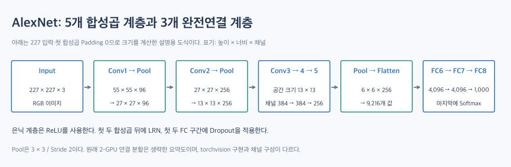
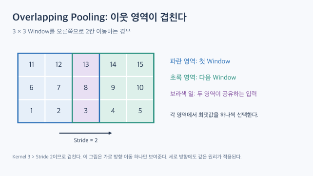

# AlexNet: 깊은 CNN을 대규모 이미지 분류로 확장한 모델

[TOC]

AlexNet은 2012년 ILSVRC에서 우승하며 CNN의 가능성을 널리 알린 모델이다. 핵심은 **깊어진 구조와 ReLU·GPU 학습·과적합 억제 기법을 함께 활용한 것**이다.

## 1. LeNet-5에서 무엇이 달라졌는가?

| 관점 | LeNet-5 | AlexNet |
| --- | --- | --- |
| 대표 입력 | 흑백 손글씨 | RGB 자연 이미지 |
| 은닉 활성화 | 스케일된 tanh | ReLU |
| 공간 축소 | 학습 가능한 Subsampling | Max Pooling |
| 분류 출력 | 클래스별 RBF 거리 | 1,000개 클래스 Softmax |

AlexNet은 합성곱 뒤에 항상 Pooling을 넣지 않는다. Conv3·Conv4·Conv5를 연속으로 쌓아 공간 크기를 유지하면서 특징을 변환한다.

## 2. 전체 구조와 출력 크기

학습 계층은 합성곱 5개와 완전연결 3개, 총 8개이다. Pooling·LRN은 이 개수에 포함하지 않는다.

아래는 원문과 같은 96·256·384·384·256 채널 구성에 대해 **입력 227, 첫 합성곱 Padding 0**으로 크기를 계산한 설명용 표이다. 배치 차원을 제외한 높이 × 너비 × 채널 순서이다.

| 단계 | 출력 크기 | Kernel / Stride / Padding |
| --- | --- | --- |
| Input | \(227\times227\times3\) | — |
| Conv1 | \(55\times55\times96\) | 11 / 4 / 0 |
| Pool1 | \(27\times27\times96\) | 3 / 2 / 0 |
| Conv2 | \(27\times27\times256\) | 5 / 1 / 2 |
| Pool2 | \(13\times13\times256\) | 3 / 2 / 0 |
| Conv3 | \(13\times13\times384\) | 3 / 1 / 1 |
| Conv4 | \(13\times13\times384\) | 3 / 1 / 1 |
| Conv5 | \(13\times13\times256\) | 3 / 1 / 1 |
| Pool3 | \(6\times6\times256\) | 3 / 2 / 0 |
| Flatten | 9,216 | — |
| FC6 → FC7 → FC8 | 4,096 → 4,096 → 1,000 | — |

### 224와 227을 구분하는 방법

논문에는 224 입력이 표기되어 있다. 따라서 227을 논문의 일관된 입력 규격이라고 단정하지 않는다. 출력 크기를 설명할 때는 **입력·Kernel·Stride·Padding을 한 세트로 명시**해야 한다.

예를 들어 첫 합성곱에서 다음 계산을 비교할 수 있다.

\[
\left\lfloor\frac{227-11}{4}\right\rfloor+1=55
\]

\[
\left\lfloor\frac{224-11}{4}\right\rfloor+1=54
\]

224 입력도 Padding을 2로 두면 출력 크기는 55이다. 실제 torchvision 구현은 이 설정을 사용하지만, 채널 구성도 위 표와 다르다.

## 3. ReLU: 큰 모델을 학습하는 데 도움을 준 활성화

\[
\operatorname{ReLU}(x)=\max(0,x)
\]

ReLU는 양수 영역에서 출력이 포화되지 않는다. 논문은 비교 실험에서 tanh보다 빠른 학습을 보고했다. 다만 특정 실험의 속도 차이를 모든 모델에 적용되는 보장으로 해석해서는 안 된다.

## 4. Overlapping Max Pooling

AlexNet은 Kernel 3, Stride 2인 Max Pooling을 사용한다. Window의 크기보다 이동 간격이 작으므로 이웃 Window가 입력 일부를 공유한다.

그림의 첫 Window는 13, 다음 Window는 15를 최댓값으로 선택한다. 숫자는 겹침을 설명하기 위한 예시이다.

## 5. 과적합을 줄이기 위한 방법

- **Dropout**: 첫 두 완전연결 계층의 은닉 출력에 확률 0.5로 적용했다. 특정 뉴런 조합에 대한 의존을 줄인다.
- **Data Augmentation**: Crop·좌우 반전·RGB 색상 변화로 학습 입력에 변화를 주었다.
- **LRN**: 같은 위치의 인접 채널 반응을 이용해 정규화했다. Batch Normalization과 같은 연산은 아니다.

원래 모델은 메모리 제약 때문에 두 GPU에 나눠 학습했고, 일부 계층에서만 서로 정보를 교환했다. 그림과 표에서는 이 연결 분할을 생략했다.

## 6. 성능 수치를 읽을 때의 주의점

**Top-5 Error**는 정답이 예측 상위 5개 안에도 없는 비율이다.

논문의 ILSVRC-2012 최종 제출 결과는 Top-5 Test Error **15.3%**이고 2위는 **26.2%**였다. 이 15.3%는 추가 사전학습을 포함한 **7개 모델의 앙상블 결과**이다. 단일 모델의 정확도로 소개하면 안 된다.

논문에 나오는 17.0%는 ILSVRC-2010 실험 결과이므로 대회 연도와 평가 조건을 구분한다.

## 7. torchvision의 AlexNet은 원 구조와 같은가?

공식 구현은 2012년 원 논문을 그대로 옮긴 모델이 아니라 이후의 변형에 기반한다.

| 항목 | 위 설명용 구조 | torchvision 구현 |
| --- | --- | --- |
| 합성곱 채널 | 96·256·384·384·256 | 64·192·384·256·256 |
| 첫 합성곱 Padding | 0 | 2 |
| LRN | 원 모델에서 사용 | 포함하지 않음 |
| 분류기 앞 | Pool 결과를 펼침 | AdaptiveAvgPool2d((6,6)) 후 펼침 |
| 모델 반환값 | 원 모델 분류는 Softmax 사용 | Softmax 이전 Logit 반환 |

따라서 라이브러리 모델을 사용할 때는 이름뿐 아니라 **실제 코드와 입력 전처리**를 확인해야 한다. 이 글은 구조 설명이며, 학습 코드를 실행한 실습 결과는 아니다.

## 핵심 정리

AlexNet의 의미는 더 깊은 CNN을 실제 대규모 문제에 학습시킨 데 있다. 구조와 함께 ReLU·GPU·Dropout·데이터 증강을 연결해 이해하고, 원 논문·설명용 구조·라이브러리 구현의 차이를 구분한다.

## 참고자료

- [dsaint31 — AlexNet](https://dsaint31.me/mkdocs_site/ML/ch14_cnn/alexnet/)
- [Krizhevsky·Sutskever·Hinton — ImageNet Classification with Deep Convolutional Neural Networks, 2012](https://papers.nips.cc/paper_files/paper/2012/file/c399862d3b9d6b76c8436e924a68c45b-Paper.pdf) — 기법과 성능 수치 확인자료
- [torchvision — AlexNet 공식 구현](https://docs.pytorch.org/vision/stable/_modules/torchvision/models/alexnet.html) — 원 모델과 라이브러리 구현 차이 확인자료

그림 두 개는 구조와 연산을 설명하기 위해 새로 작성했다.
