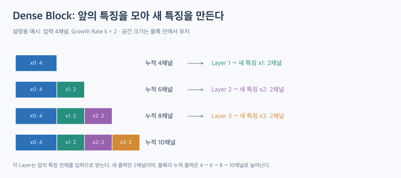
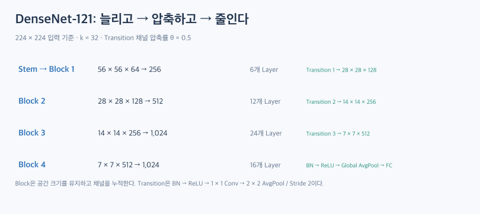

# DenseNet: 이전 특징을 이어 붙여 재사용하다

ResNet은 입력과 변화분을 더했다. DenseNet은 **이전 특징들을 채널 방향으로 이어 붙여 다음 층의 입력으로 사용한다.** 새 특징을 만들면서 기존 특징도 함께 사용할 수 있게 하는 구조다.

이 글은 구조를 설명하는 이론 글이다. 실행 코드나 학습 실험은 포함하지 않는다.

## 1. 더하기와 이어 붙이기는 다르다

| 구분 | ResNet의 Addition | DenseNet의 Concatenation |
|---|---|---|
| 결합 방식 | 같은 위치의 값을 더한다 | 채널 방향으로 나란히 붙인다 |
| 결합 조건 | 두 텐서의 크기가 같아야 한다 | 배치·공간 크기가 같아야 하며 채널 수는 달라도 된다 |
| 결합 뒤 채널 수 | 두 입력 각각의 채널 수와 같다 | 입력들의 채널 수를 합한 값이다 |

예를 들어 같은 공간 크기의 64채널 특징과 32채널 특징을 이어 붙이면 96채널이 된다. 가로·세로가 늘어나는 것은 아니다.

값으로만 단순화하면 덧셈 `[1, 2] + [3, 4]`는 `[4, 6]`이고, 이어 붙이기는 `[1, 2, 3, 4]`다. 실제 DenseNet은 특징 맵을 채널 축으로 결합한다.

## 2. Dense Connectivity: 앞의 모든 특징을 입력으로 받는다

Dense Block의 입력을 \(x_0\), 각 층이 새로 만든 특징을 \(x_1,x_2,\ldots\)라고 하자.

\[
x_l=H_l([x_0,x_1,\ldots,x_{l-1}])
\]

대괄호는 채널 방향 Concatenation이다. \(H_l\)은 합성곱·정규화·활성화 등으로 이루어진 변환이다.

- 첫 층: \(x_0\)를 받아 \(x_1\)을 만든다.
- 둘째 층: \([x_0,x_1]\)을 받아 \(x_2\)를 만든다.
- 셋째 층: \([x_0,x_1,x_2]\)를 받아 \(x_3\)를 만든다.

여기서 ‘모든 이전 층’은 **같은 Dense Block 안**을 뜻한다. 네트워크 처음부터 끝까지 해상도가 다른 특징을 그대로 모두 이어 붙이는 것은 아니다.

## 3. Growth Rate: 새로 추가하는 채널 수

Growth Rate \(k\)는 각 Dense Layer가 **새로 생성하는 채널 수**다. 학습률이나 전체 출력 채널 수가 아니다.

입력 채널이 \(C_0\)이고 \(L\)개 층을 지나면 블록의 누적 채널 수는 다음과 같다.

\[
C_{block}=C_0+Lk
\]

\(l\)번째 층의 입력 채널 수는 \(C_0+(l-1)k\), 그 층이 새로 만드는 출력은 \(k\)채널이다.

예를 들어 입력 64채널, \(k=32\), 6개 층이라면 다음과 같다.

\[
64+6\times32=256
\]

마지막 Dense Layer 자체가 256개 채널을 새로 생성하는 것이 아니다. 각 층은 32개씩 만들고, 기존 특징까지 모은 Dense Block의 출력이 256채널이 된다.

## 4. Dense Layer의 Bottleneck

대표적인 DenseNet-BC의 한 Dense Layer는 다음 순서로 처리한다.

**BN → ReLU → 1×1 Conv → BN → ReLU → 3×3 Conv**

기본 Bottleneck 구성은 다음과 같다.

\[
C_{in}\xrightarrow{1\times1}4k\xrightarrow{3\times3}k
\]

\(k=32\)라면 가운데 채널 수는 128, 새 출력은 32채널이다. 누적 입력 채널이 커져도 3×3 합성곱은 128채널을 입력으로 받는다.

첫 1×1이 언제나 채널을 줄이는 것은 아니다. 입력이 64채널이면 128로 늘어날 수 있다. 핵심은 뒤쪽 3×3의 입력 폭을 일정하게 정하는 것이다.

또한 BN과 ReLU가 합성곱 **앞에** 놓인다. 앞 글의 Post-activation ResNet BasicBlock과 순서를 혼동하지 않아야 한다.

## 5. Transition Layer: 채널을 압축하고 공간을 줄인다

Dense Block 안에서는 공간 크기를 유지한다. 블록 사이에서는 Transition을 거쳐 크기를 조절한다.

**BN → ReLU → 1×1 Conv → 2×2 Average Pooling / Stride 2**

| 연산 | 주된 역할 |
|---|---|
| 1×1 Conv | 채널을 변환하며, 압축을 적용하면 채널 수를 줄인다 |
| Average Pooling | 공간 크기를 줄인다 |

압축률을 \(\theta\)라 하면 채널 수는 다음과 같다.

\[
C_{out}=\lfloor\theta C_{in}\rfloor,\qquad0<\theta\leq1
\]

예를 들어 56×56×256 특징에 \(\theta=0.5\)를 적용하면, 1×1 합성곱 뒤 56×56×128, Pooling 뒤 28×28×128이 된다.

Bottleneck을 적용한 모델은 DenseNet-B, 채널 압축을 적용한 모델은 DenseNet-C, 둘 다 적용하면 DenseNet-BC라고 한다.

이전 특징을 개별 채널로 누적하는 성질은 Dense Block 안에서 이해해야 한다. Transition에서는 합성곱과 Pooling으로 특징을 다시 변환한다.

## 6. DenseNet-121의 전체 흐름

아래는 ImageNet용 기본 DenseNet-121에 224×224 RGB 이미지를 넣는 경우다. Growth Rate는 32, Transition의 압축률은 0.5다. 표기 순서는 높이×너비×채널이다.

| 구간 | 처리 | 출력 |
|---|---|---|
| Stem | 7×7 Conv, BN, ReLU, Max Pooling | 56×56×64 |
| Dense Block 1 | Dense Layer 6개 | 56×56×256 |
| Transition 1 | 채널 압축·Average Pooling | 28×28×128 |
| Dense Block 2 | Dense Layer 12개 | 28×28×512 |
| Transition 2 | 채널 압축·Average Pooling | 14×14×256 |
| Dense Block 3 | Dense Layer 24개 | 14×14×1024 |
| Transition 3 | 채널 압축·Average Pooling | 7×7×512 |
| Dense Block 4 | Dense Layer 16개 | 7×7×1024 |
| 분류기 | BN → ReLU → Global Average Pooling → Linear | 클래스별 점수 1000개 |

### 6.1. 121개 Dense Layer라는 뜻은 아니다

Dense Layer 수는 \(6+12+24+16=58\)개다. 각 Dense Layer에는 합성곱이 2개씩 있다. 여기에 Stem의 합성곱 1개, Transition의 합성곱 3개, 마지막 분류 계층 1개를 세면 다음과 같다.

\[
1+2(6+12+24+16)+3+1=121
\]

BN·ReLU·Pooling·Concatenation은 이 깊이 표기에 포함하지 않는다.

### 6.2. 다른 모델의 블록 구성

| 모델 | 블록별 Dense Layer 수 | Growth Rate |
|---|---|---|
| DenseNet-121 | 6 / 12 / 24 / 16 | 32 |
| DenseNet-169 | 6 / 12 / 32 / 32 | 32 |
| DenseNet-201 | 6 / 12 / 48 / 32 | 32 |

깊이 숫자만 보고 모든 층의 채널 수까지 같다고 추정하면 안 된다. 모델별 Growth Rate, 초기 채널 수, 압축 설정을 함께 확인해야 한다.

## 7. 장점과 비용을 함께 본다

### 7.1. Feature Reuse와 기울기 전달

뒤쪽 층이 앞쪽 특징에 직접 접근하므로 기존 특징을 다시 만드는 부담을 줄일 수 있다. 여러 짧은 연결 경로는 초기 층으로의 기울기 전달에도 도움이 된다.

논문은 이를 Implicit Deep Supervision이라는 관점에서도 설명한다. 그렇다고 각 Dense Layer마다 별도의 정답이나 보조 분류기를 붙인다는 뜻은 아니다.

이 연결이 모든 기울기 문제를 없애거나, 모든 데이터에서 ResNet보다 좋은 성능을 보장하는 것은 아니다.

### 7.2. 파라미터 효율과 실행 비용은 다르다

각 층은 적은 수의 새 특징만 추가한다. 그러나 이전 특징을 보관하고 반복해서 결합해야 하므로, 가중치 수가 적어도 학습 중 특징 맵 메모리와 실제 실행 시간은 별도로 평가해야 한다.

torchvision은 메모리 절약을 위한 Checkpointing 옵션도 제공한다. 일부 중간 연산을 다시 계산하는 방식이므로 메모리와 시간 사이에 절충이 생긴다.

## 8. 핵심 정리

DenseNet은 Dense Block 안에서 앞의 특징을 채널 방향으로 이어 붙여 재사용한다. 각 층의 새 출력은 Growth Rate만큼이고, 블록의 누적 채널 수는 점차 늘어난다.

Transition은 늘어난 채널을 압축하고 해상도를 낮춘다. 따라서 구조를 읽을 때는 **새 출력 채널·누적 채널·공간 크기**를 따로 추적하는 것이 중요하다.

## 관련 개념

- [ResNet](resnet.md)
- [Convolutional Layer](convolutional-layer.md)
- [Pooling Layer](pooling-layer.md)

## 참고 자료

- [DenseNet의 구조와 특징 — dsaint31](https://dsaint31.me/mkdocs_site/ML/ch14_cnn/densenet/): 글의 출발점이 된 참고 자료.
- [Densely Connected Convolutional Networks — Huang et al.](https://arxiv.org/abs/1608.06993): Dense Connectivity·Growth Rate·DenseNet-BC의 원 논문.
- [torchvision DenseNet 공식 구현](https://docs.pytorch.org/vision/stable/_modules/torchvision/models/densenet.html): 층 구성·Concatenation·Transition·분류기 및 Checkpointing 확인.

그림은 참고 자료의 구조를 바탕으로 이 글을 위해 새로 작성한 설명용 도식이다. 작은 채널 수를 사용한 예시는 이해를 위한 예시이며 학습 실험 결과가 아니다.
