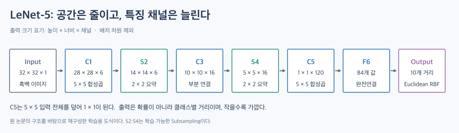
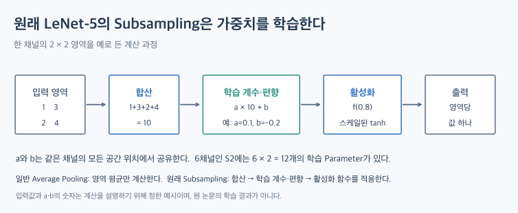
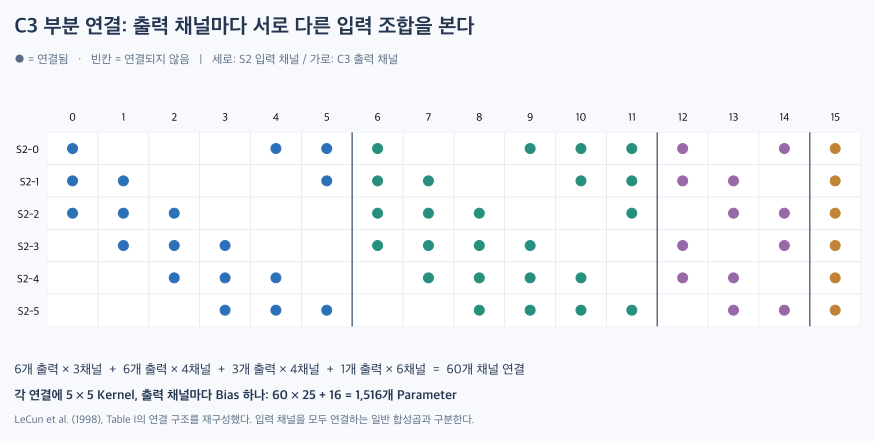

# LeNet-5: 합성곱·Subsampling·분류기를 연결한 초기 CNN

[TOC]

LeNet-5는 손글씨 숫자 인식을 위한 대표적인 초기 CNN이다. 1998년 논문에서 소개되었으며, **합성곱으로 특징을 추출하고 공간 크기를 줄인 뒤 분류하는 흐름**을 보여준다.

## 1. 전체 구조

그림은 왼쪽에서 오른쪽으로 읽는다. C1·C3·C5는 합성곱, S2·S4는 공간을 요약하는 Subsampling, F6는 완전연결 계층이다.

배치 차원을 제외하고 출력 크기는 **높이 × 너비 × 채널** 순서로 표시한다. PyTorch가 흔히 사용하는 채널 우선 표기와 순서가 다르므로 구분한다.

| 단계 | 역할 | 출력 크기 | Kernel / Stride |
| --- | --- | --- | --- |
| Input | 흑백 이미지 입력 | \(32 \times 32 \times 1\) | — |
| C1 | Convolution | \(28 \times 28 \times 6\) | \(5 \times 5\) / 1 |
| S2 | Subsampling | \(14 \times 14 \times 6\) | \(2 \times 2\) / 2 |
| C3 | 부분 연결 Convolution | \(10 \times 10 \times 16\) | \(5 \times 5\) / 1 |
| S4 | Subsampling | \(5 \times 5 \times 16\) | \(2 \times 2\) / 2 |
| C5 | Convolution | \(1 \times 1 \times 120\) | \(5 \times 5\) / 1 |
| F6 | Fully Connected | 84 | — |
| Output | Euclidean RBF | 10 | — |

입력을 제외하면 7개 계층이다. 이름의 숫자 5가 전체 계층 수를 뜻하는 것은 아니다.

## 2. 특징 추출과 공간 축소

C1과 C3는 국소 패턴을 추출한다. S2와 S4는 공간 크기를 줄이며, 이후 계층은 앞선 특징을 조합한다.

C1에서 공간 크기는 \(32-5+1=28\)이 된다. S2에서는 겹치지 않는 \(2\times2\) 영역을 요약해 \(28\times28\)을 \(14\times14\)로 줄인다.

현재 입력 크기에서 C5의 Kernel은 S4의 \(5\times5\) 공간 전체를 덮는다. 따라서 출력은 채널마다 하나의 값이다. 다만 **C5 자체는 합성곱 계층**이다.

## 3. 원래 Subsampling은 단순 Average Pooling과 다르다

원래 S2·S4는 영역의 값을 합산한 뒤, 채널별로 학습하는 계수와 편향을 적용하고 비선형 함수를 통과시킨다.

\[
y=f\left(a\sum_{i\in R}x_i+b\right)
\]

여기서 \(R\)은 요약할 영역이고, \(a\)와 \(b\)는 같은 채널의 공간 위치들에서 공유하는 학습 Parameter이다. 그림의 예시는 영역 합이 10, \(a=0.1\), \(b=-0.2\)이므로 활성화 함수의 입력이 0.8이 된다. 이 숫자들은 이해를 위한 예시이다.

따라서 학습 Parameter가 없는 일반적인 Average Pooling과 동일하지 않다. 논문은 내부 비선형 함수로 **스케일을 조정한 tanh**를 사용한다.

## 4. C3의 부분 연결

그림에서 한 열이 C3 출력 채널 하나이다. 해당 열에 표시된 점은 그 출력을 계산할 때 사용하는 S2 채널을 뜻한다. 예를 들어 C3의 0번은 S2의 0·1·2번을 사용하고, C3의 15번은 여섯 입력 채널을 모두 사용한다.

| C3 출력 채널 | 연결되는 S2 채널 |
| --- | --- |
| 처음 6개 | 연속된 3개씩 |
| 다음 6개 | 연속된 4개씩 |
| 다음 3개 | 비연속적인 4개씩 |
| 마지막 1개 | 전체 6개 |

연결 수를 제한하면서 출력 채널들이 서로 다른 입력 조합을 보게 하는 구조이다.

채널 연결은 \(6\times3+6\times4+3\times4+1\times6=60\)개이다. 각 연결에 \(5\times5\) Kernel을 두고 출력 채널별 Bias를 하나씩 더하면 다음과 같다.

\[
60\times25+16=1,516
\]

이는 원 논문 C3의 학습 Parameter 수이다. 모든 입력 채널을 연결하는 일반적인 합성곱과 구분해야 한다.

## 5. 출력은 Softmax가 아닌 RBF이다

출력 계층은 F6의 표현과 클래스별 기준 벡터 사이의 제곱거리를 계산한다.

\[
y_i = \sum_{j=0}^{83}(x_j-w_{ij})^2
\]

- \(x_j\): F6의 출력
- \(w_{ij}\): 클래스 \(i\)의 기준 벡터 성분
- \(y_i\): 클래스 \(i\)에 대한 거리 기반 출력

**값이 작을수록 해당 클래스의 기준 벡터에 가깝다.** Softmax 확률처럼 큰 값이 더 높은 확신을 뜻하는 출력과 구분해야 한다.

## 6. 현대적인 LeNet 구현을 읽을 때

| 항목 | 원래 LeNet-5 | 간소화 구현에서 가능한 변경 |
| --- | --- | --- |
| 활성화 | 스케일을 조정한 tanh | 일반 tanh 또는 ReLU |
| 공간 축소 | 학습 가능한 Subsampling | Average·Max Pooling |
| C3 연결 | 부분 연결 | 전체 채널 연결 |
| 출력 | Euclidean RBF | Linear 출력과 별도의 분류 Loss |

간소화 구현은 학습용으로 유용하지만, **원 논문의 구조를 그대로 재현한 것인지 확인해야 한다.**

## 핵심 정리

LeNet-5는 특징 추출부터 분류까지 연결한 CNN의 기본 흐름을 보여준다.

구조를 이해할 때는 **출력 크기뿐 아니라 Subsampling의 학습 Parameter, C3의 부분 연결, RBF 출력**도 함께 살펴봐야 한다.

## 참고자료

- [dsaint31 — LeNet-5](https://dsaint31.me/mkdocs_site/ML/ch14_cnn/LeNet-5/)
- [LeCun·Bottou·Bengio·Haffner — Gradient-Based Learning Applied to Document Recognition, 1998](https://doi.org/10.1109/5.726791) — 원 구조와 계층별 설명의 기준 논문
- [원 논문 열람본](https://studylib.net/doc/18667526/gradient-based-learning-applied-to-document-recognition) — Subsampling·C3 연결·RBF 설명 대조에 사용

그림 세 개는 구조와 연산을 설명하기 위해 새로 작성했다. C3 연결도는 원 논문의 Table I에 근거한다.
