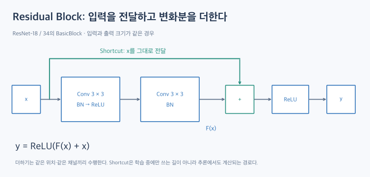
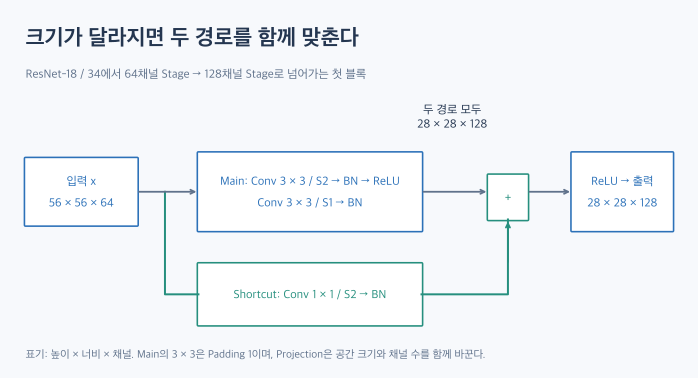

# ResNet: 입력을 더하는 연결이 깊은 학습을 돕는 이유

VGG는 작은 합성곱을 반복해 깊이를 늘렸다. 그렇다면 계층을 계속 추가하면 성능도 계속 좋아질까? ResNet은 **깊은 네트워크를 실제로 학습하기 쉽게 만드는 연결 방식**에 주목한다.

이 글은 구조와 원리를 설명하는 이론 글이다. 실행 코드나 학습 실험은 포함하지 않는다.

## 1. 깊은 모델이 훈련 데이터에서도 더 못 맞힌다면?

일반적인 계층을 더 쌓은 Plain Network에서, 깊은 모델의 **훈련 오차까지** 얕은 모델보다 커지는 현상이 관찰됐다. 논문은 이를 Degradation Problem으로 다룬다.

| 관찰 | 구분해야 할 문제 |
|---|---|
| 훈련 데이터는 잘 맞히지만 검증 데이터에서 성능이 나쁘다 | 일반화·과적합 문제를 살펴본다 |
| 깊이를 늘렸는데 훈련 오차부터 더 커진다 | 최적화의 어려움도 살펴봐야 한다 |

깊은 모델이 더 많은 표현 능력을 갖는 것과, 학습 과정이 그 능력을 활용하는 것은 별개다. ResNet의 출발점을 단순히 ‘과적합을 막는 모델’로 이해하면 이 차이를 놓친다.

## 2. 전체 변환 대신 변화분을 학습한다

블록 입력을 \(x\), 원하는 변환을 \(H(x)\)라고 하자. 다음처럼 쓸 수 있다.

\[
F(x)=H(x)-x,\qquad H(x)=x+F(x)
\]

여기서 \(F(x)\)는 **입력을 기준으로 더할 변화분**, 즉 Residual이다. 이것은 손실 함수나 정답과 예측값의 오차를 뜻하지 않는다.

입력이 10이고 원하는 출력이 11인 설명용 상황을 생각해 보자.

- 직접 변환하는 관점: 10을 받아 11을 만든다.
- 잔차 관점: 10은 전달하고, 변화분 1을 만들어 더한다.

실제로는 스칼라 대신 특징 맵을 다룬다. 모델이 먼저 정답 변환 \(H(x)\)를 계산한 다음 입력을 빼는 것은 아니다. **합성곱 경로가 곧바로 \(F(x)\)를 만들고 Shortcut 경로의 값과 더한다.**

## 3. Residual Block의 두 경로

그림은 ResNet-18·34의 기본적인 Post-activation BasicBlock이다.

| 경로 | 역할 |
|---|---|
| Main / Residual branch | 합성곱과 BN 등을 거쳐 변화분 \(F(x)\)를 만든다 |
| Shortcut branch | 같은 크기라면 입력 \(x\)를 그대로 전달한다 |
| Addition | 두 특징 맵의 같은 위치·같은 채널끼리 더한다 |

이 블록의 실제 출력은 덧셈 뒤 ReLU까지 포함한다.

\[
z=F(x)+x,\qquad y=\operatorname{ReLU}(z)
\]

흔히 쓰는 \(x+F(x)\)는 이 덧셈 구조를 강조한 표현이다. 블록 전체를 설명할 때는 마지막 활성화 함수도 확인해야 한다.

Shortcut은 학습 도중에만 쓰는 보조 장치가 아니다. 추론할 때도 두 경로의 결과를 계산해 더한다.

## 4. 왜 이 연결이 학습에 도움이 되는가?

### 4.1. 입력을 유지하는 선택을 표현하기 쉽다

어떤 블록에서 큰 변화가 필요 없다면 \(F(x)\)를 0에 가깝게 만들 수 있다. 그러면 덧셈 결과는 입력에 가까워진다.

다만 위 그림에는 마지막 ReLU가 있다. \(F(x)=0\)이어도 음수 입력까지 그대로 보존하는 것은 아니므로, ‘항상 완벽한 항등 함수’라고 일반화하면 안 된다.

### 4.2. 기울기가 전달되는 직접 경로가 생긴다

활성화 전 덧셈을 스칼라 형태로 단순화하면 다음과 같다.

\[
z=x+F(x),\qquad\frac{dz}{dx}=1+F'(x)
\]

합성곱 경로의 미분 외에 입력에서 오는 항이 있다. 벡터·텐서에서는 1 대신 항등 행렬에 해당하는 항이 나타난다.

이 식은 연결의 직관을 보여준다. 실제 블록에서는 뒤쪽 ReLU의 미분도 곱해지며, 모든 기울기가 항상 보존된다는 보장은 없다. 따라서 **ResNet이 기울기 소실을 완전히 없앤다**고 표현하는 것은 지나치다.

## 5. 두 특징 맵의 크기가 다르면?

원소별 덧셈을 하려면 공간 크기와 채널 수가 맞아야 한다. 예를 들어 56×56×64 입력을 28×28×128 출력으로 바꾸는 블록에서는 입력을 그대로 더할 수 없다.

### 5.1. Identity Shortcut

입력과 Main 출력의 크기가 같다면 입력을 그대로 전달한다. Shortcut 자체에는 학습할 가중치가 없다. 덧셈 연산은 여전히 수행한다.

### 5.2. Projection Shortcut

크기가 다르면 학습 가능한 변환 \(P(x)\)로 맞출 수 있다.

\[
y=\operatorname{ReLU}(F(x)+P(x))
\]

torchvision의 일반적인 구현에서는 필요한 위치에 **1×1 합성곱과 BN**을 둔다. 위 예시는 Stride 2로 가로·세로를 줄이면서 출력 채널을 128로 맞춘다.

채널만 달라지는 경우에도 Projection이 필요할 수 있다. 따라서 Projection이 언제나 해상도를 낮춘다는 뜻은 아니다.

## 6. BasicBlock과 Bottleneck

| 구분 | Main 경로의 합성곱 | 대표 모델 |
|---|---|---|
| BasicBlock | 3×3 → 3×3 | ResNet-18·34 |
| Bottleneck | 1×1 → 3×3 → 1×1 | ResNet-50·101·152 |

Bottleneck의 이해를 위해 입력·출력이 모두 256채널인 블록을 생각해 보자.

\[
256\xrightarrow{1\times1}64\xrightarrow{3\times3}64\xrightarrow{1\times1}256
\]

가운데 3×3 합성곱을 좁은 채널에서 수행한다. 다만 Stage의 첫 블록처럼 입력 채널이 다른 경우에는 첫 1×1이 언제나 채널을 ‘줄이는’ 것은 아니다.

기본 torchvision Bottleneck은 내부 기준 채널의 4배를 출력한다. 또한 해상도를 줄이는 Stride 2를 가운데 3×3에 둔다. 원래 구현은 첫 1×1에 두므로, 같은 ResNet-50이라는 이름이어도 세부 구현을 확인해야 한다.

## 7. 전체 구조와 모델 이름 읽기

ImageNet용 기본 구조는 다음 흐름을 따른다.

**Stem → Residual Stage 4개 → Global Average Pooling → FC**

Stem은 7×7 합성곱·BN·ReLU와 Max Pooling으로 초기 특징 맵을 만든다. 224×224 입력은 여기서 56×56까지 줄어든다.

| 모델 | 블록 종류 | Stage별 블록 수 |
|---|---|---|
| ResNet-18 | BasicBlock | 2 / 2 / 2 / 2 |
| ResNet-34 | BasicBlock | 3 / 4 / 6 / 3 |
| ResNet-50 | Bottleneck | 3 / 4 / 6 / 3 |
| ResNet-101 | Bottleneck | 3 / 4 / 23 / 3 |
| ResNet-152 | Bottleneck | 3 / 8 / 36 / 3 |

ResNet-34와 ResNet-50은 블록 수가 같지만 블록 안의 합성곱 수가 다르다. 이름의 깊이는 기본적으로 Main 경로의 합성곱과 마지막 FC를 세며, Projection Shortcut의 추가 합성곱은 이 숫자에 포함하지 않는다.

\[
\text{ResNet-34}:1+2(3+4+6+3)+1=34
\]

\[
\text{ResNet-50}:1+3(3+4+6+3)+1=50
\]

BN·ReLU·Pooling도 이 깊이 표기에는 포함하지 않는다.

## 8. 핵심 정리

ResNet은 합성곱 경로의 결과에 Shortcut 경로의 값을 더한다. 입력을 기준으로 변화분을 학습하는 구조가 깊은 모델의 최적화를 돕는다.

같은 크기에서는 Identity Shortcut을 쓰고, 크기가 바뀌면 Projection으로 맞출 수 있다. 무엇을 더하는지와 더하기 직전의 두 텐서 크기를 확인하면 구조를 읽기 쉬워진다.

다음 DenseNet에서는 특징을 더하는 대신 채널 방향으로 이어 붙이는 연결을 살펴본다.

## 관련 개념

- [VGG](vgg.md)
- [Convolutional Layer](convolutional-layer.md)
- [Activation Function](activation-functions.md)

## 참고 자료

- [ResNet 정리 — dsaint31](https://dsaint31.me/mkdocs_site/ML/ch14_cnn/resnet/): 글의 출발점이 된 참고 자료.
- [Deep Residual Learning for Image Recognition — He et al.](https://arxiv.org/abs/1512.03385): Degradation Problem과 Residual Learning의 원 논문.
- [torchvision ResNet 공식 구현](https://docs.pytorch.org/vision/stable/_modules/torchvision/models/resnet.html): BasicBlock·Bottleneck·Projection 및 Stride 위치 확인.

그림은 참고 자료의 구조를 바탕으로 이 글을 위해 새로 작성한 설명용 도식이다. 수치 예시는 이해를 위한 예시이며 학습 실험 결과가 아니다.
