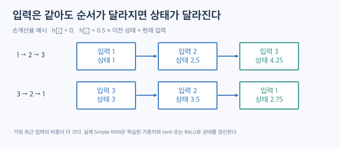
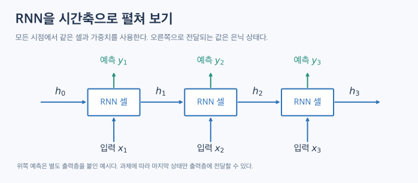
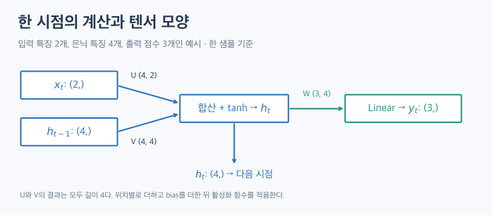

# RNN: 이전 상태를 다음 계산에 쓰는 신경망

[TOC]

어제와 오늘의 기온이 같더라도 최근 며칠간 기온이 올라왔는지 내려왔는지에 따라 내일 예측은 달라질 수 있다. 순환신경망(RNN)은 입력을 순서대로 읽으면서 **이전까지의 정보를 은닉 상태에 담고, 다음 입력을 처리할 때 그 상태를 사용한다.**

## 1. 입력의 순서가 계산에 들어오는 방식

각 시점의 입력에 독립적으로 같은 MLP를 적용하면, 현재 입력이 같을 때 그 시점의 결과도 같다. RNN은 현재 입력과 이전 상태를 함께 읽기 때문에 현재 입력이 같아도 앞에서 읽은 내용에 따라 다른 값을 낼 수 있다. 과거 입력을 명시적으로 붙여 전달하는 MLP나, 입력 구간을 한꺼번에 처리하는 1D CNN도 시퀀스에 적용할 수 있다. RNN의 특징은 **상태를 시점마다 갱신해 넘기는 연결**이다.

예를 들어 상태를 \(h_t=0.5h_{t-1}+x_t\)로 갱신하고 \(h_0=0\)으로 두면, \(1,2,3\)을 읽었을 때 마지막 상태는 4.25다. \(3,2,1\)을 읽으면 2.75다. 마지막 입력이 두 경우 모두 2인 \(1,3,2\)와 \(3,1,2\)를 비교해도 마지막 상태는 각각 3.75와 3.25로 다르다. 이 계산은 순서를 설명하기 위해 활성화와 bias를 생략한 예시다.

## 2. RNN 셀을 시간축으로 펼치기

그림의 세 상자는 같은 RNN 셀을 세 번 호출한 모습이다. \(x_1\)과 초기 상태 \(h_0\)로 \(h_1\)을 계산하고, \(x_2\)와 \(h_1\)로 \(h_2\)를 계산한다. 첫 상태는 예를 들어 0으로 초기화할 수 있다.

셀의 가중치는 모든 시점에 공유한다. 길이 3을 처리하면 셀을 3회, 길이 30을 처리하면 30회 호출한다. **학습하는 가중치 수는 같고 계산 횟수가 달라진다.** 여러 RNN 층을 쌓을 때는 층마다 자체 가중치를 가지며, 각 층 안에서 시간축으로 가중치를 공유한다.

오른쪽으로 넘어가는 \(h_t\)는 상태다. 위쪽의 \(y_t\)는 출력층이 상태를 읽어 만든 예측이다. 예를 들어 단어 태깅에서는 시점마다 예측할 수 있고, 문장 분류에서는 마지막 유효 상태에서 한 번만 예측할 수 있다.

## 3. 한 시점에서 무엇을 더하는가?

\[
h_t = \tanh(Ux_t + Vh_{t-1} + b_h), \qquad y_t = Wh_t + b_o
\]

| 기호 | 예시 Shape | 역할 |
|---|---|---|
| \(x_t\) | \((2,)\) | 해당 시점의 입력 특징 두 개 |
| \(U\) | \((4,2)\) | 현재 입력을 길이 4로 변환 |
| \(h_{t-1}\) | \((4,)\) | 이전 시점의 은닉 상태 |
| \(V\) | \((4,4)\) | 이전 상태를 길이 4로 변환 |
| \(h_t\) | \((4,)\) | 두 변환을 더하고 활성화를 적용한 새 상태 |
| \(W\) | \((3,4)\) | 상태에서 점수 세 개를 만드는 출력층 가중치 |
| \(y_t\) | \((3,)\) | 출력층이 만든 점수 |

예를 들어 \(Ux_t\)와 \(Vh_{t-1}\)의 결과는 둘 다 길이 4다. 두 벡터와 길이 4인 bias를 원소별로 더한 뒤 tanh를 적용한다. 출력층에는 길이 3인 bias를 사용할 수 있다. 표의 \(y_t\)는 활성화 전 점수이며, 실제 출력층은 과제에 맞춰 설계한다.

## 4. 시퀀스와 배치의 Shape

길이 5인 관측 시퀀스 8개가 있고 매 시점에 기온·습도 두 값을 읽는다고 하자. PyTorch에서 `batch_first=True`인 단층·단방향 `nn.RNN`의 Shape을 계산하면 다음과 같다.

| 텐서 | Shape | 읽는 방법 |
|---|---|---|
| 입력 | `(8, 5, 2)` | 샘플 8개, 시점 5개, 입력 특징 2개 |
| `output` | `(8, 5, 4)` | 각 샘플의 5개 시점에 대한 은닉 상태 |
| `h_n` | `(1, 8, 4)` | 층×방향 1개, 샘플 8개, 마지막 상태 4개 |
| 마지막 상태에 Linear 적용 | `(8, 3)` | 샘플별 점수 3개 |

PyTorch의 `output`은 각 시점의 은닉 상태다. 그림의 \(y_t\)에 해당하는 점수를 얻으려면 별도 출력층을 붙인다. `batch_first=True`는 입력과 `output`의 순서를 정하며 `h_n`은 층·방향 축이 앞에 온다. 위 Shape은 구조를 설명하기 위해 계산했다. [PyTorch nn.RNN](https://docs.pytorch.org/docs/stable/generated/torch.nn.RNN.html)

시퀀스 길이 \(T\)는 샘플마다 달라질 수 있고, 한 시점의 입력 특징 수는 계층에 맞춰 일정해야 한다. 길이가 다른 시퀀스를 묶을 때는 Padding과 실제 길이를 함께 관리하거나 Packed Sequence를 사용할 수 있다. Padding을 넣고 그대로 처리하면 마지막 배열 위치가 마지막 유효 시점과 다를 수 있다. [PyTorch nn.RNN](https://docs.pytorch.org/docs/stable/generated/torch.nn.RNN.html)

## 5. 오래전 정보를 학습하기 어려운 이유

은닉 상태는 지금까지의 입력을 고정 길이 벡터로 요약한다. 앞에서 읽은 정보가 뒤에 도달하려면 중간 상태들을 차례로 거쳐야 한다. 학습할 때도 뒤쪽 오차의 기울기가 이 경로를 역방향으로 통과한다. 이를 BPTT(Backpropagation Through Time)라고 한다.

역전파에서 여러 시점의 미분을 곱하면 기울기가 매우 작아지거나 커질 수 있다. 기울기가 작아지면 오래전 입력이 학습에 주는 신호가 약해진다. 반대로 너무 커지면 학습이 불안정해질 수 있다. Gradient Clipping은 큰 기울기를 제한한다. LSTM과 GRU는 게이트로 어떤 정보를 유지하고 갱신할지 조절해 긴 의존 관계를 다루는 데 도움을 준다. [RNN 원문](https://dsaint31.me/mkdocs_site/ML/ch16_RNN/RNN_intro/)

이전 상태가 준비돼야 다음 상태를 계산할 수 있으므로 시간축 병렬화는 어렵다. 반면 단방향 RNN은 새 관측이 들어올 때마다 상태를 갱신할 수 있어 스트리밍 처리에 사용할 수 있다.

## 6. 어떤 데이터를 처리하는가?

| 예시 | 시점 하나의 입력 | 출력 예시 |
|---|---|---|
| 날씨 예측 | 하루의 기온·습도 벡터 | 내일 기온 |
| 문장 분류 | 토큰 하나의 임베딩 | 문장 전체의 분류 점수 |
| 단어 태깅 | 토큰 하나의 임베딩 | 토큰별 태그 점수 |
| 음성 처리 | 짧은 구간의 음향 특징 | 구간별 또는 시퀀스 전체의 예측 |

## 참고 자료

- [Recurrent Neural Network — dsaint31](https://dsaint31.me/mkdocs_site/ML/ch16_RNN/RNN_intro/)
- [PyTorch nn.RNN — 상태 갱신식과 텐서 Shape](https://docs.pytorch.org/docs/stable/generated/torch.nn.RNN.html)

그림 세 개는 상태 전달과 차원 변화를 설명하기 위해 새로 그렸다.
