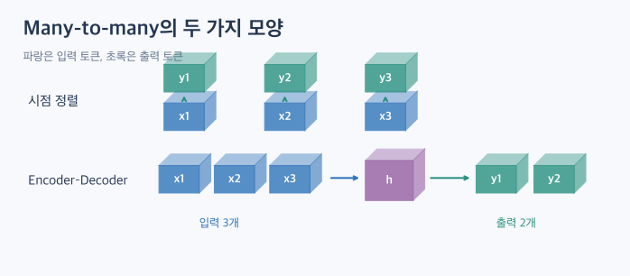
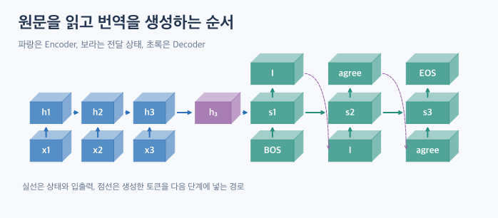
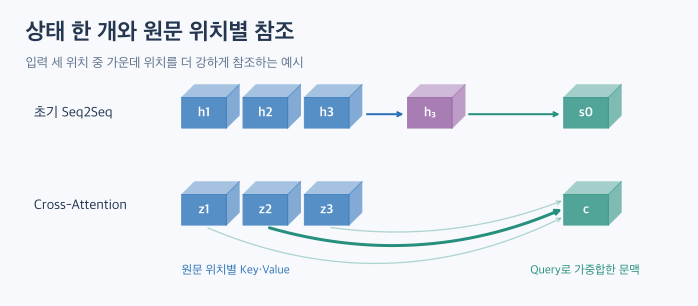

# RNN의 입출력 구조와 Encoder–Decoder

[TOC]

문장의 토큰마다 품사를 붙이는 작업과 문장 전체를 번역하는 작업은 둘 다 여러 입력에서 여러 출력을 만든다. 품사 태깅은 원문의 각 위치에 출력 하나가 대응한다. 번역은 원문을 바탕으로 별도의 출력 시퀀스를 만든다. 이 두 가지 Many-to-many를 구분하면 RNN에서 Transformer의 Encoder–Decoder 구조로 넘어가기 쉽다.

## 1. One과 Many는 시점의 개수다

한 시점의 입력도 여러 특징을 담은 벡터일 수 있다. 예를 들어 한 시점에 기온·습도·기압을 읽는다면 특징은 세 개이고 시점은 하나다.

| 구조 | 입력 → 출력 | 예시 |
|---|---|---|
| One-to-one | 입력 하나 → 예측 하나 | 이미지 한 장의 클래스 분류 |
| One-to-many | 입력 표현 하나 → 출력 시퀀스 | 이미지 표현으로 설명 문장 생성 |
| Many-to-one | 입력 시퀀스 → 예측 하나 | 리뷰 전체의 감성 분류 |
| 시점 정렬 Many-to-many | 각 입력 위치 → 대응하는 출력 위치 | 토큰별 품사 태깅 |
| Encoder–Decoder Many-to-many | 원문 시퀀스 → 별도의 출력 시퀀스 | 기계 번역 |

One-to-one은 입출력 모양을 비교하기 위한 기준이다. 이미지 한 장을 분류하는 예시는 CNN 등으로 구현할 수 있다. Many-to-one RNN에서는 중간 상태도 다음 계산에 사용하며, 분류층은 마지막 유효 상태를 읽을 수 있다. [RNN 연결 방식 원문](https://dsaint31.me/mkdocs_site/ML/ch16_RNN/RNN_topologies/)

## 2. Many-to-many 두 가지를 구분한다

**시점 정렬 방식**에서는 입력 위치와 출력 위치가 대응한다. 세 토큰의 품사를 예측하면 태그도 세 개다. 단방향 RNN을 쓰면 해당 시점까지 읽은 정보로 예측할 수 있다. 양방향 RNN을 쓰면 미래 위치의 입력도 참고할 수 있으므로 시점 정렬과 실시간 처리 여부는 별개의 선택이다.

**Encoder–Decoder 번역**에서는 원문과 번역문의 위치를 일대일로 맞출 필요가 없다. 예를 들어 원문을 설명용으로 `나도 / 그렇게 / 생각해` 세 조각, 번역문을 `I / agree` 두 조각으로 나눌 수 있다. 실제 토큰 수는 토크나이저에 따라 달라진다. 길이가 같더라도 두 문장의 단어 순서나 의미 대응은 달라질 수 있다.

**Seq2Seq는 입력과 출력이 시퀀스라는 문제의 형태**, **Encoder–Decoder는 입력을 표현하는 부분과 출력을 생성하는 부분으로 나눈 모델 구조**다. 이 글에서는 두 개념이 함께 쓰이는 번역을 중심으로 살펴본다.

## 3. Encoder–Decoder는 번역문을 어떻게 만드는가?

### 3.1. Encoder가 원문을 읽는다

Encoder RNN은 원문 토큰을 순서대로 읽고 상태를 갱신한다. 초기 Seq2Seq의 대표적인 방식에서는 원문을 다 읽은 뒤 얻은 고정 크기 표현을 Decoder에 전달한다. LSTM을 사용하는 구현이라면 Decoder를 초기화할 때 은닉 상태와 셀 상태를 어떻게 전달하는지도 확인해야 한다. 그림에서는 이를 ‘마지막 상태’로 묶어 표시했다. [Sutskever et al., 2014](https://arxiv.org/abs/1409.3215)

### 3.2. Decoder가 다음 토큰을 예측한다

| 단계 | Decoder 입력 토큰 | 예측할 토큰 |
|---|---|---|
| 1 | 시작 토큰 `<BOS>` | `I` |
| 2 | `I` | `agree` |
| 3 | `agree` | 종료 토큰 `<EOS>` |

RNN Decoder는 각 단계에서 이전 Decoder 상태와 현재 입력 토큰을 함께 사용한다. 추론 중에는 예측 분포에서 선택한 토큰을 다음 단계에 넣는다. 종료 토큰을 선택하면 생성을 마친다. 표에서는 실제 번역 결과 두 토큰과 종료 토큰을 포함한 세 번의 예측을 구분했다.

### 3.3. 학습할 때는 정답을 한 칸 밀어 넣는다

Teacher Forcing을 사용하면 학습 중 Decoder에 **이전 정답 토큰**을 넣고 다음 정답을 맞히도록 훈련한다.

| 구분 | 시점 1 | 시점 2 | 시점 3 |
|---|---|---|---|
| Decoder 입력 | `<BOS>` | `I` | `agree` |
| 맞힐 정답 | `I` | `agree` | `<EOS>` |

예를 들어 시점 2에서는 정답 `I`를 읽고 `agree`를 예측한다. 추론에서는 정답 번역문이 없으므로 직전에 생성한 토큰을 사용한다. 따라서 앞 단계에서 다른 토큰을 고르면 다음 예측도 달라질 수 있다.

## 4. 하나의 상태에서 원문 위치별 표현으로

초기 방식에서는 Decoder가 원문 정보를 하나의 고정 크기 표현을 통해 받아야 한다. 원문이 길거나 구분할 내용이 많으면 필요한 정보를 이 표현에 유지하기 어려울 수 있다.

Attention을 추가한 RNN Encoder–Decoder는 원문의 위치별 은닉 상태들을 Decoder에 제공한다. Decoder는 현재 생성 단계에 따라 위치별 관련도를 계산하고 그 결과를 조합한다. 예를 들어 `agree`를 생성하는 단계에서는 동의의 뜻을 담은 원문 부분에 더 큰 가중치를 줄 수 있다. 이는 동작을 설명하기 위한 예시다. [Bahdanau et al., 2014](https://arxiv.org/abs/1409.0473)

## 5. Transformer로 이어지는 부분

원래 번역용 Transformer도 **Encoder는 원문을 표현하고 Decoder는 번역문을 생성한다**는 역할을 유지한다. 달라지는 것은 시퀀스를 처리하는 내부 연산이다. [Vaswani et al., 2017](https://arxiv.org/abs/1706.03762)

| 연산 | 무엇을 참고하는가? | 번역 예시 |
|---|---|---|
| Encoder Self-Attention | 원문 위치끼리 | 원문 속 각 표현을 주변 문맥과 함께 해석 |
| Decoder Masked Self-Attention | 현재 위치까지의 Decoder 입력 | `<BOS>, I`를 보고 다음 토큰 계산 |
| Encoder–Decoder Cross-Attention | Decoder에서 원문의 위치별 표현을 읽음 | `agree`를 예측할 때 관련 원문 위치 참고 |

Cross-Attention에서 **Query는 Decoder 쪽**, **Key와 Value는 Encoder 쪽**에서 온다. 원문이 3토큰이고 학습 중 Decoder 입력이 3토큰이면 헤드 하나의 Cross-Attention 점수는 `(3, 3)`이다. 원문이 5토큰이고 Decoder 입력이 3토큰이면 `(3, 5)`다. 첫 축은 출력 쪽에서 질문하는 위치, 두 번째 축은 원문에서 참조할 위치다. 두 길이를 독립적으로 잡을 수 있다는 점이 Shape에서도 드러난다.

학습 중에는 한 칸 민 정답 토큰을 준비하고 미래 위치를 가리는 마스크를 적용해 여러 출력 위치를 한 번의 순전파에서 계산할 수 있다. 자기회귀 추론에서는 생성한 토큰을 다음 단계가 사용하므로 생성 순서는 유지된다. [Vaswani et al., 2017, §3](https://arxiv.org/abs/1706.03762)

## 참고 자료

- [연결방식으로 구분한 RNN — dsaint31](https://dsaint31.me/mkdocs_site/ML/ch16_RNN/RNN_topologies/)
- [Sequence to Sequence Learning with Neural Networks — Sutskever et al.](https://arxiv.org/abs/1409.3215)
- [Neural Machine Translation by Jointly Learning to Align and Translate — Bahdanau et al.](https://arxiv.org/abs/1409.0473)
- [Attention Is All You Need — Vaswani et al.](https://arxiv.org/abs/1706.03762)
