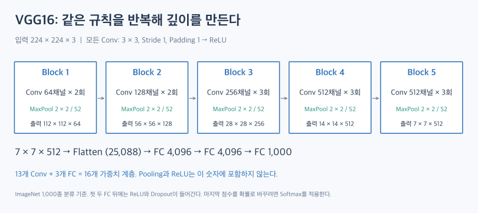
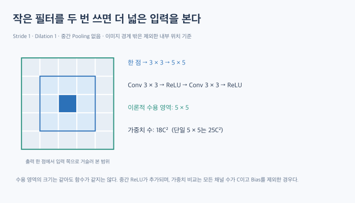

# VGG: 작은 합성곱을 쌓아 깊이를 늘리다

VGG의 핵심은 단순하다. **작은 3×3 합성곱을 여러 번 반복해 깊은 신경망을 만든다.** AlexNet 다음에 읽으면, 커널 크기를 다양하게 설계하는 방식에서 일정한 규칙을 반복하는 방식으로 관점이 바뀌는 것을 볼 수 있다.

이 글은 구조를 설명하는 이론 글이다. 실행 코드와 학습 실험은 포함하지 않는다.

## 1. VGG에서 무엇을 볼 것인가?

VGG는 Oxford의 Visual Geometry Group에서 제안한 CNN이다. 2014년 ILSVRC에서 분류 부문 2위, 위치 추정 부문 1위를 기록했다. 여기서는 대표적인 **VGG16과 VGG19**를 중심으로 살펴본다.

모델을 읽을 때는 다음 두 질문을 구분하면 이해하기 쉽다.

- **깊이:** 합성곱을 몇 번 반복하는가?
- **공간 크기와 채널:** 이미지의 가로·세로는 언제 줄어들고 특징 맵은 몇 장으로 늘어나는가?

VGG16에서는 합성곱이 공간 크기를 유지하며 특징을 변환하고, Pooling이 공간 크기를 줄인다.

## 2. VGG16의 전체 구조

입력은 224×224 RGB 이미지다. 아래 표의 출력은 각 블록의 Pooling까지 끝난 시점이며, 크기 표기는 높이×너비×채널이다.

| 구간 | 합성곱 구성 | Pooling 뒤 출력 |
|---|---|---|
| Block 1 | 3×3, 64채널 × 2회 | 112×112×64 |
| Block 2 | 3×3, 128채널 × 2회 | 56×56×128 |
| Block 3 | 3×3, 256채널 × 3회 | 28×28×256 |
| Block 4 | 3×3, 512채널 × 3회 | 14×14×512 |
| Block 5 | 3×3, 512채널 × 3회 | 7×7×512 |
| 분류기 | Flatten → FC 4096 → FC 4096 → FC 1000 | 클래스별 점수 1000개 |

각 합성곱 뒤에는 ReLU가 들어간다. 첫 두 FC 뒤에도 ReLU가 있으며, 이 구간에는 Dropout을 적용한다.

### 2.1. 이름의 16은 무엇을 세는가?

가중치를 학습하는 계층을 센다.

\[
2+2+3+3+3=13\text{개 Conv}
\]

\[
13\text{개 Conv}+3\text{개 FC}=16
\]

Pooling, ReLU, Flatten은 이 숫자에 포함하지 않는다. 따라서 실제 연산 단계가 16번뿐이라는 뜻은 아니다.

### 2.2. 공간 크기는 줄고 채널은 늘어난다

처음에는 넓은 공간에 적은 수의 특징 맵을 둔다. 뒤로 갈수록 공간 크기는 줄이고 채널 수는 늘린다. 채널 수가 늘어난다는 것은 각 위치를 표현하는 특징 값의 종류가 많아진다는 뜻이다.

다만 특정 채널이 반드시 눈·코 같은 정해진 개념을 담당한다고 해석할 수는 없다. 실제 특징은 학습 결과에 따라 달라진다.

## 3. 왜 큰 필터 대신 작은 필터를 쌓는가?

### 3.1. 여러 층을 거치면 보는 범위가 넓어진다

**수용 영역(Receptive Field)**은 출력의 한 위치가 영향을 받을 수 있는 입력 영역이다.

Stride 1, Dilation 1이고 중간에 Pooling이 없다면, 3×3 합성곱을 한 층 지날 때마다 이론적 수용 영역의 한 변이 2씩 늘어난다.

\[
R_L=1+2L
\]

| 3×3 합성곱 반복 횟수 | 이론적 수용 영역 |
|---|---|
| 1회 | 3×3 |
| 2회 | 5×5 |
| 3회 | 7×7 |

첫 번째 층의 이웃 출력들이 각각 입력의 3×3 영역을 본다. 두 번째 층이 그 이웃들을 함께 모으면 입력의 5×5 범위를 볼 수 있게 된다.

이것은 구조상 영향을 줄 수 있는 범위다. 학습 후 각 입력 위치가 실제로 기여하는 정도가 모두 같다는 뜻은 아니다.

### 3.2. 같은 채널 수라면 가중치 수를 줄일 수 있다

입력·중간·출력의 채널 수를 모두 \(C\)로 맞추고 Bias를 제외하면, \(k\times k\) 합성곱 하나의 가중치 수는 \(k^2C^2\)이다.

| 비교 | 큰 합성곱 한 층 | 3×3 합성곱 여러 층 |
|---|---|---|
| 수용 영역 5×5 | \(25C^2\) | \(2\times9C^2=18C^2\) |
| 수용 영역 7×7 | \(49C^2\) | \(3\times9C^2=27C^2\) |

예를 들어 \(C=64\)일 때, 5×5 한 층은 102,400개, 3×3 두 층은 73,728개의 가중치를 갖는다. 이 조건에서는 28% 줄어든다.

채널 수가 바뀌는 구간은 각 층의 \(k^2C_{in}C_{out}\)을 따로 계산해야 한다. 작은 필터를 쌓는다는 이유만으로 모든 네트워크의 총 연산량이나 메모리가 반드시 줄어드는 것은 아니다.

### 3.3. 중간에 ReLU가 추가된다

두 구성은 수용 영역이 같아도 같은 함수가 아니다.

- 큰 필터 한 층: Conv → ReLU
- 작은 필터 두 층: Conv → ReLU → Conv → ReLU

작은 필터를 쌓으면 중간에 비선형 변환을 더 넣을 수 있다. VGG는 이처럼 작은 커널을 반복하면서 깊이와 비선형 변환의 수를 늘린다.

## 4. Padding과 Pooling의 역할

VGG16·19의 합성곱은 Kernel 3, Stride 1, Padding 1을 사용한다. Dilation 1일 때 출력 크기는 다음과 같다.

\[
H_{out}=\left\lfloor\frac{H+2P-K}{S}\right\rfloor+1
\]

입력이 224라면 다음처럼 크기가 유지된다.

\[
224+2\times1-3+1=224
\]

반면 각 블록 끝의 Max Pooling은 Kernel 2, Stride 2로 공간 크기를 줄인다.

\[
224\rightarrow112\rightarrow56\rightarrow28\rightarrow14\rightarrow7
\]

따라서 블록 안에서 합성곱을 더 쌓는 것과 블록 사이에서 해상도를 낮추는 것을 따로 생각할 수 있다.

## 5. VGG16과 VGG19의 차이

| 항목 | VGG16: 논문의 구성 D | VGG19: 논문의 구성 E |
|---|---|---|
| 블록별 Conv 수 | 2 / 2 / 3 / 3 / 3 | 2 / 2 / 4 / 4 / 4 |
| Conv 합계 | 13 | 16 |
| FC 수 | 3 | 3 |
| 가중치 계층 합계 | 16 | 19 |

VGG19는 뒤쪽 세 블록에 합성곱을 하나씩 추가한다. 채널 수와 Pooling의 기본 흐름은 유지한다.

여기서 설명한 ‘모든 합성곱이 3×3’이라는 규칙은 VGG16의 구성 D와 VGG19의 구성 E에 해당한다. 논문에서 비교한 다른 구성 중에는 1×1 합성곱을 사용하는 구성 C도 있다.

## 6. 구현을 볼 때 주의할 점

### 6.1. 구조가 단순해도 가벼운 모델은 아니다

마지막 특징 맵을 펼치면 \(7\times7\times512=25,088\)개의 값이 된다. 이것을 4,096개 뉴런에 연결하는 첫 FC만 계산해도 다음과 같다.

\[
25,088\times4,096=102,760,448
\]

Bias를 빼도 약 1억 개의 가중치다. 작은 합성곱 커널을 사용한다는 사실과 모델 전체가 가볍다는 주장은 구분해야 한다.

### 6.2. 기본 VGG와 Batch Normalization 버전을 구분한다

현재 torchvision은 기본 `vgg16`과 Batch Normalization을 추가한 `vgg16_bn`을 구분해 제공한다. 기본 VGG16을 설명하는 도식에 BN을 당연한 구성으로 끼워 넣으면 두 버전을 혼동하게 된다.

### 6.3. 논문의 Softmax와 구현의 반환값을 구분한다

논문의 분류 설명에는 마지막 Softmax가 등장한다. 반면 torchvision의 VGG는 마지막 Linear의 출력인 **logits**를 반환한다.

`CrossEntropyLoss`로 학습할 때는 이 logits를 그대로 전달한다. 확률을 확인하려는 경우에 Softmax를 별도로 적용한다.

## 7. 핵심 정리

VGG16은 3×3 합성곱 13개와 FC 3개를 사용한다. 블록 안에서는 공간 크기를 유지하며 특징을 변환하고, 블록 끝에서는 Pooling으로 공간 크기를 줄인다.

작은 합성곱을 쌓으면 수용 영역을 넓히면서 비선형 변환을 추가할 수 있다. 일정한 채널 수를 가정하면 큰 합성곱 한 층보다 가중치 수도 줄일 수 있다. 다만 깊이와 큰 FC 때문에 모델 전체의 비용은 여전히 크다.

다음 ResNet에서는 깊은 네트워크의 학습을 돕는 연결 구조를 살펴본다.

## 관련 개념

- [AlexNet](alexnet.md)
- [Convolutional Layer](convolutional-layer.md)
- [Pooling Layer](pooling-layer.md)
- [Activation Function](activation-functions.md)

## 참고 자료

- [VGG 정리 — dsaint31](https://dsaint31.me/mkdocs_site/ML/ch14_cnn/vgg/): 글의 출발점이 된 참고 자료.
- [Very Deep Convolutional Networks for Large-Scale Image Recognition — Simonyan & Zisserman](https://arxiv.org/abs/1409.1556): 원 논문의 구조·구성 비교와 설계 근거.
- [torchvision VGG 공식 구현](https://docs.pytorch.org/vision/stable/_modules/torchvision/models/vgg.html): D/E 구성과 분류기, BN 변형 및 반환값 확인.
- [PyTorch CrossEntropyLoss](https://docs.pytorch.org/docs/stable/generated/torch.nn.CrossEntropyLoss.html): logits 입력에 대한 설명.

그림은 위 자료의 구조와 계산을 바탕으로 이 글을 위해 새로 작성한 설명용 도식이다.
