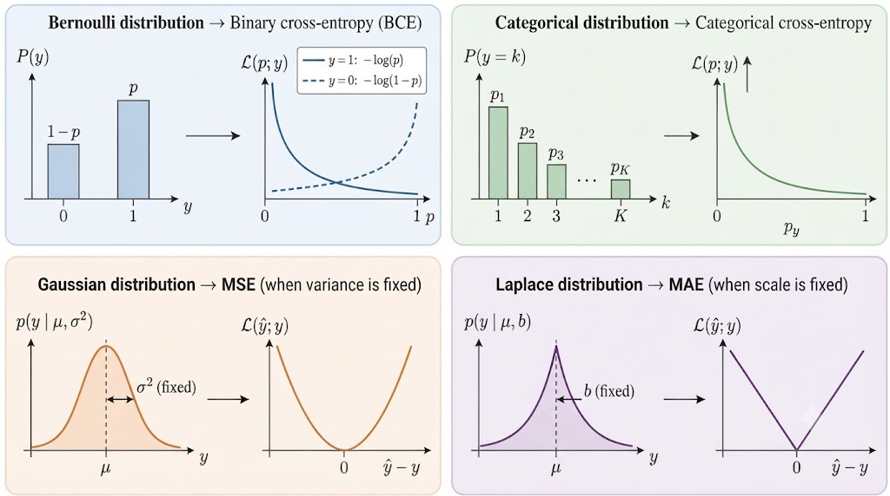

# 딥러닝 손실함수의 확률적 이해: MLE·NLL부터 Cross-Entropy, MSE, MAE, L1·L2 정규화까지

[TOC]


관련 실습: [PyTorch 딥러닝 모델 구현 실습: 선형회귀부터 ANN 학습·평가까지](../../practice/regression/linear-to-ann-regression.md) · [PyTorch로 MLP 직접 구현하기](../../practice/classification/iris-mlp-training.md) · [PyTorch로 Iris Dataset 다중 분류 구현하기: Dataset부터 ANN 학습 및 평가까지](../../practice/classification/iris-classification-pipeline.md) · [AdamW 완전 정리: Adam의 Moment Estimation부터 L2 Regularization·Weight Decay와 PyTorch 구현까지](../../practice/tech-optimizers/adamw.md)


---

  
딥러닝 모델을 학습할 때는 모델의 예측값과 실제 정답 사이의 차이를 측정하기 위해 손실함수(Loss Function)를 사용한다.

PyTorch에서는 다음과 같은 손실함수를 제공한다.

- `nn.BCEWithLogitsLoss`
- `nn.CrossEntropyLoss`
- `nn.MSELoss`
- `nn.L1Loss`

일반적으로 이진 분류에는 Binary Cross-Entropy, 다중 분류에는 Cross-Entropy, 회귀에는 MSE 또는 MAE를 사용한다고 설명한다.

그렇다면 왜 분류 문제에서는 Cross-Entropy를 사용하고, 회귀 문제에서는 MSE나 MAE를 사용하는 것일까?

이러한 손실함수는 단순히 경험적으로 만들어진 것이 아니라, **데이터가 특정 확률분포를 따른다고 가정하고 Maximum Likelihood Estimation(MLE)을 적용하면 수학적으로 유도할 수 있다.**

또한 모델의 파라미터에 대한 사전분포(Prior Distribution)를 고려하면 Maximum a Posteriori Estimation(MAP)으로 확장할 수 있으며, 이는 L1·L2 정규화와 연결된다.

이 글에서는 다음 내용을 살펴본다.

1. Maximum Likelihood Estimation(MLE)
2. Negative Log-Likelihood(NLL)
3. Bernoulli Distribution과 Binary Cross-Entropy
4. Categorical Distribution과 Cross-Entropy
5. Gaussian Distribution과 Mean Squared Error
6. Laplace Distribution과 Mean Absolute Error
7. Maximum a Posteriori Estimation(MAP)
8. Gaussian Prior와 L2 Regularization
9. Laplace Prior와 L1 Regularization
10. Observation Distribution과 Parameter Prior의 차이
11. PyTorch 손실함수 구현 및 실습

---

## 1. 딥러닝에서 Loss Function이란?

딥러닝 모델의 기본적인 목적은 입력 데이터로부터 원하는 출력값을 예측하는 것이다.

입력 데이터를 $x$, 실제 정답을 $y$라고 하자.

모델의 파라미터를 $\theta$라고 하면 예측값은 다음과 같이 표현할 수 있다.

$$
\boxed{ \hat{y}=f_\theta(x) }
$$

여기서

- $x$: Input Data
- $y$: Target
- $\hat{y}$: Prediction
- $\theta$: Model Parameters

이다.

모델은 예측값과 실제 정답의 차이를 줄이도록 파라미터를 조정한다.

이를 위해 정의하는 함수가 Loss Function이다.

$$
\boxed{ L(\theta)=\ell(y,f_\theta(x)) }
$$

모델의 학습은 일반적으로 다음과 같은 최적화 문제로 표현된다.

$$
\boxed{ \hat{\theta} = \underset{\theta}{\arg\min} L(\theta) }
$$

즉 Loss Function을 최소화하는 파라미터를 찾는 것이다.

그런데 여기서 중요한 질문이 발생한다.

> 예측값과 정답의 차이를 측정하는 방법은 여러 가지인데, 특정 문제에 어떤 Loss Function을 사용해야 할까?

이 질문은 **확률모델(Probabilistic Model)** 의 관점에서 이해할 수 있다.

---

## 2. Maximum Likelihood Estimation(MLE)

Maximum Likelihood Estimation(MLE)은 관측된 데이터가 가장 그럴듯하게 나타나도록 하는 모델 파라미터를 추정하는 방법이다.

한국어로는 최대우도추정이라고 한다.

먼저 Likelihood의 의미부터 살펴보자.

### 2.1 Probability와 Likelihood

Probability와 Likelihood는 모두 확률분포와 관련되지만 관점이 다르다.

#### Probability

모델의 파라미터가 주어졌을 때 특정 데이터가 발생할 가능성을 나타낸다.

$$
P(y\mid\theta)
$$

#### Likelihood

관측된 데이터 $y$를 고정하고, 이를 설명하는 파라미터 $\theta$가 얼마나 그럴듯한지 비교한다.

$$
\mathcal{L}(\theta\mid y) = P(y\mid\theta)
$$

두 표현은 같은 확률모델에서 출발하지만 무엇을 고정하고 무엇을 변화시키는지가 다르다.

| 구분 | Probability | Likelihood |
| --- | --- | --- |
| 고정되는 대상 | Parameter | Observed Data |
| 변화시키는 대상 | Data | Parameter |
| 목적 | 데이터의 발생 가능성 계산 | 파라미터의 적합도 비교 |

여기서 Likelihood는 파라미터에 대한 확률분포 자체를 의미하지 않는다.

즉 Likelihood를 $\theta$에 대한 함수로 보더라도, 모든 $\theta$에 대한 적분이 반드시 1이 되는 것은 아니다.

---

### 2.2 조건부 확률모델

딥러닝에서는 입력 $x$가 주어졌을 때 정답 $y$의 조건부 확률분포를 모델링할 수 있다.

이를 다음과 같이 표현하자.

$$
\boxed{ Q_\theta(y\mid x) }
$$

여기서

- $Q_\theta$: 모델이 정의하는 확률분포
- $\theta$: 모델 파라미터
- $x$: 입력 데이터
- $y$: 관측된 정답

이다.

분류 문제에서 $Q_\theta(y\mid x)$는 특정 클래스가 나타날 확률에 해당한다.

회귀 문제에서는 연속형 출력값에 대한 확률밀도함수(Probability Density Function)로 표현할 수 있다.

따라서 회귀 문제에서의 $Q_\theta(y\mid x)$는 확률 자체가 아니라 확률밀도라는 점을 구분해야 한다.

---

### 2.3 여러 Sample에 대한 Likelihood

학습 데이터셋을 다음과 같이 정의하자.

$$
\boxed{ D=\{(x_i,y_i)\}_{i=1}^{N} }
$$

여기서 $N$은 전체 Sample의 개수이다.

각 Sample의 Target이 입력과 파라미터가 주어졌을 때 조건부 독립이라고 가정하면 전체 데이터의 Likelihood는 다음과 같다.

$$
\boxed{ \mathcal{L}(\theta;D) = \prod_{i=1}^{N} Q_\theta(y_i\mid x_i) }
$$

MLE는 이 Likelihood를 최대화하는 파라미터를 찾는다.

$$
\boxed{ \hat{\theta}_{MLE} = \underset{\theta}{\arg\max} \prod_{i=1}^{N} Q_\theta(y_i\mid x_i) }
$$

즉 실제 관측 데이터에 높은 확률 또는 확률밀도를 부여하는 모델을 찾는 과정이다.

---

## 3. Negative Log-Likelihood(NLL)

Likelihood는 여러 확률 또는 확률밀도 값을 곱하는 형태이다.

하지만 많은 Sample에 대한 확률값을 계속 곱하면 수치적으로 매우 작은 값이 발생할 수 있다.

또한 곱셈 형태는 미분 및 최적화 과정에서 다루기 불편할 수 있다.

이를 해결하기 위해 Logarithm을 사용한다.

### 3.1 Log-Likelihood

Likelihood에 자연로그를 적용하면 다음과 같다.

$$
\log\mathcal{L}(\theta;D) = \log \prod_{i=1}^{N} Q_\theta(y_i\mid x_i)
$$

로그의 성질에 의해

$$
\log(ab)=\log a+\log b
$$

이므로

$$
\boxed{ \log\mathcal{L}(\theta;D) = \sum_{i=1}^{N} \log Q_\theta(y_i\mid x_i) }
$$

이다.

즉 곱셈이 덧셈으로 변환된다.

---

### 3.2 Negative Log-Likelihood

MLE에서는 Likelihood를 최대화한다.

그런데 딥러닝에서는 일반적으로 Loss Function을 최소화하는 방식으로 모델을 학습한다.

따라서 Log-Likelihood에 음수를 붙이면 된다.

$$
\boxed{ L_{NLL}(\theta) = -\sum_{i=1}^{N} \log Q_\theta(y_i\mid x_i) }
$$

이 함수가 Negative Log-Likelihood이다.

따라서

$$
\boxed{ \underset{\theta}{\arg\max} \mathcal{L}(\theta;D) = \underset{\theta}{\arg\min} L_{NLL}(\theta) }
$$

이다.

즉 **Likelihood를 최대화하는 것과 NLL을 최소화하는 것은 같은 최적화 문제**이다.

---

### 3.3 평균 NLL

실제 딥러닝 구현에서는 전체 Sample에 대한 NLL의 평균을 사용하는 경우가 많다.

$$
\boxed{ L_{NLL}(\theta) = -\frac{1}{N} \sum_{i=1}^{N} \log Q_\theta(y_i\mid x_i) }
$$

전체 합을 $N$으로 나누더라도 $N$이 고정되어 있다면 최소화하는 파라미터는 달라지지 않는다.

이제 각 Task에 적절한 확률분포를 가정하고 NLL을 유도해 보자.

---

## 4. Binary Classification과 Bernoulli Distribution

Binary Classification은 입력 데이터를 두 개의 클래스 중 하나로 분류하는 문제이다.

예를 들어 다음과 같다.

- 정상 / 비정상
- 질병 없음 / 질병 있음
- 스팸 아님 / 스팸
- 0 / 1

Binary Classification에서 Target은 일반적으로 다음 값을 가진다.

$$
\boxed{ y\in\{0,1\} }
$$

이러한 확률변수를 표현하는 대표적인 확률분포가 Bernoulli Distribution이다.

---

### 4.1 Bernoulli Distribution

Bernoulli Distribution은 두 가지 결과 중 하나가 발생하는 확률분포이다.

성공 확률을 $q$라고 하면 다음과 같다.

$$
P(Y=1)=q
$$

$$
P(Y=0)=1-q
$$

여기서

$$
0\le q\le1
$$

이다.

두 경우를 하나의 식으로 표현하면

$$
\boxed{ P(Y=y)=q^y(1-q)^{1-y} }
$$

이다.

예를 들어 $y=1$이면

$$
P(Y=1) = q^1(1-q)^0 = q
$$

이다.

반면 $y=0$이면

$$
P(Y=0) = q^0(1-q)^1 = 1-q
$$

이다.

따라서 하나의 수식으로 두 결과의 확률을 모두 표현할 수 있다.

---

### 4.2 Binary Classification 모델의 확률분포

모델이 입력 $x$에 대해 $Y=1$일 확률을 다음과 같이 예측한다고 하자.

$$
\boxed{ q_\theta(x)=P_\theta(Y=1\mid x) }
$$

그러면 $Y=0$일 확률은

$$
P_\theta(Y=0\mid x) = 1-q_\theta(x)
$$

이다.

이를 Bernoulli Distribution으로 표현하면

$$
\boxed{ Q_\theta(y\mid x) = q_\theta(x)^y [1-q_\theta(x)]^{1-y} }
$$

이다.

이제 이 확률분포에 NLL을 적용해 보자.

---

## 5. Bernoulli NLL에서 Binary Cross-Entropy 유도

NLL의 정의는 다음과 같다.

$$
\ell_{NLL} = -\log Q_\theta(y\mid x)
$$

Bernoulli Distribution을 대입하면

$$
\ell_{NLL} = -\log \left[ q_\theta^y (1-q_\theta)^{1-y} \right]
$$

이다.

로그의 성질

$$
\log(a^b)=b\log a
$$

를 이용하면

$$
\ell_{NLL} = - \left[ y\log q_\theta + (1-y)\log(1-q_\theta) \right]
$$

이다.

따라서

$$
\boxed{ \ell_{BCE} = - \left[ y\log q_\theta + (1-y)\log(1-q_\theta) \right] }
$$

이다.

이 식이 Binary Cross-Entropy(BCE)이다.

즉

$$
\boxed{ \text{Bernoulli NLL} = \text{Binary Cross-Entropy} }
$$

이다.

---

### 5.1 Target이 1인 경우

실제 정답이

$$
y=1
$$

이라면

$$
\ell_{BCE} = - \left[ 1\log q_\theta + 0\log(1-q_\theta) \right]
$$

이다.

따라서

$$
\boxed{ \ell_{BCE}=-\log q_\theta }
$$

이다.

모델이 정답 클래스에 높은 확률을 부여할수록 Loss가 작아진다.

예를 들어

$$
q_\theta=0.9
$$

라면

$$
\ell_{BCE}=-\log0.9
$$

이므로

$$
\ell_{BCE}\approx0.105
$$

이다.

반면

$$
q_\theta=0.1
$$

이라면

$$
\ell_{BCE}=-\log0.1
$$

이므로

$$
\ell_{BCE}\approx2.303
$$

이다.

즉 실제 정답이 1인데 모델이 0.1이라는 낮은 확률을 예측하면 큰 손실이 발생한다.

---

### 5.2 Target이 0인 경우

실제 정답이

$$
y=0
$$

이라면

$$
\ell_{BCE} = - \left[ 0\log q_\theta + 1\log(1-q_\theta) \right]
$$

이다.

따라서

$$
\boxed{ \ell_{BCE}=-\log(1-q_\theta) }
$$

이다.

이 경우 모델이 $Y=1$일 확률을 낮게 예측할수록 Loss가 작아진다.

---

### 5.3 Hard Target과 Soft Target

Binary Classification에서는 Target을 Hard Target과 Soft Target으로 구분할 수 있다.

#### Hard Target

Hard Target은 실제 Label이 0 또는 1인 경우이다.

$$
\boxed{ y\in\{0,1\} }
$$

일반적인 Binary Classification Dataset이 여기에 해당한다.

#### Soft Target

Soft Target은 Target을 0과 1 사이의 값으로 표현하는 경우이다.

$$
\boxed{ 0\le p\le1 }
$$

예를 들어

$$
p=0.8
$$

이라면 Target Distribution이 클래스 1에 80%, 클래스 0에 20%의 확률을 부여하는 것으로 해석할 수 있다.

Soft Target에 대한 BCE는 다음과 같다.

$$
\boxed{ \ell_{BCE}(p,q_\theta) = - \left[ p\log q_\theta + (1-p)\log(1-q_\theta) \right] }
$$

이다.

이 식은 Target Distribution과 모델의 예측분포 사이의 Cross-Entropy를 나타낸다.

Hard Target은 $p=0$ 또는 $p=1$인 특별한 경우이다.

참고로 Soft Target에서의 Cross-Entropy는 하나의 관측된 0 또는 1에 대한 NLL이라기보다, **Target Distribution을 기준으로 한 Expected Negative Log-Likelihood**로 이해하는 것이 정확하다.

---

## 6. Logistic Function과 BCE

Binary Classification 모델은 일반적으로 Logit을 출력한다.

Logit을 $z$라고 하자.

이를 확률로 변환하기 위해 Sigmoid Function을 사용한다.

$$
\boxed{ \sigma(z)=\frac{1}{1+e^{-z}} }
$$

Sigmoid Function의 출력 범위는 다음과 같다.

$$
0<\sigma(z)<1
$$

따라서 모델의 예측 확률은

$$
\boxed{ q_\theta(x) = \sigma(f_\theta(x)) }
$$

로 표현할 수 있다.

전체 흐름은 다음과 같다.

```text
Input Data
    │
    ▼
Neural Network
    │
    ▼
Logit z
    │
    ▼
Sigmoid
    │
    ▼
Probability q
    │
    ▼
Binary Cross-Entropy
```

PyTorch에서는 `nn.BCEWithLogitsLoss`를 사용하는 것이 일반적이다.

이 함수는 Sigmoid와 BCE 계산을 수치적으로 안정적인 방식으로 결합한다.

따라서 다음과 같이 구현한다.

```python
import torch
import torch.nn as nn

criterion = nn.BCEWithLogitsLoss()

logits = torch.tensor([
    [1.2],
    [-0.8],
    [0.5]
])

targets = torch.tensor([
    [1.0],
    [0.0],
    [1.0]
])

loss = criterion(logits, targets)

print(loss.item())
```

여기서 중요한 점은 **`BCEWithLogitsLoss`에 Sigmoid를 통과시킨 확률이 아니라 Raw Logit을 전달한다는 것**이다.

잘못된 사용 예시는 다음과 같다.

```python
# 권장하지 않는 방식

probabilities = torch.sigmoid(logits)

loss = criterion(probabilities, targets)
```

`BCEWithLogitsLoss` 내부에서 Sigmoid에 해당하는 처리를 수행하므로 별도로 적용하면 안 된다.

---

## 7. Multiclass Classification과 Categorical Distribution

Multiclass Classification은 세 개 이상의 클래스 중 하나를 선택하는 문제이다.

예를 들어 Iris Dataset에서는 붓꽃을 다음 세 가지 품종으로 분류한다.

- Setosa
- Versicolor
- Virginica

따라서

$$
\boxed{ K=3 }
$$

이다.

이러한 문제에서는 Categorical Distribution을 사용할 수 있다.

---

### 7.1 Categorical Distribution

Categorical Distribution은 확률변수가 $K$개의 클래스 중 하나를 선택하는 확률분포이다.

각 클래스에 대한 모델의 예측 확률을 다음과 같이 정의하자.

$$
\boxed{ \mathbf{q}_\theta = (q_{\theta,1},q_{\theta,2},\cdots,q_{\theta,K}) }
$$

여기서

$$
q_{\theta,k}=P_\theta(Y=k\mid x)
$$

이다.

모든 클래스의 확률은 다음 조건을 만족한다.

$$
\boxed{ \sum_{k=1}^{K}q_{\theta,k}=1 }
$$

또한

$$
0\le q_{\theta,k}\le1
$$

이다.

예를 들어 Iris Dataset에 대해 모델이 다음과 같이 예측했다고 하자.

$$
\mathbf{q}_\theta = (0.1,0.7,0.2)
$$

각 값은 다음을 의미한다.

| Class | Probability |
| --- | --- |
| Setosa | 0.1 |
| Versicolor | 0.7 |
| Virginica | 0.2 |

모델은 Versicolor에 가장 높은 확률을 부여하고 있다.

---

## 8. Categorical NLL에서 Cross-Entropy 유도

정답 클래스가 $c$라고 하자.

Categorical Distribution에서 해당 클래스의 확률은 다음과 같다.

$$
Q_\theta(Y=c\mid x)=q_{\theta,c}
$$

따라서 NLL은 다음과 같다.

$$
\ell_{NLL} = -\log Q_\theta(Y=c\mid x)
$$

그러므로

$$
\boxed{ \ell_{NLL} = -\log q_{\theta,c} }
$$

이다.

즉 모델이 정답 클래스에 높은 확률을 부여할수록 Loss가 감소한다.

---

### 8.1 One-Hot Encoding

정답 클래스를 One-Hot Vector로 표현할 수도 있다.

예를 들어 클래스가 세 개이고 정답이 두 번째 클래스라면

$$
\boxed{ \mathbf{p} = (0,1,0) }
$$

이다.

이때 Categorical Cross-Entropy는 다음과 같다.

$$
\boxed{ \ell_{CE}(\mathbf{p},\mathbf{q}_\theta) = -\sum_{k=1}^{K} p_k\log q_{\theta,k} }
$$

이다.

정답이 두 번째 클래스라면

$$
p_1=0,\qquad p_2=1,\qquad p_3=0
$$

이므로

$$
\ell_{CE} = - [ 0\log q_{\theta,1} + 1\log q_{\theta,2} + 0\log q_{\theta,3} ]
$$

이다.

따라서

$$
\boxed{ \ell_{CE} = -\log q_{\theta,2} }
$$

이다.

즉 Hard Target에서는 Categorical Cross-Entropy와 정답 클래스에 대한 NLL이 같아진다.

---

### 8.2 Soft Target의 Cross-Entropy

Soft Target에서는 정답을 하나의 클래스에만 할당하지 않고 확률분포로 나타낸다.

예를 들어

$$
\mathbf{p} = (0.1,0.8,0.1)
$$

과 같이 표현할 수 있다.

이때 Cross-Entropy는 다음과 같다.

$$
\boxed{ \ell_{CE} = -\sum_{k=1}^{K} p_k\log q_{\theta,k} }
$$

이다.

즉 Target Distribution의 각 확률을 가중치로 사용하여 모델의 Negative Log-Probability를 합산한다.

이러한 방식은 Soft Label을 사용하는 학습이나 Knowledge Distillation 등과 연결된다.

---

## 9. Softmax와 CrossEntropyLoss

Categorical Distribution을 사용하는 모델은 일반적으로 Softmax Function을 통해 클래스 확률을 계산한다.

모델이 출력한 Logit Vector를 다음과 같이 정의하자.

$$
\mathbf{z} = (z_1,z_2,\cdots,z_K)
$$

Softmax Function은 다음과 같다.

$$
\boxed{ q_{\theta,k} = \frac{e^{z_k}} {\sum_{j=1}^{K}e^{z_j}} }
$$

이 함수는 Logit을 확률분포로 변환한다.

따라서 전체 흐름은 다음과 같다.

```text
Input Data
    │
    ▼
Neural Network
    │
    ▼
Logits
    │
    ▼
Softmax
    │
    ▼
Categorical Distribution
    │
    ▼
Cross-Entropy
```

PyTorch의 `nn.CrossEntropyLoss`는 내부에서 Log-Softmax와 NLL 계산을 결합한다.

따라서 별도로 Softmax를 적용하지 않는다.

```python
import torch
import torch.nn as nn

criterion = nn.CrossEntropyLoss()

logits = torch.tensor([
    [2.0, 0.5, -1.0],
    [0.1, 0.2, 1.3]
])

targets = torch.tensor(
    [0, 2],
    dtype=torch.long
)

loss = criterion(logits, targets)

print(loss.item())
```

여기서 Tensor Shape는 다음과 같다.

```text
Logits Shape : [2, 3]
Target Shape : [2]
```

즉 두 개의 Sample에 대해 세 개의 클래스 Logit이 존재한다.

Target은 각 Sample의 정답 클래스 Index를 나타낸다.

One-Hot Vector를 사용하지 않고 정수 형태의 Class Index를 전달하는 것이 일반적인 PyTorch 사용 방식이다.

---

## 10. Regression과 Gaussian Distribution

이제 분류가 아닌 회귀(Regression) 문제를 살펴보자.

Regression은 연속적인 수치값을 예측하는 문제이다.

예를 들어 다음과 같다.

- 온도 예측
- 혈압 예측
- 심박수 추정
- 센서 측정값 예측
- 연속적인 생체신호 추정

Regression에서는 일반적으로 모델이 하나의 연속적인 값을 예측한다.

$$
\boxed{ \hat{y}=f_\theta(x) }
$$

그런데 이 예측값을 확률적으로 해석하려면 어떻게 해야 할까?

대표적인 방법은 **Target이 Gaussian Distribution을 따른다고 가정하는 것**이다.

---

### 10.1 Gaussian Distribution

Gaussian Distribution은 정규분포라고도 한다.

확률밀도함수는 다음과 같다.

$$
\boxed{ p(y) = \frac{1}{\sqrt{2\pi\sigma^2}} \exp \left( -\frac{(y-\mu)^2}{2\sigma^2} \right) }
$$

여기서

- $\mu$: Mean
- $\sigma^2$: Variance
- $\sigma$: Standard Deviation

이다.

Gaussian Distribution은 평균 $\mu$를 중심으로 종 모양의 분포를 가진다.

---

### 10.2 Regression 모델의 확률적 해석

Regression 모델이 입력 $x$에 대해 평균값 $\mu_\theta(x)$를 예측한다고 하자.

실제 Target은 이 평균을 중심으로 Gaussian Distribution을 따른다고 가정한다.

$$
\boxed{ Y\mid X=x \sim \mathcal{N} \left( \mu_\theta(x),\sigma^2 \right) }
$$

여기서

- $Y$: Target Random Variable
- $X=x$: 입력이 $x$로 주어진 조건
- $\mu_\theta(x)$: 모델이 예측하는 평균
- $\sigma^2$: Target의 조건부 분산

이다.

이 모델은 다음과 같이 표현할 수도 있다.

$$
\boxed{ y=\mu_\theta(x)+\epsilon }
$$

여기서 오차항은

$$
\boxed{ \epsilon\sim\mathcal{N}(0,\sigma^2) }
$$

를 따른다고 가정한다.

즉 실제 관측값은 모델의 평균 예측값에 Gaussian Noise가 더해진 형태로 표현된다.

---

## 11. Gaussian NLL에서 MSE 유도

Gaussian Distribution을 사용하는 조건부 확률밀도함수는 다음과 같다.

$$
\boxed{ q_\theta(y\mid x,\sigma^2) = \frac{1}{\sqrt{2\pi\sigma^2}} \exp \left[ -\frac{(y-\mu_\theta(x))^2}{2\sigma^2} \right] }
$$

여기에 Negative Log-Likelihood를 적용한다.

$$
\ell_{NLL} = -\log q_\theta(y\mid x,\sigma^2)
$$

따라서

$$
\ell_{NLL} = -\log \left[ \frac{1}{\sqrt{2\pi\sigma^2}} \exp \left( -\frac{(y-\mu_\theta(x))^2}{2\sigma^2} \right) \right]
$$

이다.

로그의 성질을 이용하여 정리하면

$$
\boxed{ \ell_{NLL} = \frac12\log(2\pi\sigma^2) + \frac{(y-\mu_\theta(x))^2}{2\sigma^2} }
$$

이다.

이제 중요한 가정을 적용한다.

---

### 11.1 Variance가 고정된 경우

모든 Sample에 대해 분산 $\sigma^2$가 일정하고, 모델 학습 중에도 변하지 않는다고 가정하자.

그러면

$$
\frac12\log(2\pi\sigma^2)
$$

는 상수이다.

또한

$$
\frac{1}{2\sigma^2}
$$

도 상수이다.

따라서 NLL에서 모델 파라미터 $\theta$에 따라 달라지는 부분은 다음 항이다.

$$
\boxed{ (y-\mu_\theta(x))^2 }
$$

즉 NLL을 최소화하는 것은 제곱 오차를 최소화하는 것과 같다.

전체 데이터에 대한 평균 제곱 오차는 다음과 같다.

$$
\boxed{ L_{MSE} = \frac{1}{N} \sum_{i=1}^{N} \left( y_i-\mu_\theta(x_i) \right)^2 }
$$

따라서

$$
\boxed{ \text{Gaussian NLL} \propto \text{MSE} }
$$

이다.

여기서 비례관계는 분산이 고정되어 있고, 모델 최적화와 무관한 상수항을 제외했을 때 성립한다.

**즉 Gaussian Noise를 가정하면 MSE Loss를 유도할 수 있다.**

---

### 11.2 MSE가 큰 오차에 민감한 이유

MSE는 오차를 제곱한다.

예를 들어 실제 정답과 예측값의 차이가 다음과 같다고 하자.

| Error | Squared Error |
| --- | --- |
| 1 | 1 |
| 2 | 4 |
| 3 | 9 |
| 5 | 25 |

오차가 두 배가 되면 제곱 오차는 네 배가 된다.

따라서 MSE는 큰 오차에 상대적으로 큰 Penalty를 부여한다.

이는 이상치(Outlier)가 존재할 때 학습 결과에 큰 영향을 줄 수 있다는 의미이기도 하다.

---

### 11.3 분산까지 학습하는 경우

앞에서는 분산 $\sigma^2$가 고정되어 있다고 가정하였다.

하지만 모델이 평균과 분산을 동시에 예측할 수도 있다.

예를 들어

$$
\mu_\theta(x)
$$

와

$$
\sigma_\theta^2(x)
$$

를 모두 학습한다고 하자.

이 경우 NLL은 다음과 같다.

$$
\boxed{ \ell_{NLL} = \frac12 \log \left( 2\pi\sigma_\theta^2(x) \right) + \frac{ (y-\mu_\theta(x))^2 }{ 2\sigma_\theta^2(x) } }
$$

이때 분산 관련 항이 더 이상 상수가 아니다.

따라서 전체 Loss는 단순한 MSE와 달라진다.

즉 **Gaussian Distribution을 사용한다고 해서 항상 MSE Loss가 되는 것은 아니다.**

MSE와의 대응관계는 분산을 고정한 경우에 성립한다.

---

## 12. Regression과 Laplace Distribution

Regression에서는 Gaussian Distribution 외에도 Laplace Distribution을 사용할 수 있다.

Laplace Distribution은 평균 또는 위치 파라미터 주변에 뾰족한 중심을 가지며, Gaussian Distribution보다 상대적으로 두꺼운 Tail을 가진다.

이 분포의 확률밀도함수는 다음과 같다.

$$
\boxed{ p(y) = \frac{1}{2b} \exp \left( -\frac{|y-\mu|}{b} \right) }
$$

여기서

- $\mu$: Location Parameter
- $b$: Scale Parameter

이다.

조건은 다음과 같다.

$$
\boxed{ b>0 }
$$

이다.

Gaussian Distribution이 제곱 오차를 이용하는 형태라면, Laplace Distribution은 절댓값 오차와 직접적으로 연결된다.

---

## 13. Laplace NLL에서 MAE 유도

Regression 모델의 예측값을 $\mu_\theta(x)$라고 하자.

Target이 다음과 같은 Laplace Distribution을 따른다고 가정한다.

$$
\boxed{ Y\mid X=x \sim \operatorname{Laplace} \left( \mu_\theta(x),b \right) }
$$

조건부 확률밀도함수는 다음과 같다.

$$
\boxed{ q_\theta(y\mid x,b) = \frac{1}{2b} \exp \left( -\frac{|y-\mu_\theta(x)|}{b} \right) }
$$

여기에 NLL을 적용하면

$$
\ell_{NLL} = -\log q_\theta(y\mid x,b)
$$

이다.

따라서

$$
\ell_{NLL} = -\log \left[ \frac{1}{2b} \exp \left( -\frac{|y-\mu_\theta(x)|}{b} \right) \right]
$$

이다.

로그의 성질을 적용하면

$$
\boxed{ \ell_{NLL} = \log(2b) + \frac{|y-\mu_\theta(x)|}{b} }
$$

이다.

---

### 13.1 Scale Parameter가 고정된 경우

Scale Parameter $b$가 고정되어 있다고 가정하자.

그러면

$$
\log(2b)
$$

는 상수이다.

또한

$$
\frac1b
$$

도 상수이다.

따라서 NLL에서 모델 파라미터에 따라 달라지는 부분은 다음과 같다.

$$
\boxed{ |y-\mu_\theta(x)| }
$$

즉 NLL을 최소화하는 것은 절댓값 오차를 최소화하는 것과 같다.

전체 데이터에 대한 Mean Absolute Error는 다음과 같다.

$$
\boxed{ L_{MAE} = \frac1N \sum_{i=1}^{N} |y_i-\mu_\theta(x_i)| }
$$

따라서

$$
\boxed{ \text{Laplace NLL} \propto \text{MAE} }
$$

이다.

즉 **Laplace Distribution을 가정하면 MAE Loss를 유도할 수 있다.**

---

### 13.2 MAE가 이상치에 상대적으로 강한 이유

MAE는 오차의 절댓값을 사용한다.

$$
\ell_{MAE}=|y-\hat y|
$$

따라서 오차가 증가하면 Loss가 선형적으로 증가한다.

예를 들어 다음과 같다.

| Error | MAE | MSE |
| --- | --- | --- |
| 1 | 1 | 1 |
| 2 | 2 | 4 |
| 3 | 3 | 9 |
| 5 | 5 | 25 |

MSE는 오차를 제곱하므로 큰 오차에 더 민감하다.

반면 MAE는 선형적으로 증가하므로 상대적으로 이상치의 영향을 덜 받을 수 있다.

이러한 특성 때문에 이상치가 포함된 Regression 문제에서는 MAE를 고려할 수 있다.

---

### 13.3 Scale까지 학습하는 경우

Laplace Distribution의 Scale Parameter도 학습하도록 설계할 수 있다.

이 경우 모델은 다음 값을 예측한다.

$$
\mu_\theta(x),\quad b_\theta(x)
$$

그러면 NLL은 다음과 같다.

$$
\boxed{ \ell_{NLL} = \log(2b_\theta(x)) + \frac{|y-\mu_\theta(x)|}{b_\theta(x)} }
$$

이다.

Scale Parameter가 학습 대상이기 때문에 첫 번째 항도 최적화에 영향을 준다.

따라서 고정 Scale 조건에서의 MAE와는 다른 Loss가 된다.

---

## 14. Gaussian과 Laplace Regression 비교

지금까지 두 가지 Regression Loss를 유도하였다.

| 구분 | Gaussian | Laplace |
| --- | --- | --- |
| Distribution | Normal Distribution | Laplace Distribution |
| 중심 파라미터 | Mean $\mu$ | Location $\mu$ |
| Scale 관련 파라미터 | Variance $\sigma^2$ | Scale $b$ |
| 주요 오차항 | Squared Error | Absolute Error |
| 대응 Loss | MSE | MAE |
| 큰 오차에 대한 민감도 | 상대적으로 높음 | 상대적으로 낮음 |

따라서 다음 관계를 얻는다.

$$
\boxed{ \text{Gaussian Likelihood} \rightarrow \text{MSE} }
$$

$$
\boxed{ \text{Laplace Likelihood} \rightarrow \text{MAE} }
$$

단, 두 관계는 각각 분산과 Scale Parameter를 고정한 조건에서 성립한다.

---

## 15. Loss Function과 확률분포의 관계

앞에서 유도한 결과를 정리하면 다음과 같다.

| Task | Distribution | Negative Log-Likelihood 기반 Loss |
| --- | --- | --- |
| Binary Classification | Bernoulli | Binary Cross-Entropy |
| Multiclass Classification | Categorical | Cross-Entropy |
| Regression | Gaussian | MSE |
| Regression | Laplace | MAE |

이 표에서 중요한 점은 **Loss Function이 어떤 확률분포를 가정하는지에 따라 달라진다는 것**이다.

즉 Loss Function을 선택하는 것은 단순히 계산 공식을 선택하는 것이 아니라, Target Data의 확률적 특성에 대한 가정을 선택하는 것과 관련된다.

---

## 16. MLE의 한계와 Regularization

지금까지 살펴본 방법은 모두 Maximum Likelihood Estimation에 기반한다.

MLE는 데이터의 Likelihood를 최대화하는 파라미터를 찾는다.

$$
\hat\theta_{MLE} = \underset{\theta}{\arg\max} Q_\theta(D)
$$

하지만 실제 딥러닝에서는 학습 데이터에 대한 Loss만 지나치게 최소화하면 Overfitting이 발생할 수 있다.

Overfitting은 모델이 Training Data에 과도하게 적합되어 새로운 데이터에 대한 성능이 저하되는 현상이다.

이를 완화하기 위해 Regularization(정규화)을 사용할 수 있다.

Regularization은 일반적으로 기존 Loss Function에 추가적인 Penalty Term을 더하는 방식으로 표현할 수 있다.

$$
\boxed{ L_{\mathrm{total}} = L_{\mathrm{data}} + \lambda L_{\mathrm{regularization}} }
$$

여기서

- $L_{\mathrm{data}}$: 데이터에 대한 Loss
- $L_{\mathrm{regularization}}$: 정규화 항
- $\lambda$: 정규화 강도

이다.

이러한 정규화 항도 확률적 관점에서 유도할 수 있다.

이를 이해하기 위해서는 Maximum a Posteriori Estimation(MAP)이 필요하다.

---

## 17. Maximum a Posteriori Estimation(MAP)

MLE는 관측된 데이터의 Likelihood만을 고려한다.

반면 MAP는 데이터의 Likelihood에 더하여 모델 파라미터에 대한 사전적인 가정을 고려한다.

이러한 가정을 **Prior Distribution(사전분포)** 이라고 한다.

---

### 17.1 Bayes' Theorem

Bayes' Theorem은 다음과 같다.

$$
\boxed{ P(\theta\mid D) = \frac{ P(D\mid\theta)P(\theta) }{ P(D) } }
$$

여기서

- $P(\theta\mid D)$: Posterior Distribution
- $P(D\mid\theta)$: Likelihood
- $P(\theta)$: Prior Distribution
- $P(D)$: Evidence

이다.

모델 파라미터가 연속적인 경우에는 해당 분포를 확률밀도로 해석한다.

---

### 17.2 MLE와 MAP의 차이

MLE에서는 Likelihood를 최대화한다.

$$
\boxed{ \hat\theta_{MLE} = \underset{\theta}{\arg\max} P(D\mid\theta) }
$$

MAP에서는 Posterior Distribution을 최대화한다.

$$
\boxed{ \hat\theta_{MAP} = \underset{\theta}{\arg\max} P(\theta\mid D) }
$$

Bayes' Theorem을 대입하면

$$
\hat\theta_{MAP} = \underset{\theta}{\arg\max} \frac{ P(D\mid\theta)P(\theta) }{ P(D) }
$$

이다.

여기서 $P(D)$는 파라미터 $\theta$에 의존하지 않는다.

따라서 최적화 과정에서는 상수로 취급할 수 있다.

결과적으로

$$
\boxed{ \hat\theta_{MAP} = \underset{\theta}{\arg\max} P(D\mid\theta)P(\theta) }
$$

이다.

즉 MAP는 Likelihood와 Prior를 함께 고려한다.

---

## 18. MAP를 Loss Function 형태로 변환

MAP의 목적함수는 다음과 같다.

$$
\hat\theta_{MAP} = \underset{\theta}{\arg\max} P(D\mid\theta)P(\theta)
$$

여기에 Negative Logarithm을 적용하면

$$
\hat\theta_{MAP} = \underset{\theta}{\arg\min} \left[ -\log P(D\mid\theta) - \log P(\theta) \right]
$$

이다.

따라서 목적함수를 다음과 같이 정의할 수 있다.

$$
\boxed{ J_{MAP}(\theta) = -\log P(D\mid\theta) - \log P(\theta) }
$$

첫 번째 항은 Data NLL이다.

$$
\boxed{ L_{\mathrm{data}} = -\log P(D\mid\theta) }
$$

두 번째 항은 Prior에서 유도되는 Penalty이다.

$$
\boxed{ L_{\mathrm{prior}} = -\log P(\theta) }
$$

따라서

$$
\boxed{ J_{MAP}(\theta) = L_{\mathrm{data}} + L_{\mathrm{prior}} }
$$

이다.

이 식이 Regularization의 확률적 해석을 제공한다.

즉 **MAP는 데이터에 대한 Loss에 파라미터의 사전분포에서 유도한 Penalty를 더하는 형태로 이해할 수 있다.**

---

## 19. Gaussian Prior와 L2 Regularization

모델 파라미터에 Gaussian Prior를 적용한다고 가정하자.

모델의 파라미터를 다음과 같이 표현한다.

$$
\boldsymbol{\theta} = (\theta_1,\theta_2,\cdots,\theta_d)
$$

각 파라미터가 평균 0, 분산 $\tau^2$인 Gaussian Distribution을 독립적으로 따른다고 가정한다.

$$
\boxed{ \theta_j \sim \mathcal{N}(0,\tau^2) }
$$

---

### 19.1 Gaussian Prior의 확률밀도함수

각 파라미터의 Prior는 다음과 같다.

$$
P(\theta_j) = \frac{1}{\sqrt{2\pi\tau^2}} \exp \left( -\frac{\theta_j^2}{2\tau^2} \right)
$$

파라미터들이 독립이라고 가정하면 전체 Prior는 다음과 같다.

$$
P(\boldsymbol{\theta}) = \prod_{j=1}^{d} P(\theta_j)
$$

이다.

---

### 19.2 Negative Log-Prior

전체 Prior에 Negative Logarithm을 적용하면 다음과 같다.

$$
-\log P(\boldsymbol{\theta}) = -\sum_{j=1}^{d} \log P(\theta_j)
$$

Gaussian Prior를 대입하면

$$
-\log P(\boldsymbol{\theta}) = \sum_{j=1}^{d} \left[ \frac12\log(2\pi\tau^2) + \frac{\theta_j^2}{2\tau^2} \right]
$$

이다.

이를 정리하면

$$
\boxed{ -\log P(\boldsymbol{\theta}) = \frac{1}{2\tau^2} \sum_{j=1}^{d}\theta_j^2 + C }
$$

이다.

여기서 $C$는 파라미터에 의존하지 않는 상수이다.

유클리드 노름을 사용하면

$$
\|\boldsymbol{\theta}\|_2^2 = \sum_{j=1}^{d}\theta_j^2
$$

이므로

$$
\boxed{ -\log P(\boldsymbol{\theta}) = \frac{1}{2\tau^2} \|\boldsymbol{\theta}\|_2^2 + C }
$$

이다.

---

### 19.3 L2 Regularization 유도

MAP 목적함수는 다음과 같다.

$$
J_{MAP}(\theta) = L_{NLL}(\theta) - \log P(\theta)
$$

Gaussian Prior를 대입하면

$$
J_{MAP}(\theta) = L_{NLL}(\theta) + \frac{1}{2\tau^2} \|\theta\|_2^2 + C
$$

이다.

최적화에 영향을 주지 않는 상수항을 제외하면

$$
\boxed{ J_{MAP}(\theta) = L_{NLL}(\theta) + \lambda\|\theta\|_2^2 }
$$

의 형태가 된다.

이것이 L2 Regularization이다.

따라서

$$
\boxed{ \text{Gaussian Prior} \rightarrow \text{L2 Regularization} }
$$

이다.

여기서 $\lambda$는 원래의 NLL을 합으로 사용하는지 평균으로 사용하는지에 따라 Prior의 분산 $\tau^2$와 연결되는 방식이 달라진다.

위 유도처럼 전체 NLL의 합을 사용한다면

$$
\lambda=\frac{1}{2\tau^2}
$$

이다.

반면 Data NLL의 평균을 사용하고 전체 MAP 목적함수도 $N$으로 나누어 표현한다면

$$
\lambda=\frac{1}{2N\tau^2}
$$

로 대응된다.

---

### 19.4 Gaussian Prior의 의미

Gaussian Distribution은 평균을 중심으로 높은 확률밀도를 가진다.

평균이 0이면 파라미터가 0에 가까울수록 높은 Prior Density가 부여된다.

따라서 Gaussian Prior는 큰 파라미터 값을 상대적으로 덜 선호한다.

또한 분산 $\tau^2$가 작아지면 분포가 0 근처에 더욱 집중된다.

결과적으로 큰 파라미터에 대한 Penalty가 증가한다.

즉

$$
\boxed{ \tau^2\downarrow \Rightarrow \text{Regularization Strength}\uparrow }
$$

이다.

L2 Regularization은 모델 파라미터의 크기를 전반적으로 작게 만드는 방향으로 작용한다.

---

## 20. Laplace Prior와 L1 Regularization

이번에는 모델의 파라미터가 Laplace Distribution을 따른다고 가정하자.

각 파라미터에 대해

$$
\boxed{ \theta_j \sim \operatorname{Laplace}(0,b) }
$$

라고 가정한다.

여기서

- Location Parameter: 0
- Scale Parameter: $b$

이다.

---

### 20.1 Laplace Prior의 확률밀도함수

Laplace Distribution의 확률밀도함수는 다음과 같다.

$$
P(\theta_j) = \frac{1}{2b} \exp \left( -\frac{|\theta_j|}{b} \right)
$$

이다.

각 파라미터가 독립이라고 가정하면

$$
P(\boldsymbol{\theta}) = \prod_{j=1}^{d} P(\theta_j)
$$

이다.

---

### 20.2 Negative Log-Prior

Negative Logarithm을 적용하면

$$
-\log P(\boldsymbol{\theta}) = -\sum_{j=1}^{d} \log P(\theta_j)
$$

이다.

Laplace Prior를 대입하면

$$
-\log P(\boldsymbol{\theta}) = \sum_{j=1}^{d} \left[ \log(2b) + \frac{|\theta_j|}{b} \right]
$$

이다.

따라서

$$
\boxed{ -\log P(\boldsymbol{\theta}) = \frac1b \sum_{j=1}^{d} |\theta_j| + C }
$$

이다.

여기서 L1 Norm은 다음과 같다.

$$
\boxed{ \|\boldsymbol{\theta}\|_1 = \sum_{j=1}^{d} |\theta_j| }
$$

따라서

$$
\boxed{ -\log P(\boldsymbol{\theta}) = \frac1b \|\boldsymbol{\theta}\|_1 + C }
$$

이다.

---

### 20.3 L1 Regularization 유도

MAP 목적함수에 Laplace Prior를 적용하면

$$
J_{MAP}(\theta) = L_{NLL}(\theta) + \frac1b \|\theta\|_1 + C
$$

이다.

상수항을 제외하면

$$
\boxed{ J_{MAP}(\theta) = L_{NLL}(\theta) + \lambda\|\theta\|_1 }
$$

이다.

이것이 L1 Regularization이다.

따라서

$$
\boxed{ \text{Laplace Prior} \rightarrow \text{L1 Regularization} }
$$

이다.

전체 NLL의 합을 사용하는 경우에는

$$
\lambda=\frac1b
$$

에 대응된다.

평균 NLL을 기준으로 MAP 목적함수를 표현한다면

$$
\lambda=\frac{1}{Nb}
$$

가 된다.

---

### 20.4 L1 Regularization의 특징

L1 Regularization은 각 파라미터의 절댓값에 비례하는 Penalty를 부여한다.

$$
\boxed{ L_{L1} = \lambda\sum_j|\theta_j| }
$$

L1 Norm은 0에서 미분 불가능한 지점을 가지며, 최적화 방식과 문제의 구조에 따라 일부 파라미터를 정확히 0으로 만들 수 있다.

이러한 성질을 Sparsity(희소성)라고 한다.

예를 들어 다음과 같은 파라미터가 있다고 하자.

$$
\boldsymbol{\theta} = (0.8,-0.3,0.2,0.1)
$$

L1 Regularization은 일부 파라미터를 0으로 수축시키는 방향의 해를 유도할 수 있다.

$$
\boldsymbol{\theta} = (0.7,-0.2,0,0)
$$

위 값은 개념을 설명하기 위한 예시이며 실제 최적화 결과는 아니다.

---

## 21. L1과 L2 Regularization 비교

L1과 L2 Regularization의 목적은 모두 파라미터의 크기를 제어하여 모델의 복잡도를 제한하는 것이다.

하지만 적용하는 Penalty가 다르다.

#### L1 Regularization

$$
\boxed{ L_{L1} = \lambda\sum_j|\theta_j| }
$$

#### L2 Regularization

$$
\boxed{ L_{L2} = \lambda\sum_j\theta_j^2 }
$$

두 방식의 특성을 비교하면 다음과 같다.

| 구분 | L1 Regularization | L2 Regularization |
| --- | --- | --- |
| Prior | Laplace | Gaussian |
| Penalty | 절댓값의 합 | 제곱의 합 |
| Norm | $\|\theta\|_1$ | $\|\theta\|_2^2$ |
| 주요 효과 | Sparse Solution 유도 가능 | 파라미터 크기 감소 |
| 일부 Parameter를 0으로 만들 가능성 | 상대적으로 높음 | 일반적으로 낮음 |
| 관련 기법 | LASSO | Ridge Regression |

L1 Regularization은 희소한 파라미터를 유도하는 데 유리할 수 있다.

L2 Regularization은 많은 파라미터의 크기를 전반적으로 줄이는 데 유리하다.

다만 실제 딥러닝 모델에서의 결과는 모델 구조와 Optimizer, Regularization Strength 등에 따라 달라질 수 있다.

---

## 22. Observation Distribution과 Parameter Prior의 차이

여기까지 살펴보면 동일한 Gaussian Distribution과 Laplace Distribution이 서로 다른 곳에서 사용되었다는 사실을 알 수 있다.

예를 들어 Gaussian Distribution은 MSE를 유도할 때도 사용되고, L2 Regularization을 유도할 때도 사용된다.

그렇다면 두 경우는 어떻게 다른 것일까?

핵심은 **확률분포를 적용하는 대상이 다르다는 것**이다.

---

### 22.1 Observation Distribution

Observation Distribution은 실제 Target이 모델의 예측값 주변에서 어떻게 분포하는지 나타낸다.

즉 다음 분포에 대한 가정이다.

$$
\boxed{ P(y\mid x,\theta) }
$$

이 경우 Gaussian Distribution을 가정하면 고정 분산 조건에서 MSE가 유도된다.

$$
\boxed{ \text{Gaussian Observation Distribution} \rightarrow \text{MSE} }
$$

반면 Laplace Distribution을 가정하면 고정 Scale 조건에서 MAE가 유도된다.

$$
\boxed{ \text{Laplace Observation Distribution} \rightarrow \text{MAE} }
$$

즉 Observation Distribution은 **데이터에 대한 Loss Function**을 결정한다.

---

### 22.2 Parameter Prior

Parameter Prior는 모델 파라미터 $\theta$가 어떤 값을 가질 가능성이 높은지에 대한 사전적인 가정을 나타낸다.

즉 다음 분포이다.

$$
\boxed{ P(\theta) }
$$

이 경우 Gaussian Prior를 적용하면 L2 Regularization이 유도된다.

$$
\boxed{ \text{Gaussian Parameter Prior} \rightarrow \text{L2} }
$$

반면 Laplace Prior를 적용하면 L1 Regularization이 유도된다.

$$
\boxed{ \text{Laplace Parameter Prior} \rightarrow \text{L1} }
$$

즉 Parameter Prior는 **Regularization Term**을 결정한다.

---

### 22.3 두 개념 비교

| 구분 | Observation Distribution | Parameter Prior |
| --- | --- | --- |
| 대상 | Target Data | Model Parameters |
| 확률분포 | $P(y\mid x,\theta)$ | $P(\theta)$ |
| 역할 | 데이터 Loss 결정 | Regularization 결정 |
| Gaussian | MSE 유도 | L2 유도 |
| Laplace | MAE 유도 | L1 유도 |

따라서 동일한 확률분포라도 어디에 적용하는지에 따라 결과가 달라진다.

---

## 23. Observation Distribution과 Prior 조합

Observation Distribution과 Parameter Prior는 서로 독립적인 모델링 선택으로 생각할 수 있다.

따라서 다음과 같은 조합이 가능하다.

| Observation Distribution | Parameter Prior | Loss + Regularization |
| --- | --- | --- |
| Gaussian | Gaussian | MSE + L2 |
| Gaussian | Laplace | MSE + L1 |
| Laplace | Gaussian | MAE + L2 |
| Laplace | Laplace | MAE + L1 |

예를 들어 Gaussian Observation Distribution과 Gaussian Parameter Prior를 함께 사용하면 다음과 같은 목적함수를 얻는다.

$$
\boxed{ J(\theta) = L_{MSE}(\theta) + \lambda\|\theta\|_2^2 }
$$

반면 Gaussian Observation Distribution과 Laplace Parameter Prior를 사용하면

$$
\boxed{ J(\theta) = L_{MSE}(\theta) + \lambda\|\theta\|_1 }
$$

의 형태를 얻는다.

여기서 $\lambda$는 원래 확률모델의 분산·Scale 및 목적함수의 정규화 방식에 따른 계수를 포함한 값이다.

즉 **어떤 오차분포를 가정할 것인가**와 **어떤 파라미터를 선호할 것인가**는 구분해서 생각해야 한다.

---

## 24. PyTorch 실습: 확률분포와 Loss Function

이제 앞에서 유도한 손실함수를 PyTorch에서 어떻게 사용하는지 살펴보자.

다음 예제들은 각 손실함수의 입력과 출력 형태를 이해하기 위한 독립적인 실습 코드이다.

---

### 24.1 Binary Classification: BCEWithLogitsLoss

```python
import torch
import torch.nn as nn

# Binary Classification Logits
logits = torch.tensor([
    [1.2],
    [-0.8],
    [0.5]
])

# Target
targets = torch.tensor([
    [1.0],
    [0.0],
    [1.0]
])

# Loss Function
criterion = nn.BCEWithLogitsLoss()

# Loss 계산
loss = criterion(
    logits,
    targets
)

print("BCE Loss:", loss.item())
```

여기서 Tensor Shape는 다음과 같다.

```text
Logits : [3, 1]
Targets: [3, 1]
```

`BCEWithLogitsLoss`는 각 Sample의 Logit과 Target을 이용하여 BCE를 계산한다.

Target의 dtype은 일반적으로 `torch.float32`를 사용한다.

이 예제의 핵심은 다음과 같다.

```python
criterion = nn.BCEWithLogitsLoss()
```

이 함수에 Raw Logit을 직접 전달한다.

---

### 24.2 Multiclass Classification: CrossEntropyLoss

```python
import torch
import torch.nn as nn

# 2 Samples, 3 Classes
logits = torch.tensor([
    [2.0, 0.5, -1.0],
    [0.1, 0.2, 1.3]
])

# Class Indices
targets = torch.tensor(
    [0, 2],
    dtype=torch.long
)

criterion = nn.CrossEntropyLoss()

loss = criterion(
    logits,
    targets
)

print("Cross Entropy Loss:", loss.item())
```

여기서 Tensor Shape는 다음과 같다.

```text
Logits : [2, 3]
Targets: [2]
```

즉 두 개의 Sample에 대해 세 개의 클래스 중 하나를 선택하는 문제이다.

---

### 24.3 Soft Target Cross-Entropy

`nn.CrossEntropyLoss`는 Class Index뿐 아니라 클래스별 확률을 나타내는 Soft Target도 지원한다.

예를 들어 다음과 같이 사용할 수 있다.

```python
import torch
import torch.nn as nn

logits = torch.tensor([
    [2.0, 0.5, -1.0],
    [0.1, 0.2, 1.3]
])

soft_targets = torch.tensor([
    [0.8, 0.2, 0.0],
    [0.1, 0.1, 0.8]
])

criterion = nn.CrossEntropyLoss()

loss = criterion(
    logits,
    soft_targets
)

print("Soft Target CE:", loss.item())
```

Soft Target은 각 행이 확률분포를 나타내므로 일반적으로 다음 조건을 만족하도록 구성해야 한다.

$$
\sum_{k=1}^{K}p_k=1
$$

또한

$$
0\le p_k\le1
$$

이다.

---

### 24.4 Regression: MSELoss

```python
import torch
import torch.nn as nn

predictions = torch.tensor([
    [2.0],
    [4.5],
    [3.2]
])

targets = torch.tensor([
    [2.5],
    [4.0],
    [3.0]
])

criterion = nn.MSELoss()

loss = criterion(
    predictions,
    targets
)

print("MSE Loss:", loss.item())
```

MSE는 예측값과 실제 정답 사이의 제곱 오차를 계산한다.

$$
\boxed{ L_{MSE} = \frac1N \sum_{i=1}^{N} (y_i-\hat y_i)^2 }
$$

---

### 24.5 Regression: L1Loss

PyTorch에서는 MAE를 계산하기 위해 `nn.L1Loss`를 사용한다.

```python
import torch
import torch.nn as nn

predictions = torch.tensor([
    [2.0],
    [4.5],
    [3.2]
])

targets = torch.tensor([
    [2.5],
    [4.0],
    [3.0]
])

criterion = nn.L1Loss()

loss = criterion(
    predictions,
    targets
)

print("MAE Loss:", loss.item())
```

`nn.L1Loss`는 예측값과 실제 정답 사이의 절댓값 오차를 계산한다.

$$
\boxed{ L_{MAE} = \frac1N \sum_{i=1}^{N} |y_i-\hat y_i| }
$$

---

## 25. PyTorch 실습: L1·L2 Regularization

이제 모델의 Loss에 Regularization Term을 직접 추가해 보자.

간단한 Linear Model을 사용한다.

```python
import torch
import torch.nn as nn

model = nn.Linear(4, 1)

criterion = nn.MSELoss()

x = torch.randn(10, 4)

y = torch.randn(10, 1)

predictions = model(x)

data_loss = criterion(
    predictions,
    y
)
```

여기서 `data_loss`는 Prediction과 Target 사이의 MSE이다.

---

### 25.1 L2 Regularization 직접 구현

L2 Regularization은 Weight의 제곱합을 사용한다.

```python
lambda_l2 = 0.01

l2_penalty = torch.sum(
    model.weight ** 2
)

total_loss = (
    data_loss
    + lambda_l2 * l2_penalty
)

print("Data Loss:", data_loss.item())
print("Total Loss:", total_loss.item())
```

수학적으로는 다음과 같다.

$$
\boxed{ L_{\mathrm{total}} = L_{MSE} + \lambda\|W\|_2^2 }
$$

여기서는 Bias를 제외하고 Weight에만 Regularization을 적용하였다.

실제 신경망에서는 모든 Parameter에 적용할 수도 있지만, Bias나 Normalization 관련 Parameter에는 적용하지 않는 경우도 있다.

---

### 25.2 L1 Regularization 직접 구현

L1 Regularization은 Weight의 절댓값의 합을 사용한다.

```python
lambda_l1 = 0.01

l1_penalty = torch.sum(
    torch.abs(model.weight)
)

total_loss = (
    data_loss
    + lambda_l1 * l1_penalty
)

print("Data Loss:", data_loss.item())
print("Total Loss:", total_loss.item())
```

수학적으로는 다음과 같다.

$$
\boxed{ L_{\mathrm{total}} = L_{MSE} + \lambda\|W\|_1 }
$$

이 방식은 Loss Function에 L1 Regularization Term을 직접 추가하는 방법이다.

---

### 25.3 Weight Decay와 L2 Regularization

PyTorch Optimizer에서는 `weight_decay`라는 Parameter를 사용할 수 있다.

예를 들어 다음과 같다.

```python
optimizer = torch.optim.SGD(
    model.parameters(),
    lr=0.01,
    weight_decay=0.01
)
```

일반적인 SGD에서는 Weight Decay가 L2 Penalty에 대응하는 형태로 작용한다.

하지만 모든 Optimizer에서 Weight Decay와 L2 Regularization을 동일하게 취급할 수 있는 것은 아니다.

특히 `AdamW`는 Decoupled Weight Decay를 사용하므로 Loss에 L2 Penalty를 직접 추가하는 방식과 최적화 과정이 일반적으로 다르다.

따라서 다음 두 개념을 구분해야 한다.

- **L2 Regularization:** Loss Function에 Weight 제곱합을 추가한다.
- **Weight Decay:** Optimizer가 Parameter를 갱신할 때 Weight 크기를 감소시키는 동작을 적용한다.

Optimizer에 따라 두 방식의 관계가 달라질 수 있다.

---

## 26. 딥러닝 손실함수를 확률적으로 이해해야 하는 이유

지금까지 살펴본 손실함수들은 서로 다른 문제에 사용되지만 공통적인 수학적 기반을 가진다.

먼저 데이터의 확률분포를 가정한다.

$$
Q_\theta(y\mid x)
$$

그다음 Likelihood를 최대화한다.

$$
\hat\theta_{MLE} = \underset{\theta}{\arg\max} Q_\theta(D)
$$

이를 NLL 최소화 문제로 변환한다.

$$
\hat\theta_{MLE} = \underset{\theta}{\arg\min} L_{NLL}(\theta)
$$

이때 어떤 확률분포를 선택했는지에 따라 Loss Function이 달라진다.

```text
Probabilistic Modeling
          │
          ▼
Observation Distribution
          │
          ├── Bernoulli
          │       │
          │       ▼
          │      BCE
          │
          ├── Categorical
          │       │
          │       ▼
          │   Cross-Entropy
          │
          ├── Gaussian
          │       │
          │       ▼
          │      MSE
          │
          └── Laplace
                  │
                  ▼
                 MAE
```

또한 모델 파라미터에 대한 Prior Distribution을 추가하면 다음과 같이 연결된다.

```text
Parameter Prior
       │
       ├── Gaussian
       │       │
       │       ▼
       │  L2 Regularization
       │
       └── Laplace
               │
               ▼
          L1 Regularization
```

따라서 딥러닝 손실함수는 확률모델을 최적화하는 관점에서 체계적으로 이해할 수 있다.

---

## 27. 핵심 공식 총정리

### 27.1 Maximum Likelihood Estimation

$$
\boxed{ \hat\theta_{MLE} = \underset{\theta}{\arg\max} \prod_{i=1}^{N} Q_\theta(y_i\mid x_i) }
$$

### 27.2 Negative Log-Likelihood

$$
\boxed{ L_{NLL} = -\sum_{i=1}^{N} \log Q_\theta(y_i\mid x_i) }
$$

### 27.3 Binary Cross-Entropy

$$
\boxed{ \ell_{BCE} = - \left[ y\log q + (1-y)\log(1-q) \right] }
$$

### 27.4 Categorical Cross-Entropy

$$
\boxed{ \ell_{CE} = -\sum_{k=1}^{K} p_k\log q_k }
$$

### 27.5 Mean Squared Error

$$
\boxed{ L_{MSE} = \frac1N \sum_{i=1}^{N} (y_i-\hat y_i)^2 }
$$

### 27.6 Mean Absolute Error

$$
\boxed{ L_{MAE} = \frac1N \sum_{i=1}^{N} |y_i-\hat y_i| }
$$

### 27.7 Maximum a Posteriori Estimation

$$
\boxed{ \hat\theta_{MAP} = \underset{\theta}{\arg\max} P(D\mid\theta)P(\theta) }
$$

### 27.8 MAP Objective

$$
\boxed{ J_{MAP} = -\log P(D\mid\theta) - \log P(\theta) }
$$

### 27.9 L1 Regularization

$$
\boxed{ L_{L1} = \lambda\sum_j|\theta_j| }
$$

### 27.10 L2 Regularization

$$
\boxed{ L_{L2} = \lambda\sum_j\theta_j^2 }
$$

---

## 28. 최종 정리

딥러닝에서 사용하는 손실함수는 Maximum Likelihood Estimation(MLE)을 통해 확률적으로 해석할 수 있다.

MLE는 관측된 데이터에 대한 Likelihood를 최대화하는 파라미터를 찾는 방법이다.

이를 Negative Log-Likelihood로 변환하면 Loss Function을 최소화하는 문제로 표현할 수 있다.

이때 데이터가 어떤 확률분포를 따른다고 가정하는지에 따라 서로 다른 Loss Function이 유도된다.

Binary Classification에서는 Bernoulli Distribution을 가정하여 Binary Cross-Entropy를 유도할 수 있다.

Multiclass Classification에서는 Categorical Distribution을 가정하여 Cross-Entropy를 유도할 수 있다.

Regression에서는 Gaussian Distribution과 고정 분산을 가정하면 MSE와 대응되는 Loss를 얻는다.

반면 Laplace Distribution과 고정 Scale을 가정하면 MAE와 대응되는 Loss를 얻는다.

여기서 더 나아가 모델 파라미터에 대한 Prior Distribution을 도입하면 Maximum a Posteriori Estimation(MAP)으로 확장할 수 있다.

Gaussian Prior를 사용하면 L2 Regularization이 유도되고, Laplace Prior를 사용하면 L1 Regularization이 유도된다.

이러한 관계를 이해하면 손실함수를 단순히 암기하거나 사용하는 것을 넘어, **데이터의 확률적 특성과 모델링 목적에 따라 적절한 Loss Function과 Regularization을 선택하는 이유**를 설명할 수 있다.

---

### 핵심 요약

> 딥러닝 손실함수는 확률분포의 Negative Log-Likelihood에서 유도할 수 있다. Bernoulli 분포는 BCE, Categorical 분포는 Cross-Entropy, 고정 분산 Gaussian 분포는 MSE, 고정 Scale Laplace 분포는 MAE와 연결된다. 또한 MAP 추정에서 Gaussian Prior는 L2 정규화, Laplace Prior는 L1 정규화와 연결된다.

---

## 참고 자료

- [MLE의 확률분포에 따른 Negative Log-Likelihood Loss와 DL의 Loss — Dsaint31](https://dsaint31.tistory.com/991)
- [PyTorch 공식 문서 — BCEWithLogitsLoss](https://docs.pytorch.org/docs/stable/generated/torch.nn.BCEWithLogitsLoss.html)
- [PyTorch 공식 문서 — CrossEntropyLoss](https://docs.pytorch.org/docs/stable/generated/torch.nn.CrossEntropyLoss.html)
- [PyTorch 공식 문서 — MSELoss](https://docs.pytorch.org/docs/stable/generated/torch.nn.MSELoss.html)
- [PyTorch 공식 문서 — L1Loss](https://docs.pytorch.org/docs/stable/generated/torch.nn.L1Loss.html)
