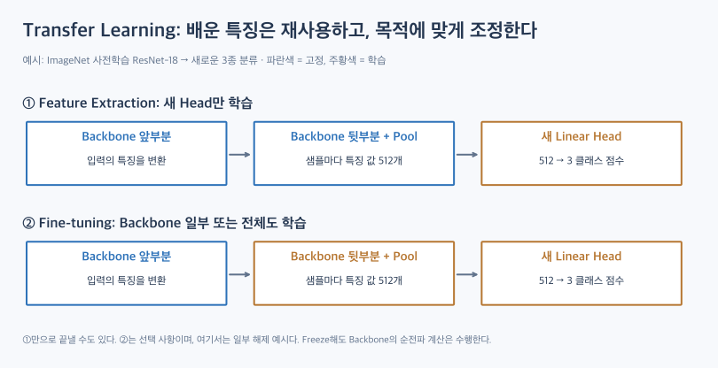
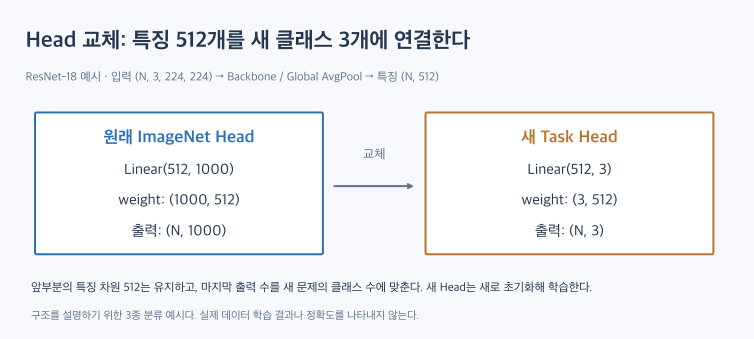

# Transfer Learning: 사전학습한 특징을 새 문제에 활용하기

[TOC]

Transfer Learning은 다른 데이터나 과제에서 학습한 표현을 새로운 문제에 활용하는 방법이다. 필터를 처음부터 모두 배우는 대신, 이미 학습한 가중치를 출발점으로 삼을 수 있다.

예를 들어 ImageNet으로 학습한 CNN의 특징 추출 부분을 가져와 새로운 이미지 분류기에 사용할 수 있다. 데이터와 계산 비용을 줄이는 데 도움이 될 수 있지만, 새 문제의 성능을 보장하지는 않는다.

이 글은 개념과 설계 과정을 설명한다. 모델 다운로드·실제 데이터 학습·정확도 측정은 포함하지 않는다.

## 1. 무엇을 가져오는가?

| 용어 | 의미 |
|---|---|
| Source | 먼저 학습한 데이터·과제 |
| Target | 새로 해결할 데이터·과제 |
| Pretrained weights | Source 학습에서 얻은 가중치 |
| Backbone | 입력에서 특징을 만드는 본체 |
| Head | 그 특징을 받아 새 과제의 출력을 만드는 부분 |

가져오는 것은 ‘이미지에 붙인 특징 이름 목록’이 아니라 **특징을 계산하도록 학습된 가중치**다. 새 이미지도 기존 Backbone을 통과하며 새 특징 값을 만든다.

## 2. Feature Extraction과 Fine-tuning

### 2.1. Feature Extraction

Backbone의 가중치를 고정하고 새 Head만 학습한다. 기존 특징을 새 정답에 연결하는 법을 배운다.

이때도 입력은 Backbone을 통과해야 한다. Freeze는 계층을 생략하는 것이 아니라 **그 가중치를 업데이트하지 않는 것**이다.

고정한 표현 위에 Linear Head만 학습하는 방식은 Linear Probing이라고 한다. 비선형 Head를 추가한 Feature Extraction까지 모두 Linear Probing이라고 부르지는 않는다.

### 2.2. Fine-tuning

Backbone 일부 또는 전체의 가중치도 Target 데이터로 조정한다. 필요하면 Head만 먼저 학습한 뒤 범위를 넓힐 수 있다.

Fine-tuning이 반드시 필요한 것은 아니다. 고정한 특징만으로 충분한 성능을 얻을 수 있으며, 데이터가 적으면 더 많이 해제한 모델이 오히려 과적합할 수 있다.

## 3. Head를 바꾸면 Shape이 어떻게 달라지는가?

ImageNet용 ResNet-18을 새 3종 분류에 활용하는 설명용 예시다.

| 단계 | 기존 모델 | Head 교체 후 |
|---|---|---|
| 입력 | (N, 3, 224, 224) | 동일한 입력 형식 예시 |
| 마지막 특징 맵 | (N, 512, 7, 7) | 동일 |
| Global Average Pooling | (N, 512, 1, 1) | 동일 |
| Flatten | (N, 512) | 동일 |
| Linear의 weight | (1000, 512) | (3, 512) |
| 클래스별 점수 | (N, 1000) | (N, 3) |

새 Head는 각 샘플의 특징 512개를 읽어 클래스별 점수 3개를 만든다. 필터·Backbone을 전부 새로 만들어야 출력 클래스 수를 바꿀 수 있는 것은 아니다.

이 표는 ResNet-18의 해당 입력 크기를 기준으로 계산한 구조 설명이다. 다른 모델의 특징 차원이나 입력 조건에 그대로 적용하면 안 된다.

## 4. 진행 순서

1. 새 데이터의 학습·검증·테스트 분할을 먼저 정한다.
2. 적절한 사전학습 모델과 가중치를 고른다.
3. 해당 가중치에 맞는 입력 채널·전처리를 확인한다.
4. Target의 출력 형식에 맞춰 Head를 교체한다.
5. Backbone을 고정한 기준 모델을 평가한다.
6. 필요하면 일부 또는 전체를 해제하고 더 작은 학습률 등으로 조정한다.
7. 검증 결과로 전략을 선택하고, 최종 테스트 데이터는 평가에 사용한다.

처음부터 Fine-tuning을 시작하는 방식도 가능하다. Head 선학습은 유용한 절차 중 하나이지 모든 모델에 강제되는 순서는 아니다.

학습률은 특정 숫자를 모든 모델에 적용하지 않는다. 새 Head와 사전학습 Backbone에 다른 학습률을 쓰는 전략도 검토할 수 있다.

## 5. 데이터 양과 유사성에 따른 출발점

| Target 상황 | 먼저 비교할 전략 |
|---|---|
| 데이터가 적고 Source와 비슷하다 | 고정 Backbone + 간단한 Head |
| 데이터가 충분하고 Source와 비슷하다 | Head 학습과 일부·전체 Fine-tuning 비교 |
| 데이터가 적고 Source와 다르다 | 더 관련 있는 사전학습 표현을 탐색하고 해제 범위를 신중히 비교 |
| 데이터가 충분하고 Source와 다르다 | 넓은 범위의 Fine-tuning과 다른 사전학습·처음부터 학습을 비교 |

이 표는 실험 출발점이다. 데이터 수와 유사성만으로 최적 전략이 결정되지는 않는다. Source 표현이 맞지 않아 전이가 오히려 방해되는 Negative Transfer도 고려한다.

앞쪽 층이 언제나 완전히 일반적이고 뒤쪽 층만 과제에 특화된다고 단정할 수 없다. 어느 층을 재사용할지는 실제 검증으로 판단한다.

## 6. Freeze와 평가 모드는 다르다

PyTorch에서 다음은 역할이 다르다.

| 설정 | 역할 |
|---|---|
| requires_grad=False | 해당 Parameter의 Gradient 계산을 끈다 |
| eval() | Dropout·BatchNorm 등의 동작 모드를 바꾼다 |
| no_grad() | 해당 구간의 Autograd 기록을 끈다 |

`eval()`만 호출해도 가중치 업데이트가 막히는 것은 아니다. 반대로 가중치를 Freeze해도 모드를 따로 관리하지 않으면 BatchNorm의 running mean·variance는 훈련 모드에서 바뀔 수 있다.

### 6.1. BatchNorm에서 두 대상을 구분한다

- 학습 Parameter: scale·shift에 해당하는 gamma·beta
- 통계 Buffer: running mean·variance

사전학습 통계를 유지하려면 모드도 관리해야 한다. Fine-tuning 중 BN 통계를 고정할지, 새 데이터에 적응시킬지는 데이터와 배치 조건에 따라 선택한다. **BN의 모든 값을 무조건 동결해야 한다는 보편 규칙으로 정리하지 않는다.**

Keras는 `BatchNormalization.trainable=False`에 추론 모드 동작도 연결되므로 PyTorch와 설정 의미를 혼동하면 안 된다. 해제한 파라미터가 Optimizer의 업데이트 대상에 들어 있는지도 확인해야 한다.

## 7. 사전학습은 정답 라벨이 있는 분류만 뜻하지 않는다

### 7.1. Auxiliary Task 기반 사전학습

최종 과제와 다른 보조 과제를 먼저 학습하고 표현을 가져오는 방식이다. 보조 과제의 정답을 데이터 자체에서 만들면 Self-supervised Pretraining에 해당할 수 있다.

언어 모델의 예를 구분하면, BERT는 마스킹된 토큰 예측을 사전학습에 사용하고, GPT 계열의 자기회귀 언어 모델은 앞선 토큰을 바탕으로 다음 토큰을 예측한다. 두 모델이 모두 같은 마스킹 방식을 쓴다고 묶으면 안 된다.

### 7.2. Greedy Layer-wise Pretraining

층 또는 모듈을 차례로 사전학습한 뒤 결합·조정하는 접근이다. 2006년 Deep Belief Network 연구는 층별 학습의 역사적 사례다.

Autoencoder의 관점에서는 첫 층의 표현을 배우고, 그 표현을 다음 층의 학습 입력으로 사용하는 흐름을 생각할 수 있다. 이는 전체 Backbone을 한 번에 사전학습하는 것과 구분된다. 깊은 모델을 학습하는 유일한 방법이었다고 표현하지 않는다.

## 8. 핵심 정리

Transfer Learning은 기존 표현을 새 과제에 재사용하는 전략이다. 고정할 부분과 학습할 부분을 정하고, 새 출력에 맞는 Head를 연결한다.

Shape에서는 **Backbone이 내보내는 특징 차원과 Head가 받는 입력 차원**을 맞추는 것이 중요하다. 학습에서는 **가중치 동결·동작 모드·Optimizer 대상**을 구분해야 한다.

## 관련 개념과 실습

- [ResNet](../architectures/resnet.md) — Backbone 구조와 특징 추출 흐름.
- [PyTorch Conv2d Shape 실습](../../practice/cnn/conv2d-shapes.md) — 입력·필터·출력의 채널과 공간 크기.
- [Batch Normalization](../normalization/index.md) — 정규화와 학습·평가 동작.

## 참고 자료

- [Transfer Learning — dsaint31](https://dsaint31.me/mkdocs_site/ML/ch11_training/knowledge_transfer/): 정리 범위와 개념 흐름의 출발점.
- [PyTorch Transfer Learning Tutorial](https://docs.pytorch.org/tutorials/beginner/transfer_learning_tutorial.html): 고정 특징 추출기와 Fine-tuning 비교.
- [Keras Transfer Learning & Fine-tuning](https://keras.io/guides/transfer_learning/): 동결·단계적 조정·BN 동작 주의점.
- [PyTorch BatchNorm2d](https://docs.pytorch.org/docs/stable/generated/torch.nn.BatchNorm2d.html): 학습 Parameter와 running statistics 구분.
- [torchvision ResNet 구현](https://docs.pytorch.org/vision/stable/_modules/torchvision/models/resnet.html): ResNet-18의 특징 차원과 분류기 구조.
- [BERT — Devlin et al.](https://arxiv.org/abs/1810.04805), [Language Models are Few-Shot Learners — Brown et al.](https://arxiv.org/abs/2005.14165): 언어 모델의 사전학습 방식 구분.
- [A Fast Learning Algorithm for Deep Belief Nets — Hinton et al.](https://www.cs.toronto.edu/~hinton/absps/fastnc.pdf): 층별 사전학습의 역사적 사례.

그림은 새로 작성한 설명용 도식이다. 색상은 가중치 업데이트 여부를 구분하며 실제 학습 결과를 나타내지 않는다.
